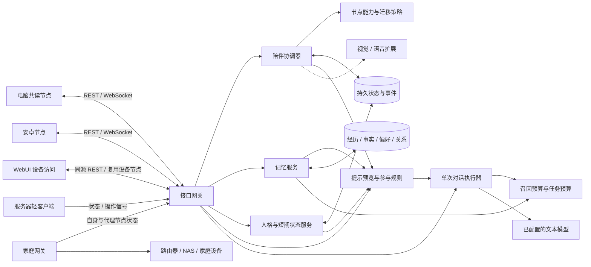

# 设备节点世界与记忆预算

每台设备是一个节点，节点提供感知和呈现能力。陪伴者拥有稳定身份、持续活动与共同记忆，并在可到达的节点之间改变当前落脚点。

## 陪伴的连续性

身份、相处模式和正在进行的活动属于陪伴者，设备提供呈现与感知能力。这样她来到手机后可以接续同一本书、同一话题和共同经历。初版默认 quiet；focus、chat、away 表达不同参与程度，宿主可据此决定安静呈现或交谈。

人格服务将稳定定义绑定 companion_id，设备切换后接续同一份设定。独立过期的短期状态表达当下情绪与精力，共同经历仍属于有来源的长期记忆。PersonalityPromptBuilder 按相处模式、用户是否主动和当前状态给出本地参与建议，并在预算内组合提示。它读取服务端输出条件，预览不授予输出权。

ports.py 还定义了后续对话编排可使用的 BehaviorPolicy 和 QuietParticipationPolicy。当前可编辑人格、更新状态、导入酒馆 V2 JSON 子集与审查提示；自动对话、情绪推断和自主生活循环在后续接入。安卓宿主准备好呈现能力、取得新租约后，才能开始输出。详见 [人格设计](personality.md)。

## 节点图

- 节点以设备为单位，具有稳定 node_id、设备种类、可用能力、在线时间和宿主提供的环境信号；WebUI 是访问方式，页面 access_id 不再创建独立节点。
- 边表示迁移策略允许的通路。初版在同一所有者下计算连边，结合在线情况和输出能力判断可达性。
- NodeGraph 独立于记忆关系图：前者管理设备落脚点，后者可以用于长期知识与经历的关联。
- 手机亮屏是候选信号；显式操作与实际阅读状态能提供更强的接力依据。初版由客户端请求迁移，自动注意力仲裁可以在同一接口上增加。

## 主服务器与轻客户端

生命体的身份、记忆、当前活动与输出权由主服务器保存。每个设备客户端负责采样和上报；有呈现能力的宿主还负责角色输出。家庭设备无法运行客户端时，网关作为观察者为它报告独立节点状态，报告中同时保留目标 ID 与观察者 ID。

设备状态使用 `context.device_state` 保存最新快照，类别变化和显式维护阶段通过观察事件传递。本地 Linux 指标与配置式 TCP / HTTP 探测是第一版适配器；安卓宿主、Home Assistant、OpenWrt 和已有指标系统可随后接入同一约定。详见 [状态协议与接入路线](device-state-tracking.md)。

`node.online` 反映最近收到报告；设备可达性来自具体观察者和端点。用户的操作目标记录为 `subject_node_id`，操作入口记录为 `origin_node_id`。即使她知道用户在维护服务器，`active_node_id` 仍表示手机或电脑上的呈现位置。只有具有输出能力并取得租约的节点能够呈现角色。

频繁指标更新只覆盖快照；本地规则选择显著变化，不在每次采样调用模型。操作经历进入长期记忆前仍需筛选，避免运行日志挤占共同经历的召回预算。

## 持续状态与迁移

状态包含活动、书籍与段落位置、相处模式、待接续上下文及记忆引用。revision 用于状态更新的乐观锁；epoch 使旧节点输出失效；短租约限制离线节点的输出期限。

人格与短期状态各有独立 revision，与活动 revision 分开管理。修改人格不会换一个生命体或撤销设备迁移；状态过期只是读到有效默认值，不生成持续写入。原卡归档、命令历史与来源记录供后续审查；人格核心、当前状态和真实经历在提示中具有明确数据边界。

迁移分三步：

1. 准备：校验版本与目的节点能力，保存迁移快照，暂时冻结上下文更新。
2. 确认：源节点停下输出并确认 released；目的节点完成本地准备后确认 ready。
3. 提交：两端条件成立，或源租约已过期，更新主节点、版本与 epoch；发放新租约并广播事件。

目的节点超时或失去可达性时保留原状态。重复请求、重连和重复确认由幂等命令与事件 cursor 处理。状态、命令结果和相关事件在同一数据库事务中持久化。

## 长期记忆与费用

| 层次 | 保存内容 | 控制方式 |
| --- | --- | --- |
| 当前上下文 | 当前共读位置、话题、近期相处状态 | 状态快照，更新时做版本检查 |
| 共同经历 | 一起读过的段落、发生过的活动 | 持久记录与来源，召回按相关度和预算选择 |
| 稳定知识 | 偏好、事实、共同习惯和关系 | semantic_key 支持修正，重要记忆可以固定 |
| 派生内容 | 批次摘要、实体与关系索引 | 持久整理任务与预算；依赖来源版本，原始记录保持可追溯 |

显式写入与召回在本地完成。完成对话默认与持久自动队列原子入库，后台按批次或等待时间调用模型生成稳定认识、摘要与关系图谱。成本约束落实在重复内容去重、按需召回、格式化上下文预算、批量触发与共享调用额度上。

模型费用主要来自检索后带入上下文、事实抽取、重复总结、向量化与主动活动。单次对话先预留任务预算，执行后按实际 usage 结算，未知用量保留预留。向量索引按内容、记忆版本和空间复用，查询缓存有界且会过期；摘要重建继续留待后续。金额估算需要相应提供商的计价信息；本框架不把估算 token 当作账单金额。

当前融合本地词法、可选向量候选、带来源摘要与有界多跳关系，候选先核验版本和有效性，再按预算裁剪。向量索引与规范图谱使用同一 SQLite；它们与设备迁移 NodeGraph 分别管理。图谱保留显式别名、独立来源和实体版本，来源变化后的派生内容在读取时剔除。向量调用共用模型账本；预览保持本地，实际对话可准备查询向量。同义表达、实体别名和复杂经历的效果仍需要真实数据评估；ANN 和失效摘要重建随后接入。详细规则见 [向量与图谱](vector-memory-and-graph.md)、[自动记忆](automatic-memory.md) 与 [长期记忆设计](memory.md)。

## 扩展与扩容

初版使用模块化单体与文件数据库。迁移策略、记忆策略、人格提示策略、token 估算器和 ModelProvider 可通过 create_app 注入；安卓呈现与设备能力通过宿主桥接接口实现。默认文本模型适配器使用兼容 Chat Completions HTTP；感知、语音和检索保留扩展协议。

DialogueService 使用既有提示构造与记忆引用，持久领取命令、预留 token，再在事务外调用 ModelProvider。模型完成时在同一提交事务中重读人格版本、有效状态、活动 revision、epoch、节点与租约；条件改变则保存 discarded 回执并结算已知用量。历史回执可查询，不自动重发失败或崩溃留下的命令。可选的模型工具在同一轮内最多执行一次、调用 1..2 个工具：主动调度写入持久计划，计划任务写入独立提醒队列并在到期后进入主动 gate（支持列表与按 ID/标题取消），委派写入独立任务队列并由单 worker 执行；默认是无 shell 的 argv 子进程，也可注入其他 `DelegationExecutor`。工具通过 `ToolRegistry` 注册，内建工具与 `module:factory` 插件共享同一合同；工具结果不回写人格，最终文字仍须通过同一输出 gate。

可选的场景分类器在对话派发前提供两档集成：`route` 仅按标签覆盖 `reply_model`，`observe` 仅把检测结果写入回执的 `scene` 诊断字段。两者都不改变提示、记忆、预算或输出权限；加载失败、超时和推理异常均 fail-open。配置与安全边界见 [场景分类器实现](nsfw-classifier-implementation.md)。

WebUI 随 API 提供，选择伙伴只读，用户点击接入后才申请迁移并确认自己的 ready。可见页面维持心跳与短租约，失活时停止输出；完成对话进入自动记忆队列，也支持手动补充。记忆页展示整理进度、摘要与关系。详见 [页面与对话合同](webui.md)。后续再加入可取消任务、参与限频、活动经历筛选和用户发起的视觉感知；频繁设备状态更新仍走本地规则。

服务扩容时，需要增加面向仓储的抽象并迁移当前 SQLite 查询，建立事务 outbox、接入消息队列，再独立扩容连接网关和模型任务。相同 companion_id 的状态更新保持有序，设备可根据持久序列恢复。当前实现不支持直接替换数据库驱动后运行于 PostgreSQL。

此版是单所有者开发运行时。账号与设备配对、多人隔离、角色动画资产、完整安卓 APK 和视觉识别在后续阶段加入。
