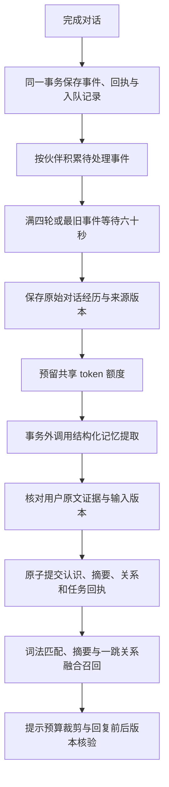

# 自动记忆、摘要与知识图谱

2026-10-12，本阶段将完成的文本对话接入持久整理队列。同一次模型整理生成稳定认识、批次摘要与实体关系，复用现有 SQLite、来源、版本和 token 账本。摘要与图谱参与人格提示的本地召回；向量模型与规范图谱的后续扩展见 [向量记忆与图谱](vector-memory-and-graph.md)。程序经验和自主对话另行实现。

## 参考实现与取舍

LivingMemory 的 [自动反思](https://github.com/lxfight-s-Astrbot-Plugins/astrbot_plugin_livingmemory/blob/HEAD/core/event_handler_modules/memory_reflection.py) 按未总结轮数触发，使用处理水位和会话锁；[双路线检索](https://github.com/lxfight-s-Astrbot-Plugins/astrbot_plugin_livingmemory/blob/HEAD/core/retrieval/dual_route_retriever.py) 融合文档与图谱候选。[图谱模型](https://github.com/lxfight-s-Astrbot-Plugins/astrbot_plugin_livingmemory/blob/HEAD/core/models/graph_models.py) 为关系保存来源、置信度和权重。本项目借鉴批次整理、同一次提取构建多种记忆视图，以及图谱帮助找到支持证据。

Angel Heart 主要管理交互调度与聊天上下文，其 [上下文压缩设计](https://github.com/kawayiYokami/astrbot_plugin_angel_heart/blob/HEAD/docs/architecture/message_context_compression.md) 将摘要与连续消息块一起提交。长期记忆由配套 [Angel Memory](https://github.com/kawayiYokami/astrbot_plugin_angel_memory) 提供；其 [DeepMind](https://github.com/kawayiYokami/astrbot_plugin_angel_memory/blob/HEAD/core/deepmind.py) 按轮数或空闲时间触发反思，失败时恢复缓冲。[睡眠维护](https://github.com/kawayiYokami/astrbot_plugin_angel_memory/blob/HEAD/core/services/sleep_service.py) 对模型失败采用保守处理。本项目采用数量与等待时间双触发，改用持久队列保存未处理范围。

这里没有复制插件代码或引入 AstrBot 依赖。插件的机制是设计参考，不代表本项目已达到相同效果。运行范围继续按 companion_id 隔离，不将群聊参与者共同出现直接解释为真实人际关系。

## 整理流程

只处理 `companion.dialogue_completed`。silent、discarded、节点心跳和设备采样不入队。事件 ID 唯一，重放完成对话回执不会再次排队。本阶段不自动回填升级前的历史对话，也不整理任意外部观察事件。

后台任务与前台回复分别执行、分别结算用量。客户端收到的 DialogueResult.model_calls 和 usage 只描述该次回复；自动整理用量见任务记录与共享账本。API 关闭时等待正在执行的整理完成落库。

每个源事件保存一个原始 episode，明确区分用户文字与助手实际说过的话。其 occurred_at 是完成对话事件的时间，created_at 是记忆落库时间。摘要保留原始记录；不会把原始对话替换成模型概括。

## 证据、冲突与更新

模型输出受有界结构约束：最多 16 条稳定认识、24 条关系，内容和字段长度有上限。每条认识必须给出属于本批次的 source_event_id 和用户消息中的精确 evidence 片段。助手文字可描述对话行为，不能单独作为用户事实证据。结构或证据不合格时不提交本批派生结果，已知实际用量仍入账。

自动认识使用 fact、preference、relationship 类型；confirmed=false、pinned=false，置信度最多 0.85。规范化相同内容可合并来源；自动 semantic_key 使用独立命名空间。更新相同键时，仅替换自动系统创建且仍处于受控 revision 的当前记录，并核对新证据时间。旧值保存为 inactive，留下 supersedes_id 与有效时间。

手动记录、手动编辑后的自动记录、固定或确认的记录受到保护。新内容与受保护键冲突时保留为 needs_review，任务回执包含新内容、证据及旧记录 ID，可使用现有 corrections 接口裁决。存在未裁决冲突的批次不发布摘要，防止被拒绝的新认识通过摘要绕过保护；其他已接受认识和关系仍可提交。自动记忆不修改人格核心或短期情绪。

摘要依赖本批原始 episode 和成功写入的稳定认识版本。每条图谱关系依赖一条支持的稳定认识及相应原始 episode；实体节点来自关系端点。实体已支持明确设置别名，同一规范边聚合独立有效来源；有界多跳只遍历已有证据关系，不自动生成推理事实。细节见 [规范图谱](vector-memory-and-graph.md)。

源记录被删除、更正、编辑或过期后，相应派生内容不再进入查询和提示。自动提取的稳定认识本身也检查证据：至少有一个当前有效的源 episode 版本才可召回；多个独立来源中仍有有效证据时可保留。此检查应用于候选限制之前和回复引用核验。提交整理结果前也重新核验原始版本，避免在模型调用期间把过时输入重新写回来。本阶段尚不自动重建失效的旧批摘要；新的对话继续生成新批次。

DELETE 删除所选记录、索引和 provenance，并记录来源墓碑，阻止尚未整理的同源事件再次自动提取。其他已保存的原始对话、派生内容、证据、事件与历史任务/命令回执不因这个操作全部清除；完整遗忘需要独立的清除协议。

## 召回融合

`POST .../memories/recall` 返回 items、summaries、relations。派生项包含 memory_versions 和 source_event_ids，关系还包含 entity_versions。查询先过滤来源、当前版本、伙伴与有效时间，再筛选匹配；图谱按配置有界扩展（默认最多两跳），关系帮助将支持记录加入原始候选。查询向量缓存命中时也融合语义候选；本接口仍不调用模型。默认累计图谱候选上限 512。

初期让至多一条摘要和一条关系优先尝试使用 60% 记忆预算，剩余预算由原始记录填充；派生项也计入 max_items，放不下则跳过。空查询可读取最近的有效派生内容。episodic 层包含经历及摘要，semantic 层包含稳定认识及关系。格式化 context_text 的标题、正文与来源版本全部计入 token 估算。读取不调用模型。

人格预览再次核对完整 MEMORY_DATA 预算。memory_refs / memory_versions 是实际入提示的记录和派生项支持记录的去重并集；支持记录正文不一定整条进入提示。回复调用前及提交时核验这组版本，继承现有的“调用前释放、调用后丢弃文字并结算”行为。

## 接口与配置

以下路径均位于 `/v1/companions/{companion_id}/memories` 下，使用已有 Bearer token。

| 方法与路径 | 行为 |
| --- | --- |
| GET `/automation` | 开关、提供商状态、批次配置、队列/任务计数及额度 |
| GET `/automation/jobs?limit=50&offset=0` | 任务、来源、用量、错误与待确认冲突 |
| POST `/automation/run`，`{"force": true}` | 提前处理一批待处理事件；仍遵循来源、并发与预算约束 |
| GET `/summaries?limit=50&offset=0` | 分页读取有效摘要 |
| GET `/knowledge-graph?query=读书&limit=50` | 读取有效实体/关系及有界一跳关联 |

分页 limit 范围 1..200；图谱 query 最长 2048 字符。提前整理接口返回任务结果，暂无可领取任务时返回 `{"status":"idle"}`。它不会重发 running、unknown 或失败任务，也不重新执行已处理事件；网络结果不明确时查询任务列表。

自动整理复用已配置的模型与超时。提供商必须支持 Chat Completions 的 `response_format={"type":"json_object"}`；记忆任务使用独立的结构化提取系统指令。统一文件中的 `[automatic_memory]` 设置下列参数，`[memory]` 设置共享模型额度，详见 [统一配置](configuration.md)。环境变量仍可覆盖：

| 环境变量 | 默认值 |
| --- | --- |
| VIRTUAL_LIFE_AUTO_MEMORY_ENABLED | true |
| VIRTUAL_LIFE_AUTO_MEMORY_BATCH_SIZE | 4，范围 1..16 |
| VIRTUAL_LIFE_AUTO_MEMORY_MAX_WAIT_SECONDS | 60，最旧事件等待上限 |
| VIRTUAL_LIFE_AUTO_MEMORY_POLL_SECONDS | 2 |
| VIRTUAL_LIFE_AUTO_MEMORY_OUTPUT_TOKENS | 1200，范围 256..2048 |

设为 false 后停止新入队与自动执行，保留现有记忆和读取能力。没有提供商时可保存已经排队的原始 episode，任务标为 local_only。

## 任务状态与恢复

| 状态 | 意义 |
| --- | --- |
| pending | 已持久保存，等待触发或可用日额度 |
| running | 一批已领取，正在整理 |
| completed | 派生结果与回执已原子提交 |
| needs_review | 已提交无冲突结果，另有受保护内容需裁决 |
| local_only | 已保存原始经历，提供商未配置 |
| deferred | 日额度不足；来源重新待处理，延后到下一 UTC 日 |
| failed | 已知失败或无效输出，不自动重试 |
| discarded | 输入版本或来源失效，未提交派生结果 |
| unknown | 执行或用量待核对，不重发原来源 |

输入超过单任务额度时先按完整事件缩小批次；单事件仍放不下则保留原始记录，返回 source_exceeds_task_budget。日额度不足延后处理，避免轮询持续制造失败任务。对话与自动整理共享默认每日 10000、单任务 5000 token 的运行时额度。

整理执行器使用 POSIX 文件锁覆盖领取、网络调用与回执提交；锁由操作系统在进程退出时释放。拿到锁后遗留 running 标为 unknown，原任务不重发，新的 pending 可继续执行。未知预留保持原样。锁文件为数据库路径后附 `.auto-memory.lock`；此后台执行器面向 Linux/POSIX 后端，非 POSIX 环境可关闭自动化后继续使用显式记忆功能。

任务保存来源版本快照、模型名和提示版本；延期后来源转入新任务，旧回执仍可审阅其当时输入。精确引用校验只能验证来源片段确实存在，不能证明模型概括或关系在语义上一定正确。本阶段未进行真实模型、长期效果或设备联调验证；向量与图谱能扩展检索范围，实际质量仍需数据评估。

自动提取遵守同一 retention_policy 与有下限的指数衰减；显著性降低不删除来源记录，不改变置信度或事实有效性。后台提取、摘要与图谱整理本身不重置衰减锚点；只有成功对话最终上下文中的相关支持记忆才能按 UTC 日强化。更正生成新记录并重置其锚点。详见 [记忆衰减](memory.md)。

自动生日保护还要求精确引用同时包含生日或出生表述、可识别的日期；缺少其中一项时，提取出的生日槽位按 stable 保存。日期支持中文月日、数字日期与英文月份。此规则用于减少误保护，不能证明模型提取的语义正确性；尚未增加生日定时提醒。

自动抽取提示版本 `auto-memory-v2` 要求有用户证据的当前偏好、生日和人物关系同时输出 `memory_index` 关联的正向三元组；饮品、生日、室友与手足关系优先使用 `prefers_drink`、`has_birthday`、`roommate`、`sibling`。第一人称主体统一为“用户”，不能根据历史或助手称呼外推人名；具名生日保留具名所有者。更正时记忆内容和关系仅保留新的当前对象，不为“不再喝乌龙茶”等旧否定对象创建正向边。提取只使用本批事件，不补充历史上下文、不复制旧边、不增加模型调用或重试。历史任务已有的提示版本保持原样。

关系落库前检查主体、对象同时出现在所指记忆内容和精确用户引用中；“用户”主体可替代有证据的第一人称，生日还要求明确的第一人称生日所有者表述。对仅出现在明确否定分句中的对象保守跳过。未通过的边在任务与安全日志中以 `relations_skipped` 记录索引和原因代码；其余稳定记忆照常原子提交，更正仍使旧记忆支持的边失效。这个策略可能漏掉合法别称、改写或否定关系，提示也不能保证模型必定补齐边。实体出现只是必要条件，有限否定检查并不证明谓词或任意中文语义正确；当前没有完整语义蕴含校验。
