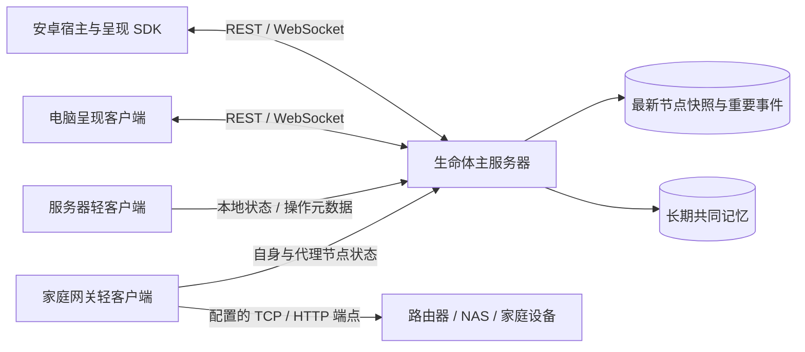

# 设备状态跟踪与轻客户端

主服务器保存同一生命体的身份、活动和记忆，各设备运行小客户端提供状态与宿主能力。服务器、NAS 和家庭网关可以只报告状态；手机、电脑还可以提供角色呈现。无法安装客户端的设备由指定网关观察。

## 四类状态

| 状态 | 含义与来源 |
| --- | --- |
| 上报链路 | 现有 `node.online` 表示主服务器最近收到注册或心跳；代理节点也只表示这条上报路径新鲜 |
| 设备与服务 | 本地采样或明确配置的 TCP / HTTP 探测；失败只说明从该观察者不可达 |
| 人的活动 | 宿主交互信号或显式操作元数据；负载升高、SSH 端口开放都不能证明用户正在操作 |
| 陪伴者呈现 | `active_node_id`、epoch 与输出租约；操作远程服务器时，角色仍可留在手机或电脑 |



## 第一版接口合同

复用 [节点协议](protocol.md) 的注册、心跳、观察和查询接口，不增加 HTTP 路径。通用客户端注册 `kind: "other"`，能力为 `device.state.report`；网关增加 `device.state.observe`。这些客户端不声明呈现能力。

直接模式使用自身 `node_id`。网关模式还为每个配置的目标注册独立节点，目标使用 `device.state.report`；每个目标的稳定 ID 与观察者的 ID 不同。一个目标暂时指定一个写入观察者。重新启动沿用配置中的节点 ID，每次进程启动生成新的 `session_id`。

每台设备应复用一个节点 ID；WebUI 已改为该设备的独立访问方式，参见[设备身份与访问](device-identity.md)。原生注册仍替换完整能力，原生心跳仍替换 context，因此多个原生采集/呈现进程需由统一宿主聚合，不能各自覆盖。同设备的多个原生写入者仲裁尚未实现。

轻客户端仅为自身注册附带 `device.device_id=node_id`，使服务端能为直接连接设备记录网络地址；网关代理目标不继承观察者的设备身份或 IP。原生呈现客户端可附带宿主持久设备 ID/MAC；Web 接入可按稳定浏览器关联、近期唯一 LAN IP 或明确绑定复用该节点。不要把网关地址当作全部被观察设备的地址。

心跳替换整个节点 context。每次都发送完整 `context.device_state`：

```json
{
  "context": {
    "device_state": {
      "schema_version": "1.0",
      "subject_node_id": "home-router-observed",
      "device_class": "router",
      "deployment_mode": "gateway",
      "observer_node_id": "home-gateway-telemetry",
      "session_id": "a-client-session-uuid",
      "sequence": 17,
      "sampled_at": "2026-10-11T08:00:00Z",
      "ttl_seconds": 60,
      "source": {
        "adapter": "tcp",
        "scope": "service_endpoint",
        "quality": "ok",
        "errors": []
      },
      "reachability": {
        "status": "reachable",
        "latency_ms": 3.2,
        "http_status": null
      },
      "health": {"status": "unknown", "reason": "not_evaluated"},
      "metrics": {},
      "operation": null
    }
  }
}
```

- `device_class` 初始接受 `server`、`workstation`、`gateway`、`router`、`nas`、`other`；后续适配器可扩展。`deployment_mode` 为 `direct` 或 `gateway`。
- `source.adapter` 为 `linux_proc`、`platform`、`tcp` 或 `http`。本地 `scope` 为 `runtime_environment`，代理为 `service_endpoint`。容器中的 `/proc`、磁盘视图可能混合宿主与容器范围，不能据此声称拿到物理主机全量指标。
- `quality` 为 `ok`、`partial` 或 `unknown`；错误仅包含稳定代码。无法取得的数值为 `null`。本地 CPU 第一轮无差分基线，不能报告为 0%。
- `reachability.status` 为 `reachable`、`unreachable` 或 `unknown`。本地采样成功只说明客户端能采样当前运行环境。HTTP 收到任何响应说明端点可达，状态码另存；200 或端口开放都不能直接证明整机健康。
- 本地 `metrics` 提供 `cpu_usage_percent`、`memory_total_bytes`、`memory_available_bytes`、`memory_used_percent`、`uptime_seconds`、`load_average`、`disk_total_bytes`、`disk_free_bytes`、`disk_used_percent`。代理指标为空；健康判定留给后续服务适配器与阈值策略。
- `sampled_at` 使用观察者 UTC 时间；`ttl_seconds` 表达有效期。消费者结合服务器 `last_seen_at` 与采样时间判断新鲜度，观察者时钟异常时应标为不确定。
- `session_id` 和递增 `sequence` 目前是来源信息。现有服务端保存原样 JSON，尚不执行会话隔离、乱序拒绝或逐字段过期；旧进程仍可能覆盖快照。不要把它们当作已经实现的服务端防护。

## 采样、重连与事件

默认每 20 秒采样并上报，状态有效期 60 秒；应与主服务器的节点 TTL 配合配置。客户端只在启动、失去注册记录时注册节点，避免每次心跳生成注册事件。网络错误使用有上限的指数退避和抖动；恢复时重新采样，避免旧样本看起来刚产生。HTTP 超时限制网络读写，系统 DNS 解析仍可能有额外延迟。

第一版依次采样、探测和上报。配置的状态 TTL 必须超过采样间隔、目标探测超时、各节点上报超时与观察发送预算的保守合计；主服务器的 `VIRTUAL_LIFE_NODE_TTL_SECONDS` 也应覆盖该节奏。目标增加时可以延长有效期，或拆为多个观察者；后续增加异步采样调度。此估计不包含 DNS、文件系统与多次网络读写的额外延迟，不是严格端到端时限。

每个目标只进行配置的探测，不发现其他设备。第一份状态作为基线；之后仅 `reachability.status`、`source.quality` 的类别变化生成 `modality: "device_state"` 观察。默认同一目标确认一个状态事件后至少等待 60 秒再生成下一个；数值波动不逐次写事件。尚未入队的变化由新样本与基线比较，合并为最新净变化；已入队观察保持原内容与采样时间，等待确认后再从新样本判断后续变化。

观察 `data` 包含 `schema_version`、`subject_node_id`、`observer_node_id`、`session_id`、`sequence`、`sampled_at` 与 `changes: [{field, previous, current}]`。提交到观察者节点的 observations 接口，保留事件发起者和观察对象的区别。每条待提交观察固定 `command_id` 和请求体，重试沿用原值。内存待发队列有上限，满时合并或丢弃并输出计数；重启不保证恢复这部分未确认事件。

观察发送每轮最多 32 条，并受单调时钟预算限制：采样间隔的四分之一与单次请求超时取较小值。已开始的请求可能超出该预算，剩余事件留待后续轮次，避免队列积压长时间占用心跳循环。

心跳刷新最新快照，不产生状态事件；已有 REST / WebSocket 事件通道传递显著变化。当前客户端先只负责上报，展示端使用 `GET /v1/nodes` 获取完整快照，再消费观察事件。心跳不调用模型，也不自动写入长期记忆。

## 展示端如何接续

现有安卓 SDK 会把 `node.observation` 交给 `AndroidNodeBridge.onEvent`，宿主可以按 `payload.modality` 处理设备变化与操作阶段。查询 `data.subject_node_id` 对应节点取得最新快照；事件上的 `node_id` 是观察者，不能直接当作目标设备。

事件回放可能包含离线期间的旧变化。展示端应保留事件的采样时间，重新读取当前状态，并由参与策略决定是否提示；历史事件不能仅凭收到时间被当作刚发生的告警。重新连接后先恢复状态，再接续当前活动。

安静陪伴可以只更新角色旁的小状态或当前话题线索；明确失败、用户求助或操作完成才成为后续对话策略的候选触发点。当前宿主回调只是接入位置，尚未实现状态面板或自动对话。

## 显式操作元数据

可选 `operation_file` 由用户的维护工具或界面以原子替换方式更新。客户端只接受以下有限字段，不读取终端历史、原始命令或进程参数：

```json
{
  "operation_id": "deploy-20261011-1",
  "subject_node_id": "lab-server-telemetry",
  "origin_node_id": "my-desktop",
  "kind": "deployment",
  "phase": "started",
  "label": "更新家庭服务",
  "updated_at": "2026-10-11T08:00:00Z",
  "ttl_seconds": 300,
  "user_initiated": true
}
```

`kind` 为 `maintenance`、`deployment`、`backup`、`network_change` 或 `other`；`phase` 为 `started`、`progress`、`completed`、`failed` 或 `cancelled`。目标必须是本客户端管理的节点。按 `(operation_id, phase)` 去重，阶段变化以 `modality: "operation"` 上报，同一阶段内的标题变化只刷新快照。过期、丢失或无效文件使当前 `operation` 变为 `null`，不推断操作完成。文件大小和字符串长度受限，错误日志只报告原因码。示例中的时间须替换为当前时间。

这样她可以知道“你正从电脑维护 NAS”，并在适当时机回应；此次只是提供信号，对话参与策略和操作界面随后接入。

## 编码范围与分工

先实现 `clients/system-node/` 的 Python 3.12+ 标准库客户端：配置与 CLI、本地采样、配置式 TCP / HTTP 观察、Bearer 上报、退避、事件合并与操作文件。提供直接模式、网关模式配置样例及可选 systemd 单元。Token 从环境变量读取，拒绝含凭据的 URL，探测请求不携带主服务器 Token。

客户端子代理独立负责 `clients/system-node/**`，主代理负责此合同、README、架构与调研文档。编码前以本文和 `docs/protocol.md` 对齐，不修改已存在的 AGENTS.md。此次只做静态检查和编译，不新增或运行测试，也不连接实际家庭设备。

## 扩展路线

1. 为主服务器增加类型化状态归一化、逐字段新鲜度、旧会话与乱序样本拒绝、多观察者仲裁；继续兼容现有 heartbeat context。
2. 增加 [Prometheus node_exporter](https://github.com/prometheus/node_exporter) 适配器复用已部署的指标；通过 [Home Assistant 状态事件](https://developers.home-assistant.io/docs/api/websocket/)、[OpenWrt ubus](https://openwrt.org/docs/techref/ubus) 获取家庭实体与路由器状态。
3. 安卓宿主将权限、亮屏、交互与阅读上下文映射为统一状态；呈现仍沿用现有迁移和输出租约。
4. 显著操作经历经过用户确认或低成本策略筛选后进入长期记忆。运行事件当前持久保留；后续增加短期历史保留与聚合，并配套事件 cursor 过期和快照恢复机制，控制磁盘增长。
5. 设备配对、逐节点凭据、权限边界与受控任务执行后续实现。当前客户端仅采集和报告；服务端仍是单所有者开发运行时。
