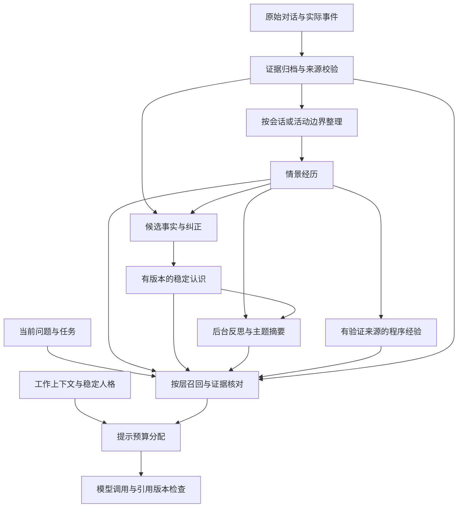

# 长期生命体的分层记忆实现调研

调研日期：2026-10-12。本文依据项目源码、官方文档、项目仓库和论文，区分软件现状与本项目的工程建议。没有修改运行时代码、安装依赖、执行测试或调用项目配置的模型。文中方案尚未经过本项目的长期数据验证。

实施进展：随后已完成证据/版本基础，并加入完成对话的自动提取、带来源摘要与一跳知识图谱融合；当前实现与参考 AstrBot 插件的取舍见 [自动记忆](automatic-memory.md)，检查范围见 [实施记录](implementation-plan.md)。下文保留调研时的现状与分阶段建议。

## 结论与选型

建议继续使用 SQLite 与现有 MemoryService，先增加证据校验、时间与版本、派生关系和持久整理任务，再接入分层召回。Hindsight 适合作为独立对照服务，EverOS 值得参考后台整理和可重建索引，Letta 值得参考常驻核心与按需读取的边界。

“分层”需要同时回答两个问题：

- **内容职责**：工作上下文、共同经历、稳定认识、反思和程序经验各保存什么、怎样变化。
- **访问成本**：哪些内容每轮常驻，哪些按需检索，哪些只在核对证据时读取。

现有 `episode / fact / preference / relationship` 主要表达内容类别；它们仍共用基本相同的写入、去重和召回流程。完整分层还需要跨层提炼、来源关系、失效传播和独立更新规则。LangGraph 官方也分别讨论短期状态、长期内容类型，以及在线或后台更新；语义记忆指事实知识，与 embedding 语义搜索是两个概念。[来源：Memory overview](https://docs.langchain.com/oss/python/concepts/memory)

## 可借鉴实现与适用边界

| 实现 | 已核查的机制 | 对本项目的意义 |
| --- | --- | --- |
| Hindsight | retain 提取事实；recall 组合多种检索；observation 后台归纳；mental model 持久保存特定问题的综合答案 | 分层职责与接口最值得参考，可作为独立服务实验。生产引入 PostgreSQL、向量扩展和模型依赖 |
| 当前 Letta | MemFS 使用 Git 管理 Markdown；根目录记忆常驻提示，带 MEMORY.md 的目录按需读取；dreaming 在后台整理 | 借鉴核心与外部记忆的边界、版本历史和异步整理。它包含完整 agent 运行时，整体采用涉及较多架构调整 |
| EverOS / EverMemOS | EverOS 缓冲消息、检测边界、提取经历，再后台生成事实、画像、预期和技能；EverMemOS 论文描述 MemCell→主题组织→重构式召回 | 借鉴按会话/活动边界写入、用户认识与 agent 经验分别整理。需分别评估论文、服务实现和当前轻量框架 |
| LangGraph | 会话状态通过 checkpoint 持久化；长期记忆按 namespace 管理，区分 semantic、episodic、procedural | 适合参考状态和记忆接口；其存储抽象仍需要应用自行实现来源、冲突、提炼和召回策略 |
| MemForest | 时间层级索引、局部脏路径刷新，减少全局重新整理 | 可借鉴后期大量历史摘要的增量更新；当前依据是预印本，不作为本项目已有性能保证 |

### Hindsight：综合认识应带来源与新鲜度

当前 `retain` 把输入提取为结构化事实，官方明确不原样保存输入正文。相同 `document_id` 的再次写入会替换旧版本并重新处理；未提供稳定文档身份可能造成重复。因此接入时仍需由本项目保存原始对话、稳定来源 ID 和处理进度。[来源：retain API](https://hindsight.vectorize.io/developer/api/retain)

当前提取分类包括 `world` 与 `experience`，后台产生 `observation`；这些分类不应被理解成真假保证。`mental model` 是开发者指定问题的持久答案，例如“我们目前共同在做哪些长期项目”。其生成在后台发生，读取无需再进行模型综合；作用范围、新鲜度和版本是重要边界。[来源：retain 架构](https://hindsight.vectorize.io/developer/retain)、[mental models](https://hindsight.vectorize.io/developer/mental-models)

Python 客户端可连接其服务。所谓 embedded 包仍会启动独立进程；生产部署要求 PostgreSQL 14+ 和支持的向量扩展，pg0 主要用于开发。它适合独立实验服务，集成成本应包含模型抽取、异步可见性和纠正/删除适配。[来源：Python 集成](https://hindsight.vectorize.io/sdks/hindsight-all)、[安装要求](https://hindsight.vectorize.io/developer/installation)

### Letta：注意当前实现与旧 V1 的差别

官方仓库说明旧 V1 API server 已退役，历史源码在 archive 分支，当前活跃源码迁至 letta-code。因此 memory blocks、message history 和 archival passages 可以作为历史设计参考，不能直接当作当前主线的接入合同。[来源：官方仓库](https://github.com/letta-ai/letta)

当前 MemFS 为每个 agent 保存 Git 记忆仓库：根目录文件每轮进入提示，带索引的目录按需读取；默认没有向量索引，消息历史检索与 MemFS 文件检索也分别处理。dreaming 可通过后台子代理和 worktree 整理记忆。对本项目最直接的启示是限制常驻内容、给深层资料提供导航，并保存可审计版本。[来源：MemFS](https://docs.letta.com/concepts/memfs)、[memory 与 dreaming](https://docs.letta.com/configuration/memory)

### EverOS：先形成完整经历，再异步整理

EverOS 当前文档描述消息先进入缓冲区，在检测到边界或显式 flush 后提取 MemCell、写入 episode。事实、预期、画像、agent 案例和技能由后台引擎生成。Markdown 是权威内容，SQLite 保存运行状态，LanceDB 保存可重建检索索引。[来源：How Memory Works](https://github.com/EverMind-AI/EverOS/blob/main/docs/how-memory-works.md)

本项目可以借鉴这一生命周期，继续用 SQLite 保存权威记录。EverMemOS 论文中的 MemCell、MemScene 与重构式召回，是相应研究架构；论文结论不自动证明当前 EverOS 每项功能的成熟度。[来源：EverMemOS 论文](https://arxiv.org/abs/2601.02163)、[EverOS overview](https://github.com/EverMind-AI/EverOS/blob/main/docs/overview.md)

## 本项目建议的职责分层

以下是工程建议，各层可以独立读取。明确的新事实可以从原始对话直接抽取，不必先经过多次摘要。

| 层 | 保存内容与例子 | 更新方式 | 现有落点 |
| --- | --- | --- | --- |
| 工作记忆 | 当前读到的段落、正在处理的问题、近期对话、尚未完成的活动 | 随活动更新，有尺寸和有效期限制；重要未完成任务独立持久化 | companions 的 activity/context；客户端提交的近期 history |
| 情景记忆 | 某次共同读书、一次维护过程、一次有意义的谈话 | 按事件或会话身份追加；保存发生时间、参与者与结果；修订保留版本 | memory_records 的 episode，需完善身份与时间 |
| 语义记忆 | 当前偏好、已知事实、共同习惯、关系认识 | 按语义键管理当前值和历史有效区间；来源冲突进入待裁决状态 | fact/preference/relationship，需完善版本与冲突处理 |
| 反思与主题摘要 | 对多次经历的归纳、某个长期项目的进展、生命体的暂时理解 | 后台增量生成，带证据、新鲜度与推断标记；来源变化后失效或刷新 | 新增派生记录与来源关系 |
| 程序经验 | 某类问题的处理步骤、适用条件、失败原因、成功判据 | 从真实结果提炼，记录验证次数和适用版本；先支持人工确认 | 后期新增程序记录 |
| 证据归档 | 原始对话、实际观察、操作结果、各次纠正 | 依据保留策略归档；可通过稳定 ID 找回，支持明确删除 | events、dialogue_commands，需完善保留与清除协议 |

稳定人格继续由 PersonalityService 管理。自动归纳得到的“我对某件事的看法”进入可修正认识层，修改人格核心另走明确接口。

未来意图和承诺应具有状态、到期时间和来源，例如“下周一起继续读第三章”。它们不能被当作已经发生的经历，也不应只存在于可能被替换的工作上下文中；可后续独立为持久任务或承诺记录。

同一信息的**陈述时间、描述的发生时间、事实有效时间、系统记录时间**可能不同。未知时间保留未知，并保存解释来源。

## 读写与维护流程

### 写入：先落证据，有边界地形成经历

1. 已完成对话或真实活动事件先保存稳定来源，并与相应整理任务的入队记录原子提交，避免崩溃后遗漏。
2. 结合会话结束、活动完成、话题切换、最大积累量和最大等待时间形成批次。先用规则处理明显边界，需要时再调用模型。
3. 保持短批次原子事件完整；过滤重复心跳、采样指标与无意义重复，不自动将全部运行事件变成长久经历。
4. episode 按来源事件、会话或活动身份去重。相同正文发生在不同日期，应保留为不同经历。
5. 用户明确陈述、工具结果和 agent 推断分别标记。假设、引用、角色扮演与未来计划不能直接当成已经发生的事实。

稳定认识建议采用原子记录集合，再从中生成小型当前画像。集合保存证据和历史，画像用于常驻提示；画像带来源和新鲜度，可重建。这样可以控制每次整段重写画像的成本，也方便局部纠正。

### 召回：按问题决定层与读取深度

- “你知道我现在喜欢什么”优先读当前有效语义记忆。
- “我们上次什么时候一起读过这本书”优先检索情景经历与时间。
- “为什么我们后来改成晚上读书”组合相关经历、变化记录和原始证据。
- “这类网络问题以前怎么解决的”优先检索程序经验，再核对适用条件与实际结果。

对话提示中的稳定人格、当前状态和用户消息继续遵守现有强制预算。长期内容使用独立记忆预算；各层份额随问题变化，初期沿用现有 800 token 默认值开展评估。为时间与来源元数据留预算，避免全部消耗于正文。

词法与向量检索器只返回候选。MemoryService 最终核验伙伴归属、有效时间、版本和派生依赖，合并重复证据后生成上下文。主题摘要用于导航或概括；精确日期、次数及原话需要读取相应经历或原文。证据不足允许返回空结果。

程序经验召回提供适用建议；实际工具执行继续遵守现有节点、epoch、租约和宿主权限边界。

### 后台整理：只处理新增或失效的范围

整理任务保存确定的任务身份、来源集合指纹、来源版本、模型/提示版本、状态及预算账本 ID。模型调用在事务外进行；结果落库前重新核验来源，再原子提交结果、来源关系和任务完成状态。执行未知的任务保留核对状态，沿用现有“不确定执行不自动重发”的成本约定。

主题和时间摘要可以并存。优先按活动、主题和实体组织；日/月摘要作为回顾与导航视图。新增经历只使相关摘要失效，避免每条消息都重新生成整个人生摘要。MemForest 的局部脏路径刷新可作为后期索引设计参考；其论文的结构更新复杂度不应当作整个模型整理过程的复杂度。[来源：MemForest](https://arxiv.org/abs/2605.23986)

### 纠正与遗忘：贯穿派生关系

稳定认识新增 `revision`、`valid_from/valid_to`、`supersedes_id`。明确纠正可替代旧值；迟到观察或低可信推断不能无条件覆盖用户确认的当前认识。置信度需要可下调，固定和确认需要可撤销；重复检索或 agent 重述不构成独立新证据。

任何摘要、向量、画像和程序经验都记录源 ID 及版本。纠正时将受影响派生内容标为失效并安排刷新，查询先检查有效性。正在生成的回复提交前重新核验实际引用的记忆版本，避免已被纠正的内容继续作为当前认识输出。

现有 DELETE 只清除记忆本体及其索引/来源，历史命令响应仍保留。完整遗忘已作为 `DELETE /v1/companions/{id}/memory` 提供（见 [自动记忆](automatic-memory.md)）：覆盖记忆记录、摘要与关系派生、向量与查询缓存、自动队列/任务、token 账本和命令日志，并写来源墓碑防止重试恢复；命令墓碑不含正文，重放幂等且不会复活内容。独立来源和混合多个来源的派生结果仍按来源失效在读取时剔除，不逐个判断清除或重建范围。

## 与当前代码的接入建议

| 组件 | 建议 |
| --- | --- |
| memory.py / MemoryService | 继续管理权威记录、幂等、事务、来源、纠正与遗忘；增加时间、版本、事件身份和显式数据库迁移 |
| MemoryRetriever 协议 | 接入为候选生成器；最终有效性检查与预算留在服务端 |
| MemoryConsolidator 协议 | 增加来源版本或指纹与提示版本；由持久任务执行器协调 |
| 新 MemoryConsolidationService | 管理批次、任务领取、预算、派生提交、失效刷新与处理进度 |
| PersonalityPromptBuilder | 接收分层结果及时间/版本信息，继续统一计算完整提示预算 |
| DialogueService | 保存实际采用的记忆 ID 与版本，并在结果提交时核验 |

最小新增持久结构可包括 `memory_jobs`、`memory_derivations`、派生摘要记录与 schema migration 版本。embedding 缓存后续按对象 ID、版本、内容哈希、模型和维度关联。程序经验暂时保持独立结构，避免直接改变现有 MemoryKind 枚举造成客户端兼容问题。

需要注意当前 `CREATE TABLE IF NOT EXISTS` 不会给旧表补字段。修改请求/响应、kind、纠正或遗忘接口时，同步 Python 类型、协议文档、OpenAPI 和 Kotlin SDK。内部任务表与索引变更可先保持服务端内部实现。

## 落地顺序与评估

1. **证据与版本**：来源验证、episode 发生时间与身份、稳定认识有效期与修正版本、引用核验、元数据编辑和明确遗忘边界。保留显式保存与本地词法召回。
2. **自动积累与后台整理**：通过持久任务处理完整会话/活动，生成经历、候选事实和带来源的主题摘要；补充进度、幂等和失效传播，接入分层召回。
3. **语义候选与经验学习**：按本地数据评估增加向量候选、必要的关系关联、多步证据搜索和经过验证的程序经验。数据规模与延迟达到需要时再增加独立检索服务。

评估按时间顺序增量写入，保留相关干扰信息，再在相同模型、提示预算和成本条件下比较现有实现、分层实现及可选独立服务。至少覆盖：重复经历的次数与日期、迟到事实、用户纠正、临时偏好过期、删除传播、跨会话活动接续、虚构经历拒答、后台中断恢复及记忆规模增长。

同时记录证据召回率、过时事实使用率、无依据陈述、写入后可检索延迟、查询延迟、模型 token 消耗和存储增长。通用问答榜单可用于补充测试；多年陪伴中的连续性、关系理解与人格稳定需要本项目独立观察，本文不声称已经得到验证。
