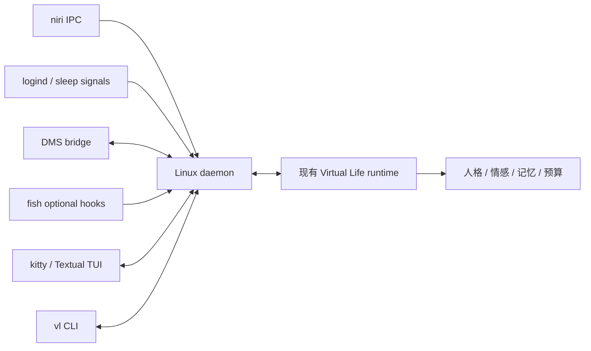

# Linux 完整客户端实施计划：Shorin DMS Niri / kitty / fish

规划日期：2026-10-18。状态：待实现。本轮仅核查仓库与上游公开源码、制定计划，没有实现客户端，没有安装服务、修改桌面配置或调用真实模型。

本文供其他代理直接执行。目标环境按 [SHORiN-KiWATA/shorin-dms-niri](https://github.com/SHORiN-KiWATA/shorin-dms-niri) 理解；具体安装版本在阶段 0 核实。这里的“完整”指可日常使用、可安装升级、具备终端交互与桌面感知的 Linux 文字陪伴宿主。截图识别、语音、桌宠形象单列为后续扩展，不作为这次文字客户端的隐含交付。

## 1. 推荐决策与交付边界

采用 **Python 用户会话守护进程 + kitty 内 Textual TUI + fish 命令入口 + DMS 状态插件**。针对这个 Linux 环境，此方案比引入 Compose Desktop / Electron 更直接：能复用已有 Python 遥测，kitty 已提供渲染、中文输入和 Wayland 窗口；DMS 已提供栏位、通知与锁屏。此前 [分发调研](client-distribution-research.md) 的跨平台 Compose 建议继续保留，本次新增 Linux 专用宿主。

fish 负责启动、补全和可选的低成本 shell 状态事件；聊天输入、多行编辑、流式草稿由 TUI 负责。不要用 `fish read` 加后台 `echo` 拼交互，它会干扰正在编辑的命令，也无法可靠撤下失效草稿。用户仍然可以在自己现有 kitty/fish 中执行 `vl chat`，无需换终端或改默认 shell。

文字客户端的正式交付必须包含：

| 能力 | 完成后的行为 |
| --- | --- |
| 接入与身份 | 首次配置、离线校验、稳定设备 ID、重启不重复建节点、显式接管已有 Linux reporter |
| 后台宿主 | 用户级 systemd 服务、单实例、本地 IPC、断线恢复、独立租约看门狗、休眠恢复 |
| 对话 | 伙伴选择、显式接入、中文多行、流式草稿、停止显示、原回执恢复、历史查看 |
| 跨设备 | 完整 prepare / released / ready / commit / abort / expiry 流程，支持 Android/Web 互迁 |
| 桌面感知 | niri 前台应用类别、工作区变化的本地统计、锁屏/空闲提示、DMS 勿扰、来源新鲜度 |
| 陪伴控制 | quiet/chat/focus/away、显式专注与休息边界、主动策略开关、静默原因、受限通知 |
| 服务端能力接入 | 读取人格、情感、预算、记忆召回；长期记忆继续由现有服务端管理 |
| 桌面入口 | `vl` CLI、fish 补全、独立 kitty 窗口、niri 快捷键片段、DMS 状态入口 |
| 运维交付 | doctor、日志、源码与 wheel、用户级安装/升级/回滚/卸载、真机验收报告 |

首次启动不自动迁移伙伴、不自动开启主动陪伴。用户显式接入后才申请呈现资格；关闭 TUI 后继续遥测，停止角色新输出。管理人格、导入角色卡、批量管理记忆等复杂操作继续打开现有 WebUI。

## 2. 已有基础、实际缺口与禁止误用

| 当前文件/模块 | 已有内容 | 本轮用法 |
| --- | --- | --- |
| `clients/system-node/system_node/collectors.py` | CPU、内存、磁盘、负载等 Linux 指标 | 复用采集核心，保持标准库 reporter 不增加桌面依赖 |
| `clients/system-node/system_node/attention.py` | logind 提示、保守在场建议、X11 应用类别 | 复用状态语义和边界规则，新增 Wayland 适配器 |
| `clients/system-node/system_node/runtime.py` | 完整心跳、退避、有界事件队列、systemd notify | 借鉴调度与预算；不同时启动旧 Runtime 和新宿主写一个节点 |
| `backend/virtual_life/node_credentials.py` | `vl_reporter_` 自身写入凭据 | 保持原权限；它不能聊天、读取伙伴、连接 WS 或领取输出租约 |
| `backend/virtual_life/coordinator.py` | owner/epoch/revision/lease、迁移、事件与幂等回执 | 保持为唯一角色状态权威 |
| `backend/virtual_life/dialogue.py` / `dialogue_stream.py` | 对话编排、累计文本 SSE、终态回执与预算 | 新终端复用；不在客户端另建模型调用与长期记忆链路 |
| `backend/virtual_life/proactivity.py` / `focus.py` | 注意力、有界候选、连续专注、主动生成 | 复用原规则，桌面只提供有证据的输入 |
| `backend/virtual_life/proactivity_output.py` | 当前 **Web access** 的主动文字实时校验 | 不能把它当现成原生输出接口；新增原生呈现会话路径 |
| `clients/android-node/.../LeaseGate.kt` | 保守租约截止、旧快照拒绝、epoch 输出句柄 | Python 移植语义，不依赖 JVM 运行；做跨语言契约用例 |

必须保留以下约束：

1. 同一设备只有一个原生注册、完整 capabilities 和完整 heartbeat context 写入者。DMS 插件、TUI、fish 都只连接本地 daemon，不直接心跳。
2. 历史事件、completed 回执、旧 companion snapshot 都不能自行授权当前输出。
3. 注意力新鲜度、节点存活、呈现会话、角色输出租约是不同概念；CPU 上报正常不能证明用户在场。
4. `meeting` / `screen_sharing` 没有可靠来源时为 null；静止阅读不等于离开，不等于可打断。
5. fish 命令结束不等于用户任务完成；窗口切换、编译完成不自动生成 `task_completed`。
6. 服务端状态、回执、事件继续原子提交；修改接口时同步协议、OpenAPI 与 Kotlin 类型。

## 3. 进程结构与代码布局



建议目录如下，路径为计划新增：

```text
clients/linux-node/
  pyproject.toml
  uv.lock
  README.md
  src/virtual_life_linux/
    cli.py                 # vl 入口；配置、诊断与本地 RPC
    config.py              # 严格配置、XDG 路径、凭据加载
    daemon.py              # 生命周期与任务监督
    state.py               # 汇聚状态、版本与本地事件
    ipc.py                 # Unix socket RPC / subscription
    storage.py             # 身份、cursor、命令恢复与短期去重
    transport.py           # HTTP / SSE / WS，限制与错误分类
    runtime/               # 节点、租约、迁移、对话、呈现会话
    adapters/              # niri、logind、DMS、fish、telemetry
    policy/                # attention 汇聚、来源 TTL、本地静默
    tui/                   # 页面、输入、草稿、历史与状态
  integrations/
    fish/conf.d/virtual-life.fish
    fish/completions/vl.fish
    niri/virtual-life.kdl
    dms/VirtualLife/        # manifest、widget、设置、状态桥接
    systemd/virtual-life-linux.service
    desktop/dev.virtuallife.Linux.desktop
  packaging/
    install.py
    build.py
  tests/                   # 新客户端专项

docs/linux-client-contract.md             # 阶段 0 冻结后的合同
docs/linux-client-validation.md           # 阶段 5 真实验证结果
examples/linux_desktop_live_test.py       # 临时服务端联调
```

运行依赖建议为 `httpx`、`websockets`、`dbus-next`、`textual`；开发依赖单独声明。具体兼容版本由阶段 0 原型确认并写入 lockfile，不直接使用未约束的最新版本。新客户端有独立安装包，不能依赖安装整个 FastAPI 运行时。

遥测复用采取“小范围抽取 + 构建同步”：把现有 `LocalCollector` 与其必要纯函数提取为标准库模块；旧 `collectors.py` 保留兼容导入，网关和探测逻辑不挪动。新客户端构建时仅复制白名单采集模块到私有 vendor 目录，记录来源哈希并检查一致性。避免运行时依赖仓库 `sys.path`，避免复制整套 reporter Runtime。旧 `clients/system-node/build.py` 与 wheel 资源同步检查要覆盖这个抽取。

daemon 内至少分离以下任务：心跳/遥测、注意力汇聚、WS 事件消费、租约续期与过期看门狗、迁移处理、对话执行、IPC、DMS 连接。慢采集、DNS、模型 SSE 不能阻塞租约和停播。同步系统调用放有界工作线程，子进程有截止时间、输出上限与退出清理。

## 4. 身份、凭据与已有 reporter 接管

### 4.1 本轮认证边界

首个可用版本沿用仓库的单所有者原型：由用户明确配置现有 owner Bearer token，仅 daemon 持有；TUI、fish、DMS 不读取它。安装向导要明确该凭据与 reporter token 的用途差异。遇到 `vl_reporter_` 立即报告 `reporter_credential_not_supported`，不尝试自提权。

本轮不把完整设备配对系统作为前置条件。更小权限的 desktop credential 列入阶段 6，禁止通过“扩大所有 reporter 权限”代替。开发和验收使用隔离 runtime 与测试 token；规划文档、样例和产物均不得包含实际凭据。

| 内容 | 位置与规则 |
| --- | --- |
| 非秘密配置 | `$XDG_CONFIG_HOME/virtual-life/linux/config.toml`，缺省 `~/.config/...` |
| owner token | 单独 `credentials` 文件，0600；向导隐藏输入；不放 argv、不导出给 shell 子进程 |
| 持久状态 | `$XDG_STATE_HOME/virtual-life/linux/<server-key>/<node-id>/`，0700 |
| 本地 IPC/锁 | `$XDG_RUNTIME_DIR/virtual-life/`，0700；socket 0600；检查 peer UID |
| 缓存 | `$XDG_CACHE_HOME/virtual-life/`；可删除，不含凭据与聊天正文 |

`server-key` 根据规范化 scheme/host/port 隔离，首版不把换 origin 当成同一服务器。`node_id`、`device_id` 首次随机生成后持久化；不要上传 machine-id、自动收集 MAC 或把用户名当身份。重装默认保留身份，重置身份必须是明确的独立命令。

### 4.2 已有系统服务升级为桌面宿主

新增 `vl setup --adopt-system-node <node_id>`：先做只读检查并生成迁移清单；涉及 root 的停止/禁用系统服务由明确的迁移步骤执行，不在普通聊天启动中隐式 sudo。

执行顺序：

1. 确认原 `server_url`、`node_id`、`device_id` 及安装来源；保留服务端节点、历史、记忆来源和 Web 绑定。
2. 保存旧服务版本与非秘密配置的恢复信息；秘密不复制到普通用户可读目录。
3. 停止并禁用旧 `virtual-life-system-node.service`，确认其进程结束；不要依赖“等一个心跳周期应该就停了”。
4. 用 owner token 将同一节点注册为 `kind=desktop`，复用原 `device_id`；本地 daemon 汇聚遥测与桌面能力。
5. 验证新 daemon 的心跳、注意力与服务就绪；失败则先停新 daemon，再按保存身份恢复 `kind=other`、原能力与旧服务。
6. 成功后可显式撤销旧部署 reporter 凭据；一旦撤销，后续回退需要重新签发，不能承诺原 token 会复活。

当前 reporter 的服务端校验只允许安全 `kind=other` 能力集合；节点升级为 desktop 后旧 reporter 不应再有写入资格。必须测试这条事实，防止恢复旧服务时静默覆盖能力。未发现原配置、存在不同 origin/身份或仍有第二个原生宿主时，中止接管并给出固定原因。

本轮单写入保证范围是一个登录用户 daemon 加上述接管流程。多个 UID/主机共用同一 node_id 的服务端强制仲裁仍需阶段 6 的宿主会话 fence，不宣称已有全局原生多写入仲裁。

## 5. 本地 IPC 合同

采用 Unix stream socket + UTF-8 JSON Lines，默认不监听 TCP。每帧带 `version:1`、`request_id`、`method`、`params`；回应带相同 request_id 和 `result` 或固定结构的 `error`。订阅事件另带单调 `sequence` 与 `generation`。

| 方法组 | 建议方法 |
| --- | --- |
| 状态 | `status.get`、`status.subscribe`、`diagnostics.get` |
| 呈现 | `renderer.attach`、`renderer.heartbeat`、`renderer.detach` |
| 伙伴 | `companion.list`、`companion.select`、`companion.connect`、`companion.mode.set` |
| 对话 | `dialogue.send`、`dialogue.hide`、`dialogue.receipt.get`、`dialogue.history.get` |
| 迁移 | `travel.prepare`、`travel.status`、`travel.abort` |
| 注意力 | `attention.override.set`、`attention.override.clear`、`attention.boundary` |
| 管理入口 | `webui.open`；只打开配置 origin 的固定页面 |
| fish | `shell.register`、`shell.started`、`shell.finished`、`shell.closed` |

renderer attach 创建随机 `renderer_id` 和递增 generation，同一伙伴同一时刻只有一个实时角色 renderer。第二个 TUI 可以查看状态/历史，用户明确接管后才替换 renderer；旧 generation 的草稿、结果与心跳全部丢弃。

推荐限制：单帧 256 KiB、文字正文不超过服务端上限、每连接待发队列 64 条、最多 8 个本地连接；慢订阅先合并状态/delta，仍堵塞则断开。256 KiB 帧预算为最大正文与 JSON 元数据保留空间，不把 64 KiB 正文再塞进同样大小的帧。对话使用累计草稿，不为每个字符无限排队。renderer 每 1 秒确认存活，超过 3 秒停止本地授权；每次实际绘制仍检查本地输出期限。断开 socket 立即清草稿，不能等服务端节点 TTL。

本地 daemon 不提供任意命令执行或文件读取 RPC。IPC 权限约束普通进程接入，不应被描述为能隔离同 UID 的恶意程序。

## 6. 服务端最小增量：原生呈现会话

已有 owner/epoch/lease 不区分“同一个 daemon 的旧 TUI 已关闭，新 TUI 刚打开”。完整客户端应补这个生命周期，复用 Web access 的过期与旧请求隔离思想，但 **不把原生终端伪装成 Web access**。

下面均是待实现设计，阶段 0 先写入 `docs/linux-client-contract.md`，再由服务端与客户端并行实现。

### 6.1 路由与存储

| 新接口 | 行为 |
| --- | --- |
| `POST /v1/nodes/{node_id}/presentations` | `{presentation_id, kind:"terminal"}`；renderer 已准备后开启。返回 node_id、presentation_id、expires_at、ttl_seconds、server_time、opened_sequence。 |
| `POST /v1/nodes/{node_id}/presentations/{presentation_id}/heartbeat` | 仅刷新未释放且未过期的会话；过期不能复活。 |
| `DELETE /v1/nodes/{node_id}/presentations/{presentation_id}` | 幂等释放指定会话，不释放新会话、不删除节点。 |
| `GET /v1/companions/{id}/proactivity/native-output` | node_id、presentation_id、epoch、可选 after_sequence；返回当前仍可呈现的原生主动文字页。DSH 全权模式下 item 可能为 `status=awaiting_generation` 的冲动（`reason_text`/`context_text`/`command_id`，`assistant_message=null`），需经 dialogue commit 路由提交回复。 |
| `GET /v1/companions/{id}/dialogue/history` | 可选 before_sequence、limit；按 companion 返回 completed 对话对与前页游标，最新页优先，供回看与近期 history 重建。 |

新增独立 `native_presentations` 表，同节点至多一个活跃 terminal presentation。与 Web access 分表；Web 可以继续管理或只读浏览，但同一设备已开活跃 Web access 时，原生 connect 返回 `presentation_busy`，要求用户关闭另一入口或明确接管；反向建立 Web access 也须检查原生呈现。对应冲突检查在同一个写事务内完成，不仅在读取输出时检查。只开 WebUI 管理页不等于申请 Web access。

建议 TTL 15 秒，daemon 每 5 秒刷新；这是规划参数，阶段 0 对照服务端 node/lease TTL 进行校验。presentation TTL 不刷新 node heartbeat，不授予角色 owner 或 lease。节点必须已有在线文字能力；创建会话不会接管伙伴。

创建时记录事件 head / opened_sequence。首次 native-output 不传 after_sequence 仅建立基线；后续只允许返回会话开启以后、游标以后、候选仍新鲜的输出。重开新会话不能把旧问候补发。page 使用独立原生响应类型，不往 Web 的必填 access_id 中塞 null。

### 6.2 对话与输出 gate

`DialogueRequest` 新增可选 `presentation_id`。旧 Android/Web/原生请求省略该字段时保持原命令指纹；有字段时把它纳入 fingerprint。`access_id` 与 `presentation_id` 互斥。

在用户消息接受、模型派发、流式草稿复核、最终提交时校验呈现会话仍属于 node 且有效；终态回执查询仍可读历史，但不授予当前呈现权。会话释放/过期后，旧任务保持 discarded，不因新会话开启而恢复。新 TUI 不自动接续旧草稿，只能按原 command_id 查询结果并作为历史状态展示。

服务端主动文字页复用现有 `_current` / `_interrupted` 规则：策略、注意力、候选时机、人格/情感/记忆引用、owner/epoch/revision/lease 与迁移全部重验。不要另写一份简化的 eligibility 判断。共享校验应提取为与访问类型无关的函数，Web、native 各实现自己的会话门禁。

对 `TransferAck` 增加可选 presentation_id，原生 target 的 ready 必须携带并持久绑定该会话。提交前再次验证；释放/过期/更换会话使这份 ready 失效，不能只看 node 仍在心跳。旧客户端未携带字段时保持原协议语义；Kotlin 类型、OpenAPI 和 transfer 迁移字段同步。released 仍先停播再确认，不被这项扩展改变。

history 接口从现有 completed 对话事件投影，按 companion 索引分页；返回 event_id、sequence、command_id、node_id、occurred_at、user_message、assistant_message。首版只包含完成的用户对话，主动文字与 pending/silent/discarded 单独作为状态展示，不伪造对话对。静态 `/dialogue/history` 路由必须注册在现有 `/dialogue/{command_id}` 之前。历史不授予当前呈现权，也不触发模型或记忆写入。

所有新增 REST 保持现有 Bearer 认证；reporter 无权调用。更新 `/v1/capabilities` 的细分能力，使新客户端能发现 native presentation 与 native-output 支持。旧服务器允许遥测和只读诊断，完整聊天接入明确提示缺少特性；不要静默绕过呈现隔离。

### 6.3 文字能力的实际投影

daemon 注册 `kind=desktop`，完整能力由一个组件计算：默认 `device.state.report`；采集用户启用且适配器存在时增加 `attention.observe`；可用 renderer attach 并完成初始化后才增加 `text.display`。不声明 `avatar.render`、`audio.output` 或 `vision.capture`。

当 TUI 断开、被替换或退出时，先清本地输出、释放 presentation，再更新注册能力。节点存活不代表仍有可呈现窗口。服务端 presentation 校验是旧 capability 暂未更新时的第二道 gate；迁移 target_ready 还必须检查真实 renderer 存活。

## 7. niri / Wayland 适配

### 7.1 niri IPC

优先通过 `$NIRI_SOCKET` 直接连接 Unix socket；读取 JSON Lines，发送 `"EventStream"` 后先处理 reply，再处理事件。上游事件流会先给当前完整状态，不要先查询一份 windows 再假定它与新订阅原子一致。[niri IPC 源码](https://github.com/niri-wm/niri/blob/main/niri-ipc/src/lib.rs)

维护最小本地窗口表与工作区表：

| 事件 | 处理 |
| --- | --- |
| `WindowsChanged` | 全量替换窗口表，重建 focus |
| `WindowOpenedOrChanged` | 更新窗口；若 focused 则清除其他 focus |
| `WindowFocusChanged` | 切换焦点；null 代表没有前台窗口 |
| `WindowClosed` | 删除；清理对应缓存，不继承上一个类别 |
| `WorkspacesChanged` | 全量替换；允许短时悬空引用 |
| `WorkspaceActivated` | 区分 output 上 active 与全局 focused，不能混用 |
| `OverviewOpenedOrClosed` | 本地保守抑制；overview 不等于可打断边界 |
| 未识别事件/新增字段 | 忽略并计数，不能杀死采集任务 |

`app_id` 只在本地映射到现有 activity 枚举，默认 kitty=terminal、编辑器=code、浏览器=browser。`title`、PID、工作区名、路径在解析入口立即丢弃，不进日志/状态文件/上传 JSON。预设的普通 kitty 不意味着用户正聊天；专用 `dev.virtuallife.Terminal` app-id 可以标记本客户端 renderer。

事件连接与动作连接分离：进入 EventStream 后同一个 socket 不再接受动作请求。`vl open` 可以查找本客户端 app-id 的窗口并通过独立 IPC 请求聚焦；只操作本客户端窗口，不基于任意窗口标题匹配。

重连退避 0.5–30 秒加抖动；断线立即将该来源标记 unavailable，应用类别归 unknown。静默的健康 IPC 连接不表示 stale：前台状态可能长期不变；用独立 Version/轻量查询定期检查连接与重建来源，不能把“很久没有窗口变化”当采集失败。

上游新增了 `Casts` / `CastsChanged` / `CastStartedOrChanged` / `CastStopped`，可作为录屏抑制来源，但 Shorin 可能使用不同 niri fork/version。阶段 0 要探测本机是否支持，不能按 main 源码推定已安装版支持。存在已知 cast 可置 screen_sharing=true 并立即静默；空列表只有在确认初始化完整、接口覆盖目标捕获路径时才提供有限的 false 证据，其余保持 unknown。录制存在不代表正在开会。

### 7.2 logind、锁屏、空闲与休眠

使用 `dbus-next` 订阅系统 bus 上 login1 会话 PropertiesChanged / PrepareForSleep；启动时读取快照，信号丢失或 bus 重启后重新读取。`loginctl` 保留为有界 fallback。只选择当前 UID 的本地 Wayland user 会话，多会话歧义时要求明确选择，不探测其他用户 socket。

合并时遵守：明确 locked=true / inactive 优先抑制；解锁需要同一来源新鲜证据，不能因为 DMS 进程退出就当作 unlocked。空闲为提示，不将 idle=true 直接映射为 user_present=false。`user_returned` 沿用现有“明确离开/锁定后返回”的规则，启动、断线恢复和普通 idle 结束不伪造。

收到 PrepareForSleep(true) 立即：清草稿、撤销 permit、关闭正在呈现的角色文字、暂停租约续期与候选消费。恢复后清除所有旧 permit，重新采样、读取 owner/epoch、重建 presentation 并获取新租约。

Linux 租约时钟使用 `time.clock_gettime_ns(time.CLOCK_BOOTTIME)`，包含 suspend。`time.monotonic()` 在 Linux 通常不累计 suspend，不能直接用它代替；不可用时 fail closed 并报告诊断，不靠系统 UTC 作为本地授权钟。

## 8. DMS 集成与感知合并

### 8.1 DMS 边界

DMS 是可插拔适配器。核心 daemon/TUI 在 DMS 未启动时仍可连接与主动对话，自动注意力字段按实际来源降为 unknown，主动输出保守抑制。不要另起通知 daemon、重启 DMS 或 fork 其主工程。

增加 `VirtualLife` DMS widget：显示“离线/未接入/陪伴中/专注/暂停”、伙伴名、连接与未知来源提示；点击执行固定 `vl open`，菜单提供 quiet/focus、休息边界和打开 WebUI。布局兼容水平/垂直 bar；不把模型密钥、服务器 token 或完整聊天正文塞到 QML 配置。

上游可核查到 `SessionService` 的 locked/active/idleHint/lockedHint/preparingForSleep，以及 `SessionData.doNotDisturb`；这些是当前源码内部服务，**不等于稳定的公共 D-Bus 接口**。插件负责适配并通过本地 IPC 发送固定结构快照，版本差异集中在插件内。[SessionService](https://github.com/AvengeMedia/DankMaterialShell/blob/master/quickshell/Services/SessionService.qml)、[通知服务](https://github.com/AvengeMedia/DankMaterialShell/blob/master/quickshell/Services/NotificationService.qml)

桥接建议：插件使用 Quickshell Process 启动固定参数 `vl dms-bridge --stdio`；子进程经本地 socket 连接 daemon，双向传输有界 JSON Lines。QML 不自行管理服务器连接；不把不可信文本拼进 shell。插件在属性变化时推送，另每 5 秒发来源心跳；桥接断开 10 秒后 DMS 来源未知。公开 `source_version` 与 `initialized`，DMS 默认 false 值只有完成初始化才可参与推断。

DMS widget 与状态桥接不得依赖“用户恰好把 widget 放到了可见 bar”。优先采用插件后台/daemon 生命周期保持桥接；如果目标 DMS 版本不能在 widget 隐藏时持续运行，doctor 明确标为 unavailable，核心使用 logind fallback。不要把隐藏导致停更的状态当新鲜证据。

### 8.2 注意力汇聚规则

每个字段保存 `value/source/observed_at/valid_until/reason`。服务端 typed attention sample 保持原合同，来源细节放有界 `context.attention_collection` 或客户端诊断，不擅自向严格 sample 增加字段。

| 字段 | 可以提供的证据 | 缺失/冲突行为 |
| --- | --- | --- |
| activity | niri app-id 白名单；本客户端窗口=chat | unknown；不读标题猜语义 |
| locked | logind LockedHint、初始化后的 DMS 锁状态 | 任一明确锁定即抑制；解锁需新证据 |
| user_present | 同会话 active、unlocked、明确非 idle 提示 | null；不把屏幕亮等同人在场 |
| focus | 用户显式专注；自动行为只做本地保护建议 | unknown；不能仅凭 code 类别认定心流 |
| availability | 用户明确且限时的“可以陪伴” | unknown；不从 idle 推出 available |
| meeting | 用户显式会议状态；后续可靠集成 | null；摄像头/麦克风活跃只增加抑制 |
| screen_sharing | 可验证的捕获源、显式手动声明 | 无覆盖依据时 null；任何正信号优先 |
| DMS 勿扰 | 新鲜 doNotDisturb | 强制本地静默；不自动改 companion mode |

注意力 heartbeat 默认 15 秒、TTL 45 秒；关键变化立即合并提交，普通焦点变化做约 500 ms 去抖。锁屏、休眠、DND 或分享开始的本地停播不等待去抖/网络。网络失败丢弃旧 attention sample，恢复后新采样、新 command_id，不重播已过时的边界。

DND=true 时在下一份 attention 将 availability 合并为 busy，使服务端也抑制新的主动模型请求；解除后按其他仍有效来源重新计算，不直接写 available。普通用户主动对话仍按现有模式语义工作，DND 不应被解释为禁止用户手动聊天。

提供显式控制：`vl attention available --for 30m`、`vl attention meeting on`、`vl attention sharing off --for 10m`、`vl break`、`vl task done`。手动值有来源、有效期和清除命令；false 声明不能覆盖新鲜的 locked/sharing=true。第一次开启主动陪伴时允许用户一次性填写限时会话状态，而不是让其依次操作许多命令。没有明确会议/分享状态时继续 unknown，界面解释静默原因。

主动触发只来自可靠 `task_completed` / `break_started` / `user_returned`，每次固定 boundary_id。explicit `vl task done` 不自动发送聊天请求；是否调用模型仍由服务端策略决定。客户端观察不自动写长期记忆。

## 9. kitty / fish / TUI 体验

### 9.1 日常流程与命令

```fish
vl setup                     # 选择服务器/身份，隐藏输入凭据，校验并安装用户服务
vl doctor                    # 环境、依赖、权限、来源与协议诊断
vl status                    # 只读状态，不注册新节点、不迁移
vl open                      # 聚焦已有专用 kitty 窗口，或新开一个
vl chat                      # 在当前 kitty/fish 中运行 TUI
vl connect sui               # 用户明确将伙伴接入本终端；内部执行迁移/续租
vl mode focus
vl break
vl travel android-phone      # 准备迁移并显示进度
vl proactivity status
vl web                       # 打开现有管理 WebUI
```

`vl connect` 是本地 daemon 操作；若没有已准备 renderer，交互终端可进入 TUI 再接入，非交互调用返回 `renderer_required`。不向没有画面的 daemon 发送 target_ready。

不默认提供 `vl ask "聊天正文"` 作为主要入口，避免正文进入 shell history/进程参数。一次性发送可用 `vl ask --stdin` 或隐藏在 TUI 输入中；失败后保留原 command_id，不自动换 ID 重发。CLI 固定退出码至少区分配置/认证/离线/冲突/结果未明，具体数值在阶段 0 冻结。

`vl open` 首选直接 argv 启动 `kitty --class dev.virtuallife.Terminal --title Virtual-Life <vl绝对路径> chat`；kitty 全局 shell 仍是 fish。独立 TUI 进程没有必要再包一层 `fish -c`。用户在现有 fish 输入 `vl chat` 仍保留完整 fish 工作流。kitty 的 class/app-id 行为由目标版本实测，不用窗口标题作为持久身份。

niri 集成只生成独立 include 片段，先 `niri validate` 再让用户合入；不覆盖 `~/.config/niri/config.kdl` 或 DMS 自动生成的 `dms/binds.kdl`。快捷键默认候选必须先做冲突检查，不能假设 Mod+某键空闲。Shorin 更新可能覆盖主配置，文档说明如何保留独立 include。

### 9.2 TUI

默认三块：顶部伙伴/模式/owner/连接/lease/采集状态；中间按时间排序的对话；底部多行输入与操作提示。窄窗口自动合并状态，不强迫鼠标操作。推荐 Enter 发送、Ctrl+J 换行，发送键可配置；不要依赖所有 kitty/fish 版本都能区分 Shift+Enter。

必须支持中文与 fcitx5、宽字符、emoji、粘贴、多行、窗口 resize、滚动阅读、选择复制、撤销输入。读者不在底部时不抢滚动；新消息以计数提示。

模式包括未接入、准备中、思考、草稿生成、完成、silent、discarded、离线、结果未明。draft 与正式历史分离；silent/discarded 不伪造助手回复。停止按钮显示为“停止显示”，不能宣称取消了服务端模型任务。

使用 alternate screen 展示可撤下的草稿，退出恢复 shell。模型文本按纯文本/受限 Markdown 呈现；过滤 ANSI、OSC、控制字符，禁用把模型输出解释成终端控制序列。超链接若启用也只接受显式允许的 URL scheme。

只在 attach 后接收当前 live output。历史是明确的回看模式，不因为重新加载事件就播放或通知一次旧回复。锁屏、切伙伴、失去 ownership、presentation、lease 或 IPC 时立即清 draft，禁止把旧 generation 的终态插入新伙伴。

### 9.3 fish 可选集成

补全和 `vl` 入口默认启用；全局 shell 事件采集默认关闭，单独 opt-in。安装到独立 conf.d 与 completions 文件，不改用户 config.fish、starship 或自定义 prompt。

使用 fish_preexec / fish_postexec 时要注意两者参数包含完整命令行。**处理器不读取、不序列化 `$argv`**；只保存本地 shell_session_id、开始/结束单调时间、退出状态和随机 operation_id。不读取 history、`$PWD`、命令展开、屏幕文字或环境变量全集。[fish 事件文档](https://fishshell.com/docs/current/language.html#event-handlers)

事件通过短超时 CLI/本地队列发送，daemon 不在时快速退出，不在 prompt 阻塞联网。多个 shell/kitty tab 独立计数；`exit`、shell 崩溃或 TTL 到期清除运行态。长命令、失败命令可在本地增加保护提示，但不会自动成为 task_completed、suspected_stuck 或可打断证据。

fish hook 应在捕获 `$status` 后再执行任何命令；验证不改变用户看到的退出状态与 pipeline 行为，不产生递归 hooks，不向 shell stdout/stderr 打日志。

## 10. 租约、迁移、流式恢复与通知

### 10.1 输出状态机

`detached -> renderer_ready -> presentation_open -> connecting -> active -> paused/releasing`。只有同时满足当前 node owner、epoch、有效 presentation、本地 renderer generation、未过期保守租约、允许的桌面状态，才进入实际输出动作。

保守截止计算参考 Kotlin LeaseGate：

```text
remaining = min(server expires_at - server_time, ttl_seconds, local maximum)
deadline_boottime = request_started_boottime + remaining - safety_margin
```

以请求开始时间计，不以响应到达时间计。建议 margin 从 250 ms 起，按 RTT 和目标系统调度验证；在预算一半附近续租，独立看门狗到 deadline 即撤销。服务端默认短租约不能套用 20 秒遥测间隔。乱序续租回复、旧 epoch/revision、时钟倒退、恢复自 suspend 都不能重新授权旧输出。

daemon 通过 IPC 向 renderer 下发 node_id、companion_id、epoch、renderer generation、presentation_id 与 BOOTTIME deadline；TUI 在每次绘制及自己的定时器中复核。daemon 单方面停止发消息不够：被冻结或排队的旧 delta 仍必须被 renderer 拒绝。观测/诊断 UI 不受角色输出租约限制。

WS 正常时接收事件，持久 cursor 按 server-key/node-id 隔离。处理完事件副作用再推进 cursor；重复事件幂等。处理 cursor frame 的扫描位置，不仅保存“最后一条投递给自己的 event”。首次接入可从 0 补状态，但历史输出一律不自动显示；状态恢复后重新获取 lease。

### 10.2 迁移

| 场景 | 行为 |
| --- | --- |
| 当前伙伴已在本节点 | 重新读 snapshot、取得 presentation 与新 lease；不准备 same_node 迁移 |
| 本机为 source | 先停 live 输出、清草稿、停止 lease 续期，再发 released；未知结果查询原 transfer |
| 本机为 target | 确认 TUI 已准备、presentation 有效、输出初始化完成后发 ready |
| source 无法联系 | 等服务端旧 lease 到期，不本地宣布迁移成功 |
| abort / expiry | 读取当前 state；源端获新 lease 才能恢复，不复活旧 permit |
| target 断开或重启 | 旧 ready 不作为新进程呈现证明；重读 transfer/owner，按协议处理 |

需要同时验证 ready/released 两种到达顺序，重复 ack、提交前离线、迁移期间新消息和服务重启。UI 显示准备、等待源释放、已提交、失败/未知，并保留原 transfer_id。

### 10.3 SSE 对话

沿用 [现有 SSE 合同](dialogue-streaming.md)：delta.text 是累计全文，替换草稿；sequence 必须连续，不追加成重复文本。处理跨字节 UTF-8、CRLF、多行 data、注释 ping、单帧与总量限制。

普通对话的近期 history 目前由请求方提供，不是服务端自动填满。daemon 从 completed 历史与当前会话构建最近最多 20 条 role/content，每条遵循现有 4096 字符及整包/提示预算限制；默认历史在内存，重启从新 history 接口恢复。不得把草稿、discarded 或主动问候拼成用户消息，也不得用长期记忆召回冒充精确对话历史。

daemon 在发出请求前持久化 command_id、伙伴、epoch、presentation 和请求指纹；正文默认仅在内存保留，除非用户明确开启本地恢复正文存储。command metadata 为 pending 不意味着可以重发；崩溃后以 GET 原回执查询。SSE 200、EOF、网络超时都不代表 completed。

终态 completed 后再读当前状态、校验展示门禁，只入一条正式历史。error/无终态 EOF 转结果未明，GET 查询原 ID；pending 409 有界退避，404 表示没有可确认回执，不换 ID 自动补发。用户决定重新发送时必须明确提示可能重复，并生成新命令。

### 10.4 主动文字与通知

主动默认关闭；启用仍需 chat 模式、人格阈值、明确注意力与服务端预算全部通过。终端有活跃 renderer 时在 TUI 里显示；关闭 TUI 后默认不生成新的主动开口机会，不自动新开 kitty、不抢焦点。

DMS 普通状态通知可以提示“连接已断开/迁移需处理”，不包含聊天正文。角色主动内容如需系统通知，作为用户显式打开的扩展输出通道，必须有自己的有效 presentation、同一租约 gate、即时 native-output 复核及失效关闭处理；不能把“通知很轻”当成免租约输出。

使用 freedesktop Notifications D-Bus，由现有 DMS 服务展示；不启动第二个通知服务。默认正常/低优先级、无声音、不标 critical、不绕过 DND；动作固定为打开 TUI。对 event_id/command_id 去重，候选过期不补发。通知可能进入 DMS 历史，用户需主动打开正文通知选项。

## 11. 配置、安装与生命周期

建议最小配置结构如下。它是设计样例，最终严格 schema 在阶段 0 冻结；省略项均有文档默认值，未知字段报错。

```toml
schema_version = 1
server_url = "http://127.0.0.1:8038"
node_id = "linux-workstation"
device_id = "persisted-installation-uuid"
label = "Linux 工作站"
credential_file = "credentials"

[desktop]
backend = "niri"
attention_enabled = false
dms_enabled = true
fish_activity_enabled = false

[interaction]
terminal = "kitty"
auto_connect = false
notifications = "status_only"

[reporting]
heartbeat_seconds = 20
attention_seconds = 15
attention_ttl_seconds = 45
```

默认使用系统 Python 3.12+ 和用户独立 venv；源码/wheel + 带 hash 的依赖锁定清单可重复安装。目标机缺 Python 时给出准确要求，不自动改系统包管理器。首版不承诺一个 zipapp 可以包含 Textual 的全部运行环境；标准库 system-node `.pyz` 继续独立发布。

安装器使用版本目录与 current 指针，例如 `~/.local/share/virtual-life/linux/versions/<version>/`；`~/.local/bin/vl` 是稳定入口。升级先构建与离线检查新版本，等待/提示处理 pending dialogue 与 transfer，停止旧 daemon 后切换，启动失败恢复旧版本和兼容配置。二进制回退前检查状态 schema，不能假定数据库已迁移仍可直接降级。

用户服务 `virtual-life-linux.service` 不以 root/virtual-life 系统账户运行。服务就绪定义是配置有效、本地 IPC 已监听、任务监督已启动；离线可完成本地就绪，同时状态明确 offline。不要照搬 reporter 的“首次网络上报成功才 READY”导致登录断网时无法进入诊断。

桌面环境变量从当前 niri 会话显式导入用户 manager，至少包括 WAYLAND_DISPLAY、NIRI_SOCKET、XDG_CURRENT_DESKTOP、XDG_SESSION_TYPE；DBUS_SESSION_BUS_ADDRESS 按实际会话检查。不要导入整个 env，更不要把 token 导入 systemd 全局环境。

优先挂到实际生效的 graphical-session target；同时提供 niri 启动脚本作为兼容入口，负责环境导入与 `systemctl --user start`。两者以 systemd 与本地 flock 保证只启一个 daemon。会话退出立即停服务，不能仅依靠用户 manager 在所有环境中都会退出；不默认 enable-linger。

SIGTERM：先撤输出 permit/清草稿，尽力释放 presentation，停止续租与新模型请求，关闭流订阅，保存 cursor/未明命令元数据，然后有界退出。取消 SSE 订阅不等于服务端停止推理。

`vl doctor --json` 至少报告：Python/客户端/协议版本、niri/DMS/kitty/fish 的实际版本或缺失、socket 可访问性、会话歧义、系统/用户 bus、来源初始化、新鲜度、单实例、有效能力、renderer/presentation/lease、服务目标与配置权限。秘密、命令行、窗口标题、聊天正文不进入诊断。

## 12. 执行阶段、依赖与完成门槛

按工作包验收，不以“界面能打开”代替完整可用。工作量为粗略工程估计，含实现与评审，不含等待目标真机；并行只在合同冻结后开始。

| 阶段 | 主要工作 | 完成门槛 | 估计 |
| --- | --- | --- | --- |
| 0：冻结合同与环境 | 核查实际 Shorin/niri/DMS 版本；依赖原型；IPC/呈现/API/状态机/退出码 | 合同文档、脱敏环境报告、niri/DMS fixture、最小 kitty 中文 TUI 与 suspend 时钟验证 | 1–2 人日 |
| 1：宿主基础 | 独立包、配置、身份、IPC、单实例、遥测、服务；后端 presentation 并行 | 无桌面可诊断；重启身份不变；原 reporter 回归通过；同设备无双写 | 3–5 人日 |
| 2：文字闭环 | TUI、SSE、租约、迁移、native output | 临时 runtime 对话/停止/断流/互迁；旧会话与旧 epoch 无输出 | 4–6 人日 |
| 3：桌面与陪伴 | niri/logind/DMS、注意力汇聚、显式边界、策略与静默原因 | 真实锁屏/休眠/DND/断开立即停播；unknown 不触发主动生成 | 3–5 人日 |
| 4：日常交付 | fish/kitty/niri 入口、安装升级回滚、doctor、文档 | 干净用户安装、离线启动、升级失败恢复、Shorin 配置不被覆盖 | 2–3 人日 |
| 5：整体验收 | 后端回归、PTY/桌面真机、跨节点与发布产物 | 验收矩阵全部通过或明确阻塞；报告可复现，产物可独立安装 | 2–3 人日 |
| 6：后续扩展 | scoped desktop credential/配对、全局原生 writer fence、视觉/语音等 | 单独设计与授权范围，不阻塞首个单所有者文字客户端 | 单独估算 |

总量约 15–24 人日，属于初步估计；3–4 个实现代理可并行压缩日历时间，但协议整合、真机与升级验证有顺序依赖。阶段 0 后按发现重新估算，不把人日简单除以代理数当交付承诺。

## 13. 代理分工与可直接交接的任务书

指定一个集成代理拥有 `docs/linux-client-contract.md`、公共接口与发布决策。先冻结 client port/DTO，再由 UI 和适配器代理并行；不要让它们各写自己的 node 注册、lease 或 HTTP client。

| 代理 | 文件所有权 | 依赖 | 交付 |
| --- | --- | --- | --- |
| A：协议与后端 | native presentation 服务、proactivity output 重构、API、模型、后端测试 | 阶段 0 合同 | 新原生会话与输出校验、旧 Web/Android 兼容、协议/OpenAPI/Kotlin 变更说明 |
| B：Linux 宿主核心 | config/state/storage/ipc/transport/daemon/runtime；遥测抽取 | 阶段 0 合同；与 A 对接 | 单实例 daemon、核心状态机、HTTP/SSE/WS、lease/transfer、IPC fake server |
| C：Wayland / DMS | adapters/niri、logind、dms、policy；DMS 插件 | IPC/采集 ports | 有界采集与 fixture、来源 TTL、保守 attention、实际 DMS 版本适配报告 |
| D：终端与交付 | tui、CLI 用户命令、fish/kitty/niri/systemd/packaging | B 的冻结 ports；C 的状态 DTO | 中文 TUI、入口集成、可安装包、升级回滚、使用说明 |
| E：集成验收 | examples live test、整合测试、validation 文档与产物检查 | 各工作包就绪 | 跨端合同核对、自动化与真机证据、缺口清单 |

多人会同时需要改 `cli.py`、pyproject、测试配置、Kotlin RuntimeApi 等共享文件。B 先冻结入口与依赖清单，D 通过命令子模块接入；A 提供 Kotlin 变更给集成代理集中合并。共享文件只设一位写入者，其他代理提交具体补丁说明。

下面任务模板可以直接复制；分派时附本计划、冻结合同和该代理文件边界，不能只写“按聊天记录继续”。

**A 的任务：** 在 `/home/wjqawa/virtual_life` 实现本计划第 6 节的原生呈现会话、ready 会话绑定、主动输出门禁及分页对话历史。先阅读 AGENTS、protocol、device-identity、dialogue-streaming、proactivity 及原生合同。保持 owner/epoch/lease 与现有 reporter 权限不变；旧请求省略 presentation_id 时指纹不变。覆盖旧会话隔离、同节点 Web/native 竞争、过期不可复活、主动输出基线与重验、流式生成中释放和历史路由/分页的回归。同步协议、OpenAPI 与 Kotlin 类型。报告修改、实际检查与兼容影响，不安装客户端、不改生产配置。

**B 的任务：** 按第 3–5、10–11 节实现独立 Python Linux daemon 与本地 IPC。一个进程拥有节点全量写入；TUI/DMS/fish 不能持有服务器 token。先输出可供 C/D 使用的冻结 ports/DTO 与 fake daemon，然后实现身份、状态存储、租约/迁移、SSE/WS、原回执恢复、并发任务与服务生命周期。租约用 CLOCK_BOOTTIME，支持可注入时钟。保持原标准库 reporter 包可构建。测试只操作临时目录、临时 runtime，不启动开发机 systemd 或使用生产 token。

**C 的任务：** 按第 7–8 节实现 niri/logind/DMS 适配与注意力汇聚。以目标环境版本 fixture 为准；EventStream 初始全量、增量、断线、未知事件和多会话都要覆盖。入口即丢弃标题/路径/PID；缺失值保持 unknown/null。DMS bridge 不依赖可见 widget 才存活，插件不能改用户主配置或另起通知服务。交付真实桌面验证步骤与未验证边界。只通过 B 的 IPC/ports 接入，不自行注册节点、续租或调用模型。

**D 的任务：** 按第 9、11 节实现 kitty 内 Textual TUI、CLI、fish 补全/可选事件、niri 独立片段及用户级安装升级。多行中文、草稿替换/撤下、结果未明、历史、owner/lease 状态必须可操作。正文不进 argv，模型文本不解释成 ANSI/OSC。安装不覆盖 Shorin/DMS 自动生成配置，升级不产生双 daemon。依赖 B 的公开 ports，通过 fake daemon 开发；不改公共协议或自建服务端传输。

**E 的任务：** 在不改生产配置和设备服务的前提下，按第 14 节构建临时 runtime/确定性模型/PTY/桌面验证链。记录每项运行环境、步骤、预期、实际与证据路径；区分 mock、nested compositor、目标桌面和真实外部模型。整合 A–D 并完成原 reporter/WS/WebUI/Android 合同回归及干净安装回滚。真实模型调用单列成本与次数，不把离线 fixture 当真机通过。

若使用自定义 `deep` 代理，spawn 必须包含上述完整任务及路径，并核实其第一条回复确认了具体任务；未收到任务时向同一代理 followup_task 重发。provider 错误与任务未送达分别记录，不能用一条简单 probe 证明任务交接成功。

## 14. 验收矩阵与验证命令

### 14.1 必须验证的行为

| 类别 | 用例 | 通过条件 |
| --- | --- | --- |
| 身份 | 首装、重启、重装、切服务器、接管 reporter | 节点稳定；cursor 按 origin 隔离；旧 reporter 不覆盖 desktop |
| 并发 | 双 daemon、双 TUI、Web 与 native 竞争、旧 TUI 延迟消息 | 拒绝/明确接管；无双 live renderer；旧 generation 无作用 |
| 租约 | 高 RTT、乱序回复、过期、时钟异常、休眠跨过 TTL | 截止后无新文字；恢复必须获取新许可 |
| 迁移 | ready/released 两顺序、重复 ack、源离线、目标关闭、abort、重启 | 仅合法 owner 输出；原 transfer 不被换 ID 自动重复 |
| 对话 | 中文首段、累计 delta、断字节、乱序、silent/discarded、EOF、停止 | pending 时能见草稿；草稿可撤；终态仅一条；原回执恢复 |
| 呈现 | 生成中释放、过期后新开、旧结果迟到、Web 仍活跃 | 旧任务不借新会话显示；权限变化贯穿生成与提交 |
| niri | 初始全量、增量、focus=null、关闭、overview、多屏工作区、重连 | 本地状态一致；未知字段兼容；不上报标题/路径 |
| 注意力 | 空闲阅读、锁屏、解锁、会话歧义、未知 meeting/sharing | 不伪造在场/可打断/返回边界；来源失效立即降级 |
| DMS | 勿扰、锁屏、插件隐藏/卸载、服务重启、桥接断线 | 立即抑制；来源变 unknown；daemon/TUI 可诊断运行 |
| fish | 多 shell、失败命令、超长命令、daemon 不在、hook 退出状态 | 不泄露命令/PWD，不拖慢 prompt，不伪造 task boundary |
| 主动 | disabled、quiet/focus、unknown、过期边界、重复事件 | 不多调用模型；不补旧问候；通知不绕 DND |
| 安装 | 新用户、无网、缺依赖、版本切换失败、schema 不兼容、卸载 | 可诊断；不双写；恢复旧版；身份保留规则明确 |

建议性能目标是验收起点，不是未经测量的承诺：锁屏/休眠/本地断开事件到停止新绘制 <250 ms（正常调度条件）；IPC p95 <100 ms；15 分钟空闲且无对话时平均 CPU <1% 单核、RSS <150 MiB；niri 稳态一个事件连接，无高频 spawn 轮询。记录硬件、采样工具和观测区间，未达标给出原因及后续处理。

租约过期判定必须由独立 watchdog/绘制 gate 保证，性能统计不能替代正确性。锁屏事件被系统延迟、进程冻结时，恢复执行后先检查 BOOTTIME 截止，再处理缓存输出。

### 14.2 自动化与回归

文档变更本身不需要运行模型或完整测试。实现代理新增的是跨边界协议/生命周期测试，避免为简单配置文字堆砌镜像测试。测试使用临时数据库、可控时钟、确定性模型，覆盖真实失败边界。

实现后从仓库根执行现有检查；新路径必须加入 lint/测试范围，不能只运行旧的 backend/examples 命令：

```sh
uv run pytest
uv run ruff check backend examples clients/linux-node/src clients/linux-node/tests
uv run ruff format --check backend examples clients/linux-node/src clients/linux-node/tests
uv run python examples/export_openapi.py
clients/android-node/build-sdk.sh assemble exampleClasses
uv run python clients/system-node/build.py
uv run --project clients/linux-node pytest clients/linux-node/tests
uv run --project clients/linux-node python clients/linux-node/packaging/build.py
```

新包 build/test 的精确入口由独立 pyproject 与阶段 0 合同确定，上述新命令是预期形式。后端全量在集成阶段跑一次；随后只有代码变化或失败才重复。涉及 Web/native 呈现互斥时，执行现有 WebUI 工作流、流式与主动输出 smoke；不要以 Kotlin 编译代替 Android 真机迁移验证。

### 14.3 真实环境验收

至少完成以下三层，报告分别标记：

1. 临时 runtime + fake niri/DMS + PTY：自动化协议、草稿、回执、迁移与生命周期。
2. 目标用户的 Shorin DMS Niri + kitty + fish：真实 app-id、中文输入、锁屏、休眠、DND、插件生命周期、多屏、登录退出和用户级服务。
3. 独立测试 companion 与另一台节点：真实跨设备迁移；允许时再做少量真实提供商对话，单列调用次数、用量与延迟。

当前工作环境未证明存在目标 Wayland 会话，所以“代码测试通过”不能填成第 2 层已通过。缺真机时交付可运行脚本、步骤与等待验证项；正式宣称客户端完成前必须补齐目标环境结果。

报告产物建议放 `.data/linux-client-review/`，不提交个人日志、数据库或截图；提交脱敏的 `docs/linux-client-validation.md`。正文包含版本/commit、配置摘要、测试结果、未覆盖项、包哈希、复现步骤和清理说明。

## 15. 后续扩展，按独立工作包处理

| 工作包 | 何时实施 | 设计要求 |
| --- | --- | --- |
| scoped desktop credential 与配对 | 单所有者版本稳定后，或需要分发到非完全可信设备时 | 自身 node/允许 companion/HTTP 与 WS 同约束、撤销实时生效、不能管理人格或其他部署；保持 reporter 原权限 |
| 服务端原生 writer fence | 多 UID、多宿主或远程接管需求明确时 | 宿主 generation/session、过期和旧写入拒绝；本地 flock 不冒充全局仲裁 |
| 用户主动“看屏幕” | 文字客户端完成后 | 先核查目标 niri 的截图能力与 Portal 后端；用户手势、仅内存、有界图像与真实模型合同；现有 observation 并不等于视觉模型链已实现 |
| 持续视觉 | 主动截图验证后 | Portal ScreenCast + PipeWire、可见授权、变化采样、锁屏撤权、显式成本预算；不把 libei 当普通窗口观察前置依赖 |
| 本地语音 | 用户另行需要时 | 单独 ASR/TTS、音频设备/播放 gate、打断与睡眠资源释放；不预先声明 audio.output |
| 图形角色 | 用户需要终端外角色时 | 独立 Wayland layer-shell/渲染宿主，复用 daemon 与租约；不塞进当前 TUI 任务 |

## 16. 调研依据与版本不确定性

本轮通过官方仓库源码和官方文档核对接口；常规网页搜索服务遇到上游错误后改为读取公开源码。以下链接指向可变分支，**不是目标机兼容性证明**；阶段 0 要记录实际安装版本与测试对应 commit。

- [Shorin DMS Niri 仓库](https://github.com/SHORiN-KiWATA/shorin-dms-niri)：确认预设身份、安装入口与 niri-session 使用方式。
- [Shorin niri 主配置](https://github.com/SHORiN-KiWATA/shorin-dms-niri/blob/main/dotfiles/.config/niri/config.kdl)：存在拆分 include、DMS 自动启动与生成配置；因此以独立片段接入。
- [Shorin kitty 配置](https://github.com/SHORiN-KiWATA/shorin-dms-niri/blob/main/dotfiles/.config/kitty/kitty.conf) 与 [fish 配置](https://github.com/SHORiN-KiWATA/shorin-dms-niri/blob/main/dotfiles/.config/fish/config.fish)：已有 fish、starship 等个性化配置，集成不覆盖用户文件。
- [niri IPC 类型与协议](https://github.com/niri-wm/niri/blob/main/niri-ipc/src/lib.rs)：EventStream 初始状态、独立动作连接、窗口/工作区/录屏事件与非稳定版本边界。
- [DMS IPC 实现](https://github.com/AvengeMedia/DankMaterialShell/blob/master/quickshell/DMSShellIPC.qml)：不能凭名字编造 lock/DND 外部 API；具体可用命令以安装版本探测为准。
- [DMS widget 模板](https://github.com/AvengeMedia/DankMaterialShell/blob/master/.agents/skills/dms-plugin-dev/assets/templates/widget/Widget.qml)：PluginComponent、水平/垂直 bar 与 popout 的当前组织方式；它只是上游源码参考，本轮没有加载或执行其 skill。
- [kitty 启动文档](https://sw.kovidgoyal.net/kitty/launch/) 与 [fish 事件处理](https://fishshell.com/docs/current/language.html#event-handlers)：终端直接运行程序和可选 shell 事件的依据。
- 本仓库当前权威合同：[协议](protocol.md)、[设备身份](device-identity.md)、[流式聊天](dialogue-streaming.md)、[主动陪伴](proactivity.md)、[Linux 自动采集](linux-attention-collection.md)。旧研究草案如与它们冲突，以已实现合同为准。
