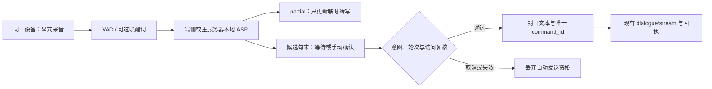

# 本地实时语音识别与对话交接调研

> 2026-10-18 方向更新：新的[连续语音、TTS 与客户端实施规划](realtime-voice-and-client-plan.md)已明确采用端侧 ASR、服务端视觉与 TTS。本文保留为历史调研，其中“主服务器 ASR 优先”和“手动发送优先”不再是下一步实施方向；模型参考与既有测量需结合新规划使用。

2026-10-15。目标是让设备采集用户语音，在设备或主服务器本地持续转写，并在用户真正说完、明确面向伙伴且当前访问有效时，转交现有对话。本文是调研和建议合同，尚未实现采音、ASR 服务、语音接口或唤醒功能。

## 建议先做什么

第一版建议采用 **设备采音 → 主服务器本地 CPU 流式 ASR → 确认文本 → 现有 SSE 对话**。先提供按住说话/点击开始后手动发送，验证中文识别及整条延迟；随后增加显式启用的唤醒词与自动判停。端侧完整识别保留同一适配接口，在具体设备上跑过资源与精度对照后加入。

优先对照 sherpa-onnx 的中文 int8 Streaming Zipformer 与中英双语 Streaming Paraformer，配合 Silero VAD。需要更好的句末修正时，再比较 FunASR 2pass；需要更复杂的轮次判断时，再比较本地 Smart Turn。此处选型是基于已有接口、部署复杂度和本地运行能力的工程判断，尚非本项目音频实测结论。

本次只读环境检查：主服务器可见 x86_64、8 个逻辑 CPU、Xeon E5-2690 v3、约 11.7 GiB 内存，当前项目解释器 Python 3.14.3。用户随后确认本地有 **Tesla P40 24 GB**，用于语音计算及后续视觉。当前执行环境没有 `nvidia-smi`、`/dev/nvidia*`、NVIDIA 驱动 proc 条目或可见 NVIDIA PCI 设备，说明本环境暂未看到该卡，不能据此否认宿主有卡。后续先确认卡所在主机及透传/计算服务连接，再测模型。ASR 可使用独立 Python 3.12 环境或原生运行时，验证其依赖后再打包，避免影响现有 API 环境。

## 说完到回复首字的延迟预算

这里的首字指屏幕上伙伴回复的第一个有效文字，不是 ASR 临时转写首字，也不含尚未实现的 TTS。以单路约 5–15 秒短句、模型已预热、局域网正常、识别在说话期间跟得上实时、当前外部 LLM 不变为前提，规划如下；**除 LLM 的既有单次实测外，均是工程估算，尚无 ASR 实测或 p95 数据**。

| 阶段 | 自动判停预算 | 依据与限制 |
| --- | --- | --- |
| 确认用户说完 | 约 0.8–1.2 秒 | 保留停顿容忍；犹豫/续说可更长，松键结束可基本省去这段等待 |
| ASR 剩余解码/封口 | 约 0.1–0.4 秒 | 主要解码发生在说话期间；若积压或另跑整句精修，预算失效，需实测 |
| 最后音频传输、权限/上下文复核与交接 | 约 0.05–0.15 秒 | 已建立的 LAN 连接、无排队时的初始预算 |
| 对话派发到可见首字 | 约 2.7 秒基线 | 上轮真实 WebUI 实测 2.711 秒，包含现有对话准备/传输/呈现，只有一次样本 |

由此将自动判停的体验先按 **约 4 秒，粗略 3.5–4.5 秒**规划；松键自动交接按 **约 3.0–3.5 秒**规划。若转写后还要求点击发送，人类确认等待另计。该区间不是置信区间或服务承诺，不能当作 p50/p95；网络、长历史/检索、冷启动、GPU 视觉争用或识别积压都可能增加耗时。

流式 ASR 的价值是把识别计算与用户说话重叠，不是用户说完后再识别整句话。ASR 临时文字可以在说话时显示，让用户感知正在识别；正式 LLM 首字还需等待判停与已测的对话链路。P40 可帮助本地处理跟上实时，但不会直接缩短当前外部 LLM 约 2.7 秒这部分，不能据显存推导出说完后一秒回复。

## P40 与后续视觉的算力安排

P40 是 Pascal、计算能力 **6.1**。NVIDIA 官方列出了其 FP32 与 INT8 推理能力；这不能直接换算成新款 GPU 上的 FP16/BF16 模型速度。[NVIDIA 计算能力表](https://developer.nvidia.com/cuda/gpus/legacy)、[P40 官方介绍](https://developer.nvidia.com/blog/new-pascal-gpus-accelerate-inference-in-the-data-center/)

兼容性会约束选型：当前 vLLM 官方最低要求计算能力 7.5，P40 不满足，因此此前列为候选的 Qwen3-ASR 官方 vLLM 流式路线不作为这张卡的部署方案。CUDA 13 也不再为 Pascal 提供离线编译支持；固定为 CUDA 12.x 仍需逐项核对驱动、库版本和运行时是否包含 sm_61，不能只看“支持 CUDA”。例如旧 cuDNN 8.9.1 支持 6.1，当前 cuDNN 支持矩阵已不包含 Pascal；直接装最新 ONNX Runtime GPU/cuDNN 组合不保证可用。[vLLM NVIDIA 要求](https://raw.githubusercontent.com/vllm-project/vllm/main/docs/getting_started/installation/gpu.cuda.inc.md)、[CUDA 13 发布说明](https://docs.nvidia.com/cuda/archive/13.0.0/cuda-toolkit-release-notes/index.html)、[cuDNN 8.9.1 支持矩阵](https://archive.docs.nvidia.com/deeplearning/cudnn/archives/cudnn-891/support-matrix/index.html)、[当前 cuDNN 矩阵](https://docs.nvidia.com/deeplearning/cudnn/backend/latest/reference/support-matrix.html)

建议先这样分工，之后用同机并发实测决定是否移动 ASR：

- CPU 常驻 VAD、唤醒词和轻量流式 ASR，保证视觉推理时语音仍可处理；测得 ASR 跟不上实时后，再比较兼容 P40 的 GPU 识别路径。
- P40 优先用于 OCR/视觉编码或小型视觉语言模型。先验证有对应后端支持的约 2B–4B 量化视觉候选，限制单张图像预算；24 GB 提供容量余量，但不代表高分辨率视觉低延迟。可考察 llama.cpp 的多模态接口，具体模型、CUDA 构建与 sm_61 必须验证。[llama.cpp 多模态说明](https://github.com/ggml-org/llama.cpp/tree/master/tools/mtmd)
- 沿用[视觉分层方案](screen-perception-and-flow.md)：结构化状态/变化检测优先，仅在必要时对选定区域做 OCR 或视觉分析，避免逐帧运行大模型。后台视觉队列只保留最新待处理帧，限制并发和单任务图像量。
- 若语音和视觉最终共用 GPU，语音任务优先，视觉只在预算允许时派发，并保留显存余量。优先队列不能立刻抢占已运行的长 GPU kernel，因此还要限制视觉任务粒度；必要时继续使用 CPU ASR，不能只靠调度标签承诺延迟。

后续验收要同时测“语音独占”“视觉独占”“语音期间触发视觉”三种情况，记录最后人声到首字的 p50/p95、ASR 实时系数、显存峰值与最长积压。本轮没有驱动安装、GPU 推理、模型加载或 P40 性能实测。

## 现有代码能复用什么

- 设备身份、Web access、epoch、输出租约与迁移保护已存在；语音输入仍属于同一个物理设备，不注册“麦克风节点”或“ASR 节点”。主服务器 ASR 是内部服务。
- `backend/virtual_life/dialogue.py` 的 `DialogueRequest`、持久 command_id、预算、原回执恢复和 SSE 回复可复用。先把确认文本作为 `user_message`，`audio_requested` 继续为 false；它表示请求音频输出，不表示输入来自麦克风。
- 当前对话要求有效的 `text.display`、节点/访问/epoch/租约与活动 revision。无呈现权的采音设备不能绕过 gate；跨设备语音控制需要另外定义用户绑定和授权，本阶段不自动提供。
- `backend/virtual_life/ports.py` 的 `SpeechProvider.synthesize` 是 TTS，不是识别接口。需要另设有状态的 `StreamingAsrProvider`，支持 create/feed/finalize/reset/close，保证每会话缓存隔离。
- 现有 Linux reporter 只有设备上报、可选注意力权限；不能调用对话或获得输出租约。不能把其凭据自动升级成语音或管理凭据。原生采音宿主的窄权限授权需单独设计，首版可先复用已授权的 WebUI 访问。
- 当前没有服务端对话取消，也没有真实 TTS 播放；停止显示不取消已发生的模型成本。不能把语音插话宣传为完整的全双工打断。

## 识别引擎比较

以下“流式”区分逐块维护解码状态与反复重跑整段/滑动窗口，不能仅凭界面不断刷字判断。

| 方案 | 官方可核实能力 | 对本项目的取舍 |
| --- | --- | --- |
| sherpa-onnx + Streaming Zipformer/Paraformer | 本地 ONNX 运行；Linux、Android 等平台；有中文、中英双语流式模型和麦克风示例 | 首选原型。CPU 与端侧可复用一套模型/接口，先测 int8 中文与双语各一款 |
| FunASR Paraformer streaming / 2pass | online 出增量，offline 做句末修正；有 CPU WebSocket runtime、VAD、标点与热词支持 | 中文备选；若使用 2pass，修正前的 online 文本不可提交 LLM，否则一句话会被调用两次 |
| SenseVoiceSmall / Fun-ASR-Nano | 官方提供本地转写，SenseVoiceSmall 有语种、情感和音频事件标签；FunASR 将流式任务单列为 Paraformer streaming | 可评估句末精修，不能因推理快就当成原生流式；情感标签不直接写现有情感状态 |
| whisper.cpp | 原生 C/C++、CPU 与多平台后端；官方 microphone stream 示例每半秒重新转写，明确称为简单示例 | 多语种和兼容性对照；其示例的窗口/重跑策略需要额外去重，中文必须用多语种模型而非 `.en` |
| Qwen3-ASR 0.6B/1.7B | 官方支持多语种和中文方言，当前官方流式路径使用 vLLM，且流式不返回时间戳 | 保留增强候选；不作为当前 CPU 基线的默认依赖，不把批量吞吐宣传值当单路延迟 |

依据：[sherpa 本地运行与平台](https://k2-fsa.github.io/sherpa/onnx/index.html)、[Streaming Zipformer 模型](https://k2-fsa.github.io/sherpa/onnx/pretrained_models/online-transducer/zipformer-transducer-models.html)、[Streaming Paraformer](https://k2-fsa.github.io/sherpa/onnx/pretrained_models/online-paraformer/index.html)、[FunASR 模型选择](https://github.com/modelscope/FunASR)、[FunASR 2pass 官方指南](https://github.com/modelscope/FunASR/blob/main/runtime/docs/SDK_advanced_guide_online_zh.md)、[SenseVoice](https://github.com/QwenAudio/SenseVoice)、[whisper.cpp 实时示例](https://github.com/ggml-org/whisper.cpp#real-time-audio-input-example)、[Qwen3-ASR 流式说明](https://github.com/QwenLM/Qwen3-ASR#streaming-inference)。

原型候选可从 `sherpa-onnx-streaming-zipformer-zh-int8-2025-06-30` 与 `sherpa-onnx-streaming-paraformer-bilingual-zh-en` 开始。下载前固定运行时版本、模型来源/版本、tokens、采样率、语言和 SHA256，并核对各 checkpoint 的许可；运行时代码的许可不能代替模型许可。此轮未下载权重或安装 ASR 依赖。

## 端侧与主服务器怎么分工

| 路径 | 设备处理 | 主服务器处理 | 主要代价 |
| --- | --- | --- | --- |
| 主服务器本地识别，建议首版 | 采音、降噪/回声处理、格式转换，可选本地 VAD | 独立进程 VAD/流式 ASR、终句判断、对话 gate | LAN 传音、服务端 CPU；网络中断必须废弃当前未确认语句 |
| 端侧完整识别 | VAD、ASR、终句；上报确认文本与来源 | 核验会话/权限、去重、提交对话 | 各平台音频接入、模型分发、内存/能耗和准确率分别验证 |
| 混合增强，后续 | 本地 VAD/唤醒词，触发后才发送短段音频 | 更高精度转写或句末精修 | 多阶段状态更复杂；禁止因网络失败自动切到外部云 ASR |

统一内部音频可先选 16 kHz、单声道、PCM S16LE。纯音频约 `16000×2=32000` 字节/秒，即 256 kbit/s；这不含封装开销。Web 采集可能是 48 kHz，必须真正重采样，不能只改元数据。20 ms 的网络帧是 320 个采样；Silero 当前 16 kHz ONNX 调用需组为 512 个采样（32 ms），不能直接把每个 20 ms 帧塞给模型。[Silero 官方实现](https://raw.githubusercontent.com/snakers4/silero-vad/master/src/silero_vad/utils_vad.py)

传输分块与 ASR 模型分块分别处理，每路独立重采样/VAD/解码状态。模型推理移出 FastAPI 事件循环；初期限制单路、有限线程和至多约 1 秒输入积压，超载返回明确状态，不能无界堆音频。音频缺帧、序号跳跃或乱序时将当前语句标为无效，不拼接成看似完整的发言。

## “合适时机”分成三道判断

### 一、是不是说给伙伴

VAD 只说明有语音。麦克风也会收到电视、路人、会议、录音和用户自言自语；ASR 转写成功、声音大或出现名字都不等于明确交互意图。

首版用按住说话/明确录音会话建立意图，默认完成转写后供用户编辑并点击发送。免手模式需要用户另行启用，使用唤醒词开启一次有时限的交互窗口，只有该窗口内的发言可候选交接；不要不断转写环境后拿全文问 LLM“是不是叫我”。唤醒词仍不是说话人身份认证，电视误唤醒需在实际语料中评测。

中文可评估 sherpa-onnx 的中英 KWS，官方已有 `sherpa-onnx-kws-zipformer-zh-en-3M-2025-12-20`；支持自定义关键词，但需按所选模型生成 tokens 和调阈值。“随”单字短且常见，不宜直接作为默认唤醒词，建议评估“你好，随”等短语。openWakeWord 官方当前说明主要支持英文，因此不作为中文开箱即用默认。[sherpa KWS](https://k2-fsa.github.io/sherpa/onnx/kws/index.html)、[中英模型](https://k2-fsa.github.io/sherpa/onnx/kws/pretrained_models/index.html)、[openWakeWord 语言说明](https://github.com/dscripka/openWakeWord#language-support)

没有面向伙伴证据的环境语音不进入对话或记忆。若未来把“有交谈声”用于注意力保护，最多作为弱信号，不把它转换成 `meeting=false`、`availability=available` 或自动发言权限。现有桌面采集的 unknown 不因 ASR 存在而改成安全。

### 二、这一轮是不是说完

按住模式以松开/发送为显式结束，先 flush 解码器再封口。自动模式以 VAD + ASR endpoint 为基线，区分临时 partial、引擎 segment final 和用户 turn final：一句中间的引擎 final 也可能只是换气或模型内部切段。

建议初始参数为：保留约 300 ms 本地前滚音频，累计至少约 250 ms 人声；连续约 800–1200 ms 无语音后尝试判停。若用户继续说话，回到 listening 并合并同轮，重置候选判停；约 20 秒长句提示手动结束，约 30 秒硬上限结束采集并要求确认，不能靠长度自动发送。参数是待校准起点，不是中文通用规律，更不是“停顿一秒就调用 LLM”。

“我想……”“等一下”、犹豫和换气需要延长等待；标点和稳定文字只能辅助。可在 VAD 静音候选时调用本地 Smart Turn v3.2：官方提供中文在内的多语言、CPU ONNX 模型，直接利用音频线索；其结果只帮助判断是否说完，不能证明是说给伙伴。首版按键/确认路径不依赖它，接入前单独验证慢速中文与噪声。[Smart Turn 官方仓库](https://github.com/pipecat-ai/smart-turn)

### 三、现在能否交给对话

只在 turn final 封口后检查：明确意图、文本非空且不超过现有 4096 字符上限、来源会话/序号有效、伙伴未切换、当前节点/access/epoch/租约仍有效、用户未取消、没有并发正式对话。声音质量不足或模型没有可比较置信度时保留待确认，不能编造一个通用 `confidence>0.8` 门槛。

这是用户主动输入，走既有用户对话参与规则；不要用后台“需要先证明不在开会且 unfocused”规则一概拒绝用户主动求助，也不要因此放宽任何输出 gate。锁屏、隐藏、断开、停止、迁移、访问失效或切换伙伴时，丢弃自动发送资格。恢复后供用户重新确认，不补发旧语音。

若模型正回复，继续转写可以保留短时草稿，但首版不并发第二次 LLM，也不自动重放队列；待用户确认且前一轮终态已知后重新提交。后续可增加短时待发送队列，但必须有 TTL、显式状态和取消，不能承诺当前不存在的服务端取消能力。

## 建议的状态与接口边界



输入会话建议携带 `{voice_session_id, node_id, access_id?, companion_id, epoch, activation_mode, sample_rate, channels, encoding}`。音频帧带连续 sequence 和实际 sample count；用服务端累计时长限制速率，不只相信客户端时间戳。接口名和能力名需在实现时确定，本文不改变现有 OpenAPI。

识别结果建议采用累计替换而非盲目追加：

```json
{
  "voice_session_id": "voice-1",
  "utterance_id": "utterance-1",
  "result_revision": 3,
  "stage": "partial",
  "text": "今天先帮我看看",
  "engine": "configured-local-asr"
}
```

状态可为 `partial → candidate_final → confirmed → submitted`，另有 `cancelled/expired/failed`。partial、噪声、无意图转写和取消内容不写成用户事件，不进入记忆或触发情感规则。FunASR 2pass 的句末修正更新候选 revision，不能另发一条用户消息。`confirmed` 后冻结文本/hash，映射唯一 dialogue command_id；重复 final、重连或确认只查询同一个回执。

提交时读取新鲜 companion revision，不复用开麦时的旧值。接收记录与提交状态要遵循现有事务/幂等规则，长时间识别不能持有 SQLite 写事务。ASR 结束并不代表 LLM 已接收；LLM 结果不明继续按原 command_id 恢复，不把一次 utterance 换 ID 重发。封口后的修正只能由用户明确发起新的更正，不能改写已接受事件。

WebSocket 建议先由受鉴权 HTTP 签发短时、绑定 node/access/epoch/companion 的一次性语音会话票据，再用于首帧鉴权；同时验证 Origin、连接上限和过期。不把管理 token 放 URL，不让外部设备直接访问无鉴权 ASR runtime。端侧识别上传文本也执行同样的来源与权限检查，不因“本地识别”而信任自报意图。

## 采音与部署要点

WebUI 最容易先闭环：由用户点击申请 `getUserMedia`，使用 AudioWorklet 取 PCM、真正重采样并发送，临时转写显示在输入区。MediaRecorder 的 WebM/Opus 块不是 PCM，不能直接送给只收 PCM 的后端。录音、识别中、待确认、提交中和失败要分别可见，随时可以停止并撤回未提交文本。

浏览器麦克风要求安全上下文。当前 `http://局域网IP:8038` 不满足一般的麦克风条件，需要 HTTPS；`localhost` 是例外。Web Speech API 的 `processLocally` 仍为实验性能力，默认 false 可由浏览器选择远程处理，因此不能用它默认实现“纯本地 ASR”。[getUserMedia 官方说明](https://developer.mozilla.org/en-US/docs/Web/API/MediaDevices/getUserMedia)、[processLocally](https://developer.mozilla.org/en-US/docs/Web/API/SpeechRecognition/processLocally)

Linux 原生采音应运行在明确授权的桌面用户会话，通过 PipeWire/PulseAudio/ALSA 接入实际麦克风；现有 SSH reporter 的系统账户不负责寻找别人的音频 socket 或麦克风权限。语音 worker 可与已有宿主通过本地 IPC 协作，由宿主保持完整节点注册与心跳，不能再启动一个写同 node 的注册进程。ASR 引擎和模型作为可选资源分发，不把体积和依赖塞进默认标准库 reporter。

Android 后续由宿主接 `AudioRecord`、运行时麦克风权限和符合平台要求的前台服务；已有 Kotlin SDK 只是协议层。后台采音不能只靠 SDK 或 SSH 安装器完成。[Android 麦克风前台服务要求](https://developer.android.com/develop/background-work/services/fgs/service-types#microphone)

默认不保存原始音频，未启用时不打开麦克风；前滚和当前句音频只保留在有界内存中，取消/断开/到期时清除。调试录音单独选择并设置清理期限。ASR 可完全本地，但提交现有对话后文本仍会发送给配置的 LLM；本地识别不等于整套对话都在本地运行。未来增加 TTS 时另做回声消除与播放期间的输入策略，不能假设浏览器的 echoCancellation 请求必然成功。

## 实施顺序与验收

1. **本地识别原型**：独立进程，对同一批中文/中英音频比较两款 sherpa 流式模型；记录版本/hash、许可、CPU/RSS、实时系数 RTF、首个 partial 和最终文本延迟。先用明确许可样例和用户自愿录音，不接生产记忆。
2. **WebUI 按键/确认交接**：HTTPS/localhost 采音，临时文本可编辑，手动确认后只提交一次现有 SSE。此阶段就能使用语音对话，不依赖唤醒词或常开录音。
3. **免手模式**：显式开启，加入中文唤醒词、短时交互窗口、VAD/endpoint，视实测增加 Smart Turn。自动交接前执行完整 gate，未达可靠性就继续要求确认。
4. **原生端侧与分发**：Linux 桌面用户 worker、Android 宿主，比较能耗/内存/离线效果；复用同一设备与协议，单独分发可选模型。TTS、真正的服务端取消和全双工另列阶段。

验收至少包括以下互相独立的结果，不只看转写截图：

| 指标/场景 | 验证内容 |
| --- | --- |
| 中文 CER 与关键实体 | 日常中文、中英混说、姓名/项目名、数字、否定句；统一标点/数字归一规则，分别报告关键实体错误 |
| 时延 | 首个有效 partial、真实最后人声到 turn final、final 到 LLM 派发、最后人声到首个回复的 p50/p95；区分识别与现有约 2.7 秒的单次 LLM 首字测量 |
| 实时与资源 | RTF=解码耗时/音频时长，单路及并发、冷启动、模型常驻 RSS、CPU、长时间积压与设备能耗；未实测前不宣称实时 |
| 停顿和续说 | 犹豫、换气、长句、“等一下”、句末接话；记录过早切轮率和不必要等待 |
| 错误触发 | 电视/播客/旁人、自言自语、会议与背景音乐；分别记录每小时误唤醒、误提交、漏唤醒，不把人声检测率当意图准确率 |
| 无音频 | 纯静音/噪声、无法采音、权限拒绝、设备拔除；无正式用户事件、记忆与 LLM 调用 |
| 幂等与权限 | 同 utterance 重复 final/确认、2pass 修正、断线、撤销、锁屏、伙伴切换、epoch 迁移与租约过期；一次确认至多一次 LLM，旧录音不补发 |
| 故障与恢复 | ASR 进程崩溃/过载、缺帧、模型文件损坏、LLM 结果不明；明确状态、有界资源、原回执恢复，无隐式云转写或换 ID 重发 |

本轮完成了仓库接口检查、主机只读检查与上述官方资料核对。没有打开麦克风、采集真实录音、下载模型、测量 ASR 精度/时延、启动识别服务或修改运行配置。本轮已完成的桌面采集与真实 LLM 对话验收见[上一阶段记录](linux-attention-validation.md)，其结果不能代替本节语音验收。
