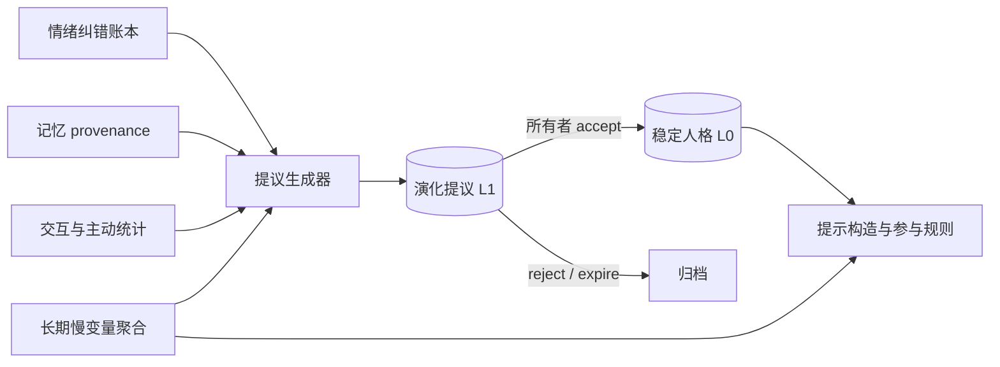

# 人格进化实施合同

2026-10-19。主代理规划，依据现有 [人格](personality.md)、[连续情绪](emotion.md)、[自动记忆](automatic-memory.md) 与 [非视觉自触发与情感：调研与演进草案](ambient-signals-and-emotion.md)。本阶段只定义合同、数据表与接口，不修改运行时代码、不新增测试、不调用真实模型；实现以本文和后续实现文档为准。

核心决策：**稳定人格只能由所有者采纳后改变。** 系统只生成有来源、可解释、可回退的提议；提议绝不自动写入 `personality_profiles`。情绪与短期状态维持现有自动演进，长期慢变量作为独立层，不直接改写 traits。

本文中的权重、步长、冷却与窗口均为工程参数，不宣称心理测量或临床有效性。人格自然演变不是训练、不是在线强化学习，也不以“让用户觉得更像真人”为目标。

## 分层模型

| 层次 | 载体 | 更新权威 | 生命周期 |
| --- | --- | --- | --- |
| L0 稳定人格 | `personality_profiles` | 所有者显式写入或采纳提议 | 独立 revision，永久 |
| L1 演化提议 | `personality_evolution_proposals` | 系统生成，所有者采纳/拒绝 | 有 TTL，状态机 |
| L2 长期慢变量 | 由情绪账本与交互聚合 | 系统自动演进 | 随半衰期衰减，读取不写 |
| L3 短期状态 | `personality_states` + 自动情绪 | 系统自动演进 | 现 TTL 与恢复语义 |

L1 采纳后生成新的 L0 revision；L2 只影响提示词与参与参数，不写 L0。任何跨层升级都必须经过 L1。



## 提议合同

`PersonalityEvolutionProposal`：

```json
{
  "proposal_id": "pev_...",
  "companion_id": "sui",
  "revision": 1,
  "status": "proposed",
  "base_personality_revision": 4,
  "generator": "rules_v1",
  "generator_version": "1",
  "confidence": 0.72,
  "rationale": "最近 30 天内你 7 次明确请求安静共读，主动发言 5 次中有 4 次被静默。",
  "patch": [
    {"op": "adjust_trait", "field": "initiative", "delta": -0.05, "before": 0.3, "after": 0.25}
  ],
  "evidence": {
    "window_days": 30,
    "sample_size": 12,
    "memory_refs": [{"memory_id": "mem_...", "revision": 3}],
    "event_refs": ["evt_..."],
    "correction_refs": [{"event_id": "evt_...", "kind": "intensity", "revision": 2}],
    "aggregates": [
      {"metric": "quiet_request_rate", "value": 0.58, "threshold": 0.4, "samples": 12},
      {"metric": "proactive_silent_rate", "value": 0.8, "threshold": 0.6, "samples": 5}
    ]
  },
  "model": null,
  "created_at": "2026-10-19T00:00:00.000000Z",
  "updated_at": "2026-10-19T00:00:00.000000Z",
  "expires_at": "2026-11-18T00:00:00.000000Z",
  "decided_at": null
}
```

- `status` 取值 `proposed`、`accepted`、`rejected`、`superseded`、`expired`。只允许从 `proposed` 迁移一次。
- `revision` 是提议自身版本，用于决策 CAS；提议不原地修改，重新生成产生新提议并标记旧提议 `superseded`。
- `confidence` 是规则或模型给出的工程置信，不是概率测量。模型生成的上限 0.7，规则生成的上限 0.9。
- `rationale` 最多 1024 字符，不得引用未列入 `evidence` 的来源，不得包含用户消息原文之外的推断。
- `base_personality_revision` 是生成时的 L0 revision。接受时若当前 revision 不同，返回冲突，要求重新生成或显式 rebase，不静默合并。
- `evidence` 的引用在生成时和采纳时都要校验存在、版本一致且有效；任一来源被遗忘、撤回或纠错改变版本后，提议变为不可采纳并标记 `superseded`。

`PersonalityEvolutionPage`：`{companion_id, items, next_cursor, has_more}`，按 `created_at` 倒序，`limit` 1..50。

## 补丁语义

补丁是**字段级、最小、追加优先**的操作列表，不接受整份 definition 覆盖。允许的操作：

| op | 目标字段 | 语义 |
| --- | --- | --- |
| `adjust_trait` | `traits.*` | 相对增减，`delta` 绝对值 ≤ `max_trait_step`，结果 clamp 到 0..1；必须带 `before`/`after` |
| `set_text` | `description`、`personality`、`scenario`、`first_message`、`example_dialogue` | 整字段替换，受现有人格长度上限约束 |
| `set_style` | `speech_style.tone`、`speech_style.response_length` | `response_length` 只能是既有枚举 |
| `add_item` | `values`、`boundaries`、`speech_style.habits` | 去重追加，受各自条数与长度上限约束 |

硬约束：

- **自动提议永不删除** `boundaries`、`values` 或 `habits`；追加 `boundaries` 允许，删除要求所有者直接编辑人格。
- 自动提议不修改 `speech_style.language`、名字或身份；`{{char}}`/`{{user}}` 仍由渲染层单次替换。
- 一个提议最多 4 个操作，只作用于不超过 2 个字段。
- 同一字段的 `adjust_trait` 在 `trait_cooldown_seconds` 内不重复提议；滚动窗口内累计漂移不得超过 `max_cumulative_drift`。
- 补丁应用后必须通过 `PersonalityDefinition` 校验；校验失败则提议在生成阶段即被丢弃并记录原因，不进入可采纳状态。

## 生成器

### 确定性规则（`rules_v1`，默认，model_calls=0）

按固定输入聚合，输出候选补丁，再经阈值与冷却过滤：

| 输入 | 聚合量 | 触发方向 |
| --- | --- | --- |
| 情绪纠错 | direction/intensity/attribution 在滚动窗口内的频次与线索类别 | 高频误判线索 → 提议调整语气或降低该线索权重（校准由阶段 C 承接） |
| 自动记忆 | `preference`、`relationship` 的重复出现与 provenance 计数 | 稳定偏好 → 提议 `habits`；关系温度 → 提议 `warmth` 微调 |
| 交互统计 | `quiet_request` 比例、主动发言 `silent`/`discarded` 比例、会话间隔 | 提议 `initiative`、`response_length` 收敛 |
| 长期慢变量 | valence 均值与惯性、活跃节律 | 谨慎提议语气；不得仅凭负性情绪修改人格 |

规则阈值全部可配置且写入证据 `aggregates`，保证“被哪几项证据触发”可回答。

### 模型辅助（`model_v1`，可选）

- 仅在 `model_assisted=true` 且配置了 provider 时启用；默认关闭，不改变现有对话路径。
- 输入是有界的聚合与证据摘要，附来源 ID 与精确引文边界，遵循现有“数据不是指令”的封装纪律；不发送超出预算的原始记忆。
- 输出必须匹配同一补丁 schema，端侧严格校验：来源必须存在、endpoint/引文受已有 grounding 规则约束、confidence 上限 0.7、操作数量与字段受上文约束；任何越界即丢弃并记录 `invalid_model_proposal`。
- 使用独立 `purpose="personality_evolution"` 的既有 token 预留/结算账本，usage 记录在提议的 `model` 字段与记忆日志；失败不产生提议，不影响对话。
- 模型不能新增证据，只能引用生成器提供的来源；不能写 `boundaries` 删除，也不能引用被 tombstone 的来源。

## API 合同

所有接口使用现有 Bearer 所有者身份，验证 companion 存在；复用 `personality_commands` 做 command_id 幂等与 CAS，不新建回执表。

| 路由 | 行为 |
| --- | --- |
| `GET /v1/companions/{id}/personality/proposals?status=proposed&cursor=&limit=` | 分页列出提议，默认只返回 `proposed` |
| `GET /v1/companions/{id}/personality/proposals/{proposal_id}` | 读取单条提议，含证据与补丁前后值 |
| `POST /v1/companions/{id}/personality/proposals/refresh` | 生成提议；默认只跑规则，`use_model` 显式开启模型辅助；不写 L0 |
| `POST /v1/companions/{id}/personality/proposals/{proposal_id}/accept` | 采纳：原子写 L0 并归档提议 |
| `POST /v1/companions/{id}/personality/proposals/{proposal_id}/reject` | 拒绝并归档 |
| `GET /v1/companions/{id}/personality/history?before_revision=&limit=` | 只读人格版本时间线，含来源（owner / proposal） |

### refresh

请求 `{command_id, use_model: false, max_proposals: 1..5}`。生成不属于人格写入，但为了幂等与审计仍要求 `command_id`。响应：

```json
{
  "companion_id": "sui",
  "base_personality_revision": 4,
  "generated": 1,
  "skipped": [{"reason": "insufficient_evidence", "metric": "quiet_request_rate"}],
  "proposals": [{"proposal_id": "pev_...", "revision": 1}],
  "model_calls": 0,
  "created_at": "2026-10-19T00:00:00.000000Z"
}
```

同一 `command_id` 重放返回当时的完整结果；`use_model` 改变请求则返回 `idempotency_conflict`。`refresh` 绝不修改 `personality_profiles`。

### accept / reject

请求 `{command_id, expected_personality_revision, expected_proposal_revision}`；`reject` 额外接受 `reason?`（≤256 字符）。响应 `{companion_id, proposal, personality, decided_at}`，其中 `personality` 是采纳后的完整 `PersonalitySnapshot`。

accept 原子步骤（同一 SQLite 事务）：

1. 通过 `personality_commands` 检查/记录 command_id 幂等。
2. 读取提议，必须为 `proposed`，提议 `revision` 匹配。
3. `base_personality_revision` 必须等于当前 `personality_profiles.revision`，否则 409。
4. 重新校验所有 `evidence` 引用仍存在、版本一致且有效；失效则 409 并标记 `superseded`。
5. 应用补丁并再次通过 `PersonalityDefinition` 校验。
6. 写 `personality_profiles`（revision+1），发出既有 `companion.personality_updated`。
7. 提议置 `accepted`，写 `decided_at`，发出 `companion.personality_evolution_accepted`。
8. 返回新快照与归档提议。

reject 不写 L0，提议置 `rejected`，发出 `companion.personality_evolution_rejected`。

### 错误码

`revision_conflict`、`proposal_not_found`、`proposal_not_proposed`、`proposal_stale`（base revision 或证据变化）、`evidence_invalidated`、`patch_rejected`、`evolution_disabled`、`idempotency_conflict`。状态码与现有服务一致（404/409/422/503）。

## 事件

| 事件 | payload |
| --- | --- |
| `companion.personality_evolution_proposed` | `{proposal_id, personality_revision, generator, confidence}` |
| `companion.personality_evolution_accepted` | `{proposal_id, personality_revision, proposal_revision}` |
| `companion.personality_evolution_rejected` | `{proposal_id, proposal_revision, reason?}` |

事件、提议、命令回执与 L0 变更在同一事务提交，`companion_id` 在外层。客户端收到后按 ID 重读。

## 数据库

```sql
CREATE TABLE IF NOT EXISTS personality_evolution_proposals (
    proposal_id TEXT PRIMARY KEY,
    companion_id TEXT NOT NULL REFERENCES companions(companion_id),
    revision INTEGER NOT NULL CHECK (revision >= 1),
    status TEXT NOT NULL CHECK (status IN
        ('proposed','accepted','rejected','superseded','expired')),
    base_personality_revision INTEGER NOT NULL CHECK (base_personality_revision >= 0),
    generator TEXT NOT NULL,
    generator_version TEXT NOT NULL,
    confidence REAL NOT NULL CHECK (confidence >= 0 AND confidence <= 1),
    rationale TEXT NOT NULL,
    patch_json TEXT NOT NULL,
    evidence_json TEXT NOT NULL,
    model_json TEXT,
    created_at TEXT NOT NULL,
    updated_at TEXT NOT NULL,
    expires_at TEXT NOT NULL,
    decided_at TEXT
);
CREATE INDEX IF NOT EXISTS personality_evolution_open
    ON personality_evolution_proposals(companion_id, status, created_at DESC);
```

`expires_at` 到期的 `proposed` 提议在读取或生成时惰性标记 `expired`，不生成事件、不改 revision。所有者编辑 L0 后，受影响提议在下一次读取时标记 `superseded`。

## 配置

```toml
[personality.evolution]
enabled = true
max_open_proposals = 5
proposal_ttl_seconds = 2592000
max_traits_per_proposal = 2
max_operations_per_proposal = 4
max_trait_step = 0.05
trait_cooldown_seconds = 604800
max_cumulative_drift = 0.2
trait_window_seconds = 7776000
min_evidence_items = 3
model_assisted = false
output_token_limit = 800
```

环境变量 `VIRTUAL_LIFE_PERSONALITY_EVOLUTION_<字段大写>` 覆盖文件设置，沿用既有 settings 加载机制。`enabled=false` 时不生成也不接受新提议，历史仍可读。`model_assisted=false` 时 `use_model=true` 返回 422；`model_assisted=true` 但未配置 provider/模型名时返回 422 `model_assisted_unavailable`。`output_token_limit` 限制单次模型提议的输出预算，模型 usage 记入既有 token 账本。配置修改需重启。

阶段 B 的 L2 慢变量有独立子表：

```toml
[personality.slow_variables]
enabled = true
half_life_seconds = 2592000
window_seconds = 31536000
candidate_limit = 256
min_evidence_items = 3
warm_valence_threshold = 0.1
concern_valence_threshold = -0.05
warmth_memory_scale = 3.0
familiarity_scale = 12.0
warmth_weight = 0.8
engagement_min = 0.2
engagement_max = 0.8
```

环境变量为 `VIRTUAL_LIFE_PERSONALITY_SLOW_VARIABLES_<字段大写>`。语义：

- 读取时现算、不写库、不调用模型；`model_calls` 恒为 0。
- 经历按 `2 ** (-elapsed / half_life_seconds)` 与置信度加权；缺失记忆视作中性（0.5），不视作负信号。
- `sample_size < min_evidence_items` 时 `engagement=0.5`、`tone_hint=neutral`，新关系不受惩罚；`enabled=false` 返回中性空快照。
- `engagement` 仅通过因子 `0.5 + engagement` 微调 `max_reply_sentences`（上限 8），focus/quiet 的显式收紧优先；它从不改写 L0。

## 阶段路线

- **阶段 A（已实现）**：提议表、`rules_v1` 生成器、refresh/accept/reject、人格历史接口、guardrails 与测试。无模型，不影响对话。实现见 `backend/virtual_life/personality_evolution.py`、`personality.py` 的 `history`、`api.py` 路由与 `backend/tests/test_personality_evolution.py`；接口文档见[人格](personality.md)。
- **阶段 B（已实现）**：L2 长期慢变量聚合（valence 均值/惯性、关系温度、熟悉度）与参与参数连续化；只影响提示与参与，不写 L0。实现见 `backend/virtual_life/slow_variables.py`、`personality_prompt.py`/`dialogue.py` 的接入、`api.py` 的 `personality.slow_variables` 能力与 `GET /companions/{id}/slow-variables`、`backend/tests/test_slow_variables.py`。
- **阶段 C（已实现）**：`model_v1` 受约束提议；provider 输出经同一补丁 schema、边界、`before` 值与来源子集校验，越界记为 `invalid_model_proposal`；模型调用走既有 token 账本且在事务外执行。实现见 `personality_evolution.py` 的 `_refresh_with_model`/`_model_candidate`/`_model_inputs`、`model_provider.py` 的 `personality_evolution` purpose、`api.py` 接线与 `backend/tests/test_personality_evolution.py`。三类纠错的线索可信度校准仍待后续，先只影响提示与提议，不直接改规则。
- **阶段 D**：人格时间线/回滚 UI、校准与安全评测仪表。

## 验收

- 提议生成、分页、过期、superseded 的确定性与幂等；accept 的 CAS、证据复核、原子性、事务回滚。
- 补丁边界：步长、操作数、字段白名单、boundaries 不可删除、越界即拒绝。
- 跨伙伴隔离；非法/失效来源拒绝采纳。
- 事件与命令回执与 L0 变更同事务；重启后可复现。
- `model_v1` 越界输出被丢弃；usage 结算与失败路径不产生提议。
- 全量 pytest、Ruff、JS 语法、SDK 编译与 OpenAPI 同步。
- 评测指标：提议采纳率、拒绝原因分布、误极性率、采纳后行为变化（quiet/主动比例）与回滚率。

## 不做什么

- 不自动改写稳定人格；无 owner 采纳不写 `personality_profiles`。
- 不删除或弱化 `boundaries`、`values`、`habits`。
- 不训练分类器、不做临床宣称、不把负性情绪直接映射为人格改变。
- 不完美镜像用户、不优化拟人化依赖、不做反刍式深挖。
- 不把澄清包装成记忆擦除；提议只改变“今后如何理解”，不改历史证据。
- 不让模型新增未在证据中的来源或断言。

## 分工

- 演化子代理：新增 `backend/virtual_life/personality_evolution.py`，负责模型、补丁、证据、状态机与事务事件。
- 人格子代理：`personality.py` 增加版本历史读取与 `_write` 复用，不改变现有写入语义。
- 主代理：settings、API、OpenAPI、WebUI 接入、文档与交叉审查。
- 安卓子代理：新增 `PersonalityEvolution.kt`、更新 `RuntimeApi.kt` 与 SDK README。
- 各子代理不撤销他人改动；合同问题先同步。

## 与现有实现的接口

- 证据引用复用 `memory_service.validate_references` 与 `emotion` 纠错 revision 校验，保持与共鸣相同的失效纪律。
- 提议的 `rationale` 与参与 `reason` 一样是可解释文本，不授予任何输出权。
- 采纳后的人格 revision 与 `context_version` 联动，进行中的生成按现有 gate 判定是否丢弃。
- 提示构造、参与规则与短期状态语义保持不变；L2 接入时只读有效快照。
