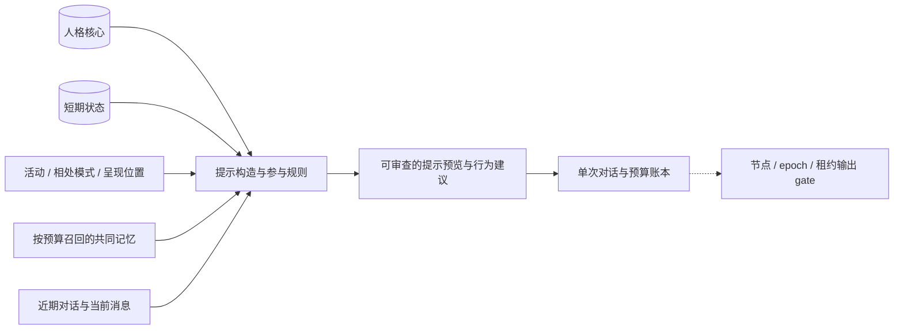

# 基础人格：角色设定、短期状态与陪伴行为

自动连续情感已接入对话与提示，详见[情感状态与记忆共鸣](emotion.md)。原手动状态及 TTL 接口保留；自动状态通过独立情感接口读取。

人格由生命体主服务器保存，绑定 `companion_id`。设备提供感知与呈现；切换设备后读取同一份人格、当前状态和共同记忆。角色定义、短期状态、参与规则和提示预览由本地服务提供；[单次文本对话](webui.md)复用这些材料调用配置的模型。

## 参考与取舍

[SillyTavern 角色设计](https://docs.sillytavern.app/usage/core-concepts/characterdesign/)使用描述、性格、场景、开场白和示例对话定义角色；描述、性格与场景会持续占用上下文。[Prompt Manager](https://docs.sillytavern.app/usage/prompts/prompt-manager/)控制提示组成与顺序。[Character Card V2](https://github.com/malfoyslastname/character-card-spec-v2/blob/main/spec_v2.md)提供 JSON 交换格式和扩展字段。

本项目借鉴角色卡与提示组合，增加持续陪伴需要的状态和行为约束。以下分层属于本项目设计，不是酒馆已经实现的生命体机制。

| 层次 | 第一版实现 | 生命周期 |
| --- | --- | --- |
| 稳定人格 | 描述、性格、价值取向、表达风格、五项行为偏向 | 所有者显式编辑，独立 revision |
| 当前状态 | 情绪、精力、社交精力、来源与有效期 | 独立 revision；过期回到中性默认值，保留原记录 |
| 关系与经历 | 现有 fact、preference、relationship、episode | 来源可追溯，按需召回 |
| 参与选择 | quiet / focus / chat / away、用户是否主动、输出条件与当前状态 | 本地规则；预览不发起模型或输出 |



默认示例延续“随”：温和、好奇、有自己的判断，愿意安静共读；用户忙于维护设备时保持陪伴。数值偏向用于可解释规则和表达提示，不代表经过心理学测量的人格。

## 人格定义合同

`PersonalityDefinition` 使用以下完整替换模型；省略字段采用默认值，拒绝未知原生字段：

```json
{
  "description": "{{char}} 是陪你共读、生活和照看设备的虚拟伙伴。",
  "personality": "温和而独立，对你的想法和周围事物保持好奇。",
  "values": ["尊重你的节奏", "诚实表达自己的判断", "珍惜共同经历"],
  "boundaries": ["不编造共同经历或未取得的视觉信息", "不把设备在线等同于你正在关注它"],
  "traits": {"warmth": 0.7, "curiosity": 0.7, "assertiveness": 0.6, "playfulness": 0.3, "initiative": 0.3},
  "speech_style": {"language": "zh-CN", "tone": "温和、自然，有自己的观点", "response_length": "brief", "habits": []},
  "scenario": "随着你在设备间移动，接续当前活动。",
  "first_message": "我在。想一起读一会儿，还是先安静待着？",
  "example_dialogue": "<START>\n{{user}}: 今天有点累。\n{{char}}: 那我们先安静待一会儿，不急着追下一件事。",
  "alternate_greetings": []
}
```

五项 traits 是 0..1 的有限数。描述最多 4096 字符、性格 2048、场景 2048、开场白 1024、示例 4096；values / boundaries / habits 各最多 8 条，每条 128 / 128 / 160 字符；备用开场白最多 8 条，每条 1024。language 最多 64、tone 最多 512；response_length 为 `brief`、`balanced` 或 `detailed`。整个定义受现有 65,536 字节、32 层 JSON 边界约束。

名字使用现有 `companion.name`，身份使用 `companion_id`。编辑人格和导入角色卡都不会生成另一个身份。未配置人格时 GET 返回中性、友好的默认定义、revision=0、configured=false，不在读取时写入数据库。

`PersonalitySnapshot`：`{companion_id, revision, configured, definition, source_card, import_warnings, created_at, updated_at}`。source_card 是原始导入 JSON 或 null，归档字段不参与提示构造。首次显式写入 revision=1。更新体为 `{command_id, expected_revision, definition}`，revision 不匹配返回 409；相同命令重试返回原结果，换 payload 返回 idempotency_conflict。

未配置人格的 created_at / updated_at 为 null。人格和状态版本都是非负 64 位整数，互不影响 companion 的活动 revision 或迁移 epoch。人格命令表中的 command_id 在所有人格编辑、导入、状态更新和 companion 之间唯一；它与既有节点、记忆命令表分别存储。重放返回当时的完整回执，需要当前状态时再次 GET。

## Character Card V2 导入

导入体 `{command_id, expected_revision, card}`；card 是有限 JSON 对象，`spec="chara_card_v2"`、`spec_version="2.0"`，data 至少包含字符串 name、description、personality、scenario、first_mes、mes_example。已出现的标准元数据须具有正确基本类型。初版只接收 JSON，不读取 PNG、下载资产或执行脚本。

- description / personality / scenario 对应同名原生字段；first_mes 对应 first_message，mes_example 对应 example_dialogue；alternate_greetings 映射为备用开场白。
- traits、values、boundaries、speech_style 使用原生默认值，再由所有者显式编辑。
- 完整原卡及未知 extensions 保存在 source_card，不丢弃原始资料。后续编辑原生定义时仍保留这份导入归档；它不是当前人格的导出结果。
- 卡片 name 作为来源保存；模板 `{{char}}` 使用现有 companion.name。名字不同时返回固定警告码。
- system_prompt、post_history_instructions、character_book 与其他扩展保留但不激活；非空时返回相应警告。角色卡中的提示覆盖不能修改运行时控制规则。当前不是完整酒馆兼容引擎。

固定警告码为 `card_name_differs`、`system_prompt_ignored`、`post_history_instructions_ignored`、`character_book_ignored`、`extensions_ignored`。已有字符串元数据、字符串数组、extensions 对象及 character_book 中出现的标准字段须有正确基本类型；归档子集允许缺失未使用的字段。字段映射后仍须符合原生人格长度上限。

模板仅单次替换 `{{char}}` 与 `{{user}}`；其他宏保持文本，不执行表达式、递归替换或工具调用。示例对话是风格材料，不作为真实共同经历。

## 短期状态

`PersonalityState`：`{mood, energy, social_battery}`。mood 为 `calm`、`cheerful`、`curious`、`concerned` 或 `tired`；energy 和 social_battery 为 0..1，默认 0.8 / 0.7，默认 mood=calm。

写入体 `{command_id, expected_revision, state, ttl_seconds: 1800, source_event_id?}`。TTL 为 30..86400 秒；来源事件若提供必须存在，且不能属于另一个 companion。状态由所有者或后续行为任务显式更新，本阶段不在心跳或每轮对话中自动推断情绪。

`PersonalityStateSnapshot`：`{companion_id, revision, state, recorded_state, expired, source_event_id, expires_at, updated_at}`。state 是当前有效状态；过期返回中性默认值，recorded_state 保留最后写入值，revision 不回退。首次未配置时 revision=0、recorded_state=null、expired=false。读取和自然过期不写数据库、不生成事件。

未配置状态的 source_event_id / expires_at / updated_at 为 null。状态来源可以是未绑定 companion 的节点观察事件；引用其他 companion 的事件返回 `source_event_conflict`。服务保留来源，不将状态情绪宣称为对用户心理的测量。

人格与状态写入各自的表，与自己的命令回执和事件在同一 SQLite 事务中提交。事件为 `companion.personality_updated`（payload `{personality_revision}`）和 `companion.personality_state_updated`（payload `{state_revision, expires_at}`），companion_id 放在事件外层。客户端收到后按 ID 重新读取最新记录。

## 提示预览与成本

请求 `PersonalityPreview`：`{user_message, user_name: "你", user_initiated: true, audio_requested: false, history: [], token_budget: 3072, memory_token_budget: 800, max_memory_items: 8}`。history 最多 20 条，只接受 user / assistant 与 content；每段最多 4096 字符，整请求受 bounded JSON 限制。当前消息与历史内容都会去空白且必须为 1 到 4096 字符，user_name 最多 128。预算为整数；运行时策略默认人格核心上限 1200、总预览上限 4096，记忆沿用现有召回策略上限。

提示构造采用明确顺序：稳定身份与人格指令、当前模式与有效状态、活动与上下文事实、慢变量、可选心理活动、相关记忆、可选示例、近期对话、当前用户消息。JSON 数据和风格示例用固定标签包裹，提醒后续模型保留来源边界；此格式不能代替模型执行器的权限和输出校验。

人格核心、当前模式/状态和当前消息完整保留；基础块超出预算返回 422，不静默截断人格或当前消息。可选块按剩余预算整块加入；工作上下文受控序列化，原始 source_card 不入提示。记忆只保留真正进入 context_text 的项与 memory_refs；近期历史优先保留最近连续片段，避免把中间被省略的内容看作完整对话。最终重新估算完整 context_text，包括标题和分隔符，不能仅相加各块估算。

检索 query 使用当前消息的前 2048 字符，以满足现有召回合同；当前消息在提示中仍完整保留。最终记忆数据块的标题、元数据与分隔符也计入 memory_token_budget。`omitted_sections` 标记 `activity_context`、`slow_variables`、`inner_activity`、`memories`、`style_examples` 或 `history` 的预算舍弃；`truncated` 表示已提供或已召回材料未能完整进入提示，不表示整个记忆库被全部载入或历史全部召回。

`PersonalityPolicy` 默认 `{max_personality_tokens: 1200, max_prompt_tokens: 4096}`，可通过 create_app 注入，与 TokenEstimator 共用。估算是近似值，不等于真实模型计费。预览不预留模型额度、不调用提供商、不写共同记忆；DialogueService 按现有 token 账本预留与结算。

响应 `PersonalityPreviewResult`：`{companion_id, personality_revision, state_revision, companion_revision, epoch, active_node_id, context_text, estimated_tokens, token_budget, truncated, omitted_sections, memory_refs, memory_versions, participation, model_calls: 0, emotion, slow_variables, inner_activity}`。MEMORY_DATA 可包含原始记忆、派生摘要与图谱关系。memory_versions 是实际入提示记录及派生项支持记录的 `{memory_id, revision}` 去重并集；支持正文不一定全部进入提示。对话在发送前与提交回复时核验引用仍存在、版本相同且有效。

响应另含 `entity_versions`，汇总实际入提示图谱关系的 `{entity_id, revision}`；对话同样前后核验实体版本，别名修改或撤回会阻止旧图谱解释继续输出。预览可使用已有查询向量缓存，保持 model_calls=0；实际对话的付费查询向量由单独 `memory_retrieval` 描述，详见 [向量记忆与图谱](vector-memory-and-graph.md)。

participation 是 `{respond, allow_audio, presence, max_reply_sentences, reason, tone}`。输出条件由主服务器按当前 active_node、epoch 和租约、节点在线与输出能力计算，不接受客户端自报的 output_permitted。规则先检查输出条件和 away；显式用户互动可以回应，focus 时简短。非主动的 quiet / focus 保持安静；chat 仅在 initiative>=0.65、energy>=0.35、social_battery>=0.25 时建议参与。音频只在用户主动请求、节点具有音频能力时建议允许。presence 随有效情绪选择安静、留意、好奇或关切，输出条件不足时为 `none`。

presence 的固定值为 `none`、`quiet`、`attentive`、`curious`、`concerned`；calm / tired 对应 quiet，cheerful 对应 attentive。reason 使用 `output_not_permitted`、`companion_away`、`user_requested`、`waiting_for_user`、`initiative_below_threshold`、`energy_below_threshold`、`social_battery_below_threshold`、`chat_participation`。表达长度 brief / balanced / detailed 分别建议最多 2 / 4 / 8 句，focus 至多 2 句，静默为 0。`tone` 随有效情绪给出表达倾向（`neutral`/`warm`/`inquisitive`/`soothing`/`subdued`/`playful`/`animated`/`wondering`/`gentle`/`terse`/`confident`）：cheerful→warm、curious→inquisitive、concerned/sympathetic→soothing、tired→subdued、amused→playful、excited→animated、surprised→wondering、proud→confident、annoyed→terse，其余 neutral；情绪驱动回复长度：cheerful/amused/excited/proud 建议 +1 句，concerned/tired/sympathetic/annoyed −1 句（仍限 1..8，显式 focus/quiet 收紧优先）。

这些是本地预览建议，不授予输出权。单次文本执行在模型完成时重新检查人格版本、有效状态、companion revision、epoch 和新鲜租约，再交给宿主 gate；自动对话的候选与门控由 [主动陪伴](proactivity.md) 提供，限频调度在主动策略中按冷却与每日限额执行。

## HTTP 与模块分工

| 接口 | 用途 |
| --- | --- |
| GET /v1/companions/{id}/personality | 获取人格或默认值 |
| POST /v1/companions/{id}/personality | 显式替换定义，CAS + 幂等 |
| POST /v1/companions/{id}/personality/import | 导入 V2 JSON 子集，保存原卡 |
| GET /v1/companions/{id}/personality/state | 获取有效短期状态与原记录 |
| POST /v1/companions/{id}/personality/state | 显式更新短期状态，CAS + 幂等 |
| POST /v1/companions/{id}/personality/preview | 本地参与建议与预算内提示 |

人格编辑与状态更新属于所有者配置接口，使用现有 Bearer 身份，不需要设备输出租约。迁移和角色输出仍使用既有协议。

PersonalityService(database_path, clock=None) 导出 get(companion_id)、update(companion_id,payload)、import_card(companion_id,payload)、get_state(companion_id)、update_state(companion_id,payload)、history(companion_id, before_revision=None, limit=20)。导出上述 Pydantic 定义/请求/响应与 PersonalityError(status_code,code,message)。SQLiteStore 提供事务；服务拥有 personality_profiles、personality_states、personality_commands、personality_profile_revisions 表，使用既有 events 表发布事件。

PersonalityPromptBuilder(memory_service, policy=None, token_estimator=None) 导出 preview(companion_snapshot, personality_snapshot, state_snapshot, payload, *, output_permitted=False, host_allows_audio=False)。导出 PersonalityPreview、PersonalityPolicy、PersonalityPreviewResult 与 ParticipationPreview。传输层读取现有节点/租约，并只传入服务端计算的输出条件；构造器不持有或修改节点输出权。

- 人格子代理：仅 `backend/virtual_life/personality.py`，负责模型、导入、存储、版本与事务事件。
- 提示子代理：仅 `backend/virtual_life/personality_prompt.py`，负责模板、参与规则、可追踪预算与预览。
- 安卓子代理：仅新增 `clients/android-node/src/main/kotlin/dev/virtuallife/node/Personality.kt`、更新 RuntimeApi.kt 与 SDK README，负责类型与接入方法。
- 主代理：调研、合同、API 整合、示例、OpenAPI 与项目文档。

各子代理不撤销他人改动；合同问题先同步。按用户要求尝试 DeepSeek；不修改已有 AGENTS.md。此阶段只做静态检查、编译和接口定义导出，不新增或运行测试，也不调用真实模型。

## 示例与后续接入

完整 V2 JSON 示例见 [sui.v2.json](../examples/character_cards/sui.v2.json)。主服务启动后可运行：

```bash
uv run python examples/personality_preview.py --show-prompt
```

此脚本创建独立的演示节点和 companion，导入并编辑角色定义、更新短期状态，显式记录一条共读经历，再展示 quiet / focus / chat 的参与建议和预算提示。它会写入演示数据，无实际角色渲染或模型调用；当前阶段未执行该脚本。

ModelProvider 的单次对话执行已在 [WebUI 阶段](webui.md)接入：使用本预览的版本与记忆引用，预留任务 token，调用后结算实际 usage，并在呈现前重新验证节点、epoch 与租约。下一步再接可取消的对话、参与限频、经历筛选和用户发起的视觉感知。

## 人格进化（阶段 A）

人格自然演变以“有来源的提议”实现，稳定核心只能由所有者显式采纳后改写。分层模型、补丁语义、栅栏规则与后续阶段（长期慢变量、模型校准）的完整合同见[人格进化实施合同](personality-evolution-plan.md)。

PersonalityEvolutionService(personality, emotion, memory, policy=None, provider=None, model_name="", token_estimator=None) 导出 list、get、refresh、accept、reject；它复用 PersonalityService 的 personality_commands 幂等、personality_profiles 原子写与 events 事件发布，只新增 personality_evolution_proposals 表。规则生成器 `rules_v1` 完全本地、`model_calls=0`：`quiet_request_rate` 与 `proactive_silent_rate` 超阈值时提议下调 `traits.initiative`（步长与累计漂移受限），`correction_rate` 记为 `calibration_requires_phase_c`，`preference_repeat` 记为 `model_semantics_required`。

HTTP 接口（均为所有者配置接口，复用 Bearer 身份，不需要输出租约）：

| 方法 | 路径 | 行为 |
| --- | --- | --- |
| GET | `/v1/companions/{companion_id}/personality/history` | 按 revision 倒序的只读定义历史，`before_revision` + `limit` 分页；迁移前数据库合成一条 `pre_migration` 条目 |
| GET | `/v1/companions/{companion_id}/personality/proposals` | 提议列表，`status`、`after_sequence`、`limit` 过滤；读取时惰性标记过期/被取代 |
| POST | `/v1/companions/{companion_id}/personality/proposals/refresh` | 从本地证据生成提议，幂等；返回 `generated`、`skipped` 与提议 |
| GET | `/v1/companions/{companion_id}/personality/proposals/{proposal_id}` | 单个提议 |
| POST | `/v1/companions/{companion_id}/personality/proposals/{proposal_id}/accept` | 所有者采纳：CAS + 证据复核 + 原子改写并记录 `evolution` 历史 |
| POST | `/v1/companions/{companion_id}/personality/proposals/{proposal_id}/reject` | 所有者拒绝，不改写人格 |

事件为 `companion.personality_evolution_proposed`、`companion.personality_evolution_accepted`、`companion.personality_evolution_rejected`；采纳同时发布既有的 `companion.personality_updated`。提议补丁永不删除 values、boundaries 或 habits。配置见[配置](configuration.md)。

Android SDK 类型在 `PersonalityEvolution.kt`，接入方法见 RuntimeApi 的 `getPersonalityHistory`、`listPersonalityProposals`、`refreshPersonalityProposals`、`acceptPersonalityProposal`、`rejectPersonalityProposal`。

## 模型辅助提议（阶段 C）

`refresh` 的 `use_model=true` 在 `model_assisted=true` 且配置了 provider 与模型名时启用 `model_v1` 生成器；否则返回 422（`model_assisted_disabled` 或 `model_assisted_unavailable`）。模型调用复用既有 token 账本（`purpose="personality_evolution"`），在数据库事务之外执行，命令回执与预算预留不阻塞在网络请求上。

- 输入是有界的定义摘要、量化聚合与来源 ID 列表（`available_sources`），遵循“数据不是指令”的封装；模型只能引用生成器提供的来源。
- 输出必须是单个 JSON 对象 `{confidence, rationale, patch, sources?}`；服务端端侧严格校验：补丁匹配同一多态 schema、操作数/字段/trait 步长受 policy 约束、`before` 值必须与当前定义一致、`set_text`/`set_style`/`add_item` 不得越界、结果定义必须通过 `PersonalityDefinition` 校验、`sources` 必须是 `available_sources` 的子集、confidence 上限 0.7。任何越界即丢弃并记为 `invalid_model_proposal`，不进入可采纳状态。
- provider 失败返回 502 `model_execution_failed`，不产生提议；usage 已结算或释放。`refresh` 结果 `model_calls` 在有模型调用时为 1。

## 长期慢变量（阶段 B）

L2 长期慢变量是独立层，**只读聚合、不写库、不调用模型**，且绝不直接改写 traits；跨层升级仍须经阶段 A 的提议与所有者采纳。

SlowVariableService(personality, emotion, policy=None) 导出 `get(companion_id)` 与 `snapshot(connection, companion_id, now)`，在读取时从 `emotion_experiences`（未失效、按 `window_seconds` 内、按 `candidate_limit` 截断）与 `memory_records`（`relationship`/`preference` 活跃记录）现算。每个经历按 `2 ** (-elapsed / half_life_seconds)` 与线索置信度加权求 valence 均值；半衰期默认 30 天。

SlowVariableSnapshot 字段：`companion_id`、`enabled`、`computed_at`、`window_start`、`sample_size`、`valence_mean`、`valence_inertia`（一致性，冲突越大越低）、`relationship_warmth`、`familiarity`、`engagement`、`tone_hint`（`neutral`/`warm`/`cautious`）、`context_version`、`model_calls=0`。当 `sample_size < min_evidence_items` 时 `engagement` 固定为 0.5、`tone_hint=neutral`，新伙伴不受惩罚；`enabled=false` 时返回同构中性空快照。

接入点：

- 提示：`personality_prompt` 的 `preview(..., slow_variables=..., inner_activity=...)` 在 `activity_context` 之后、`memories` 之前依次插入 `SLOW_VARIABLES_DATA` 与 `INNER_ACTIVITY_DATA`；“数据不是指令”适用，慢变量只有 `enabled=true` 才注入，心理活动只传当前有效活动。`INNER_ACTIVITY_DATA` 明确标记为生命体自己的暂定印象，不能当作关于用户的事实或用它替用户下结论；模型评判的 `model.rationale` 仅供审计，不进入提示。
- 参与：`ParticipationPreview` 新增 `engagement`，仅微调 `max_reply_sentences`（因子 `0.5 + engagement`，上限 8），显式的 focus/quiet 收紧仍然优先；新增 `tone`，随有效情绪给出表达倾向，并由情绪驱动回复长度（正向 +1 / 负向 −1 句，限 1..8）。对话路径在事务内计算快照并传给三处预览。

HTTP 接口（所有者配置接口，复用 Bearer 身份，不需要输出租约）：

| 方法 | 路径 | 行为 |
| --- | --- | --- |
| GET | `/v1/companions/{companion_id}/slow-variables` | 只读快照；读取不改写人格、情绪或记忆 |

能力声明为 `personality.slow_variables`（`enabled`、`read_only=true`、`affects="prompt_and_participation"`、`policy`）。配置见[配置](configuration.md)。Android SDK 类型在 `SlowVariables.kt`，接入方法见 RuntimeApi 的 `getSlowVariables`。
