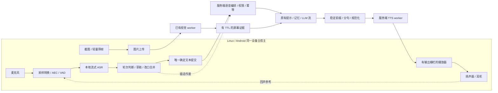
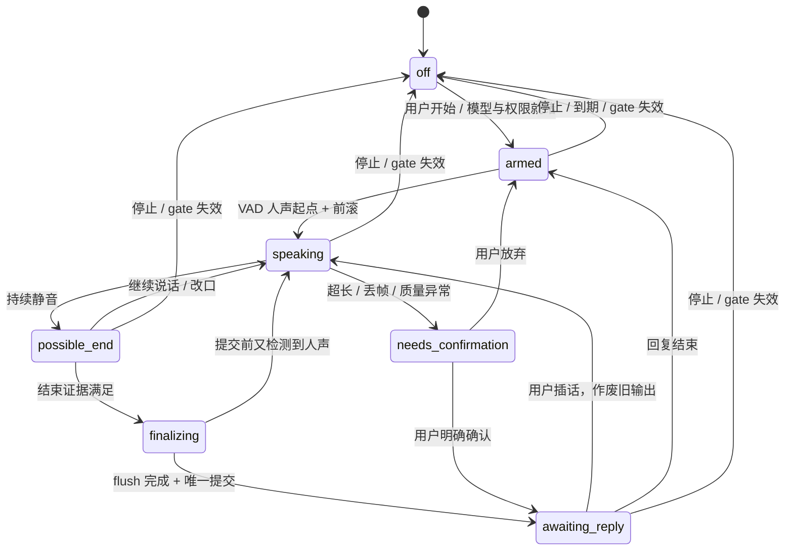

# 连续语音对话、TTS 与 Linux / Android 客户端实施规划

日期：2026-10-18。状态：**待实施的执行合同**。本文只交付规划，不表示语音链路、取消接口或新 Android 客户端已经实现。执行代理应先核对实际代码，再更新实施状态和验收报告。

目标：显式开启一次对话后，用户可以持续自然说话、停顿、补充、打断伙伴；客户端在合适的时机提交确定文本，服务端流式生成回复并分段合成语音，客户端尽早播放。随后把这条链路接入 Linux 和 Android，统一采用 **端侧 ASR，服务端视觉理解，服务端 TTS，端侧播放**。

## 1. 已确定的方向与交付顺序

### 1.1 不再沿用的旧方向

- [旧语音调研](local-realtime-speech-research.md)建议“设备采音 → 主服务器 ASR”，本次改为**设备本地完成 ASR 和轮次判断，只向服务端上交文本与必要元信息**。默认路径没有麦克风音频上传接口，也不在识别失败时暗中切换云端。
- 原 Android Demo 在手机执行 MNN 视觉推理；新主客户端改为**取屏、可选轻量筛帧、上传，服务端理解**。手机不再必须下载视觉大模型。
- 服务端屏幕视觉已经存在，不要依据旧规划的“待实施”重新造一套接口。Linux 的截图上传也已经存在，本次在其上整合。
- “按住说话、松开提交”是诊断和兜底模式，**显式开启后的连续自动交谈是本次主交付**。不能做完录音按钮就宣称实时对话完成。

### 1.2 阶段与完成定义

| 阶段 | 产物 | 进入下一阶段的条件 |
| --- | --- | --- |
| A：语音合同与 TTS | 键盘输入 → 现有 LLM → 分句合成 → 播放、有界合成适配器与取消合同 | 无须先有 ASR 即可真实播音，不会重复朗读累计 delta，旧输出可立即失效 |
| B：连续对话核心 | 端侧 ASR / VAD 抽象、轮次状态机、文本提交、服务端作废与新轮隔离 | 停顿续说、改口、插话、断线场景自动测试通过 |
| C：Linux 接入 | daemon 持有音频资源，CLI / TUI 操作，本地识别、实时播放、沿用截图上传 | 真实模型文件可加载；有硬件时完成持续交谈实测 |
| D：Android 接入 | 保持 JVM SDK，新增 Android 宿主，AudioRecord / AudioTrack、端侧 ASR、服务端视觉 | SDK / APK 编译与测试通过；真机项独立标注 |
| E：整体验收 | 复现脚本、测量报告、安装与配置、未验证项、交接清单 | 假链路与真实链路证据分开，任何缺项有明确位置 |

先完成服务端和跨平台合同，再做 Linux，最后 Android；基础合同冻结后可以并行实施两个宿主，禁止各自设计不同的 wire schema。

## 2. 当前仓库基线：哪些复用，哪些新增

| 位置 | 当前事实 | 本次动作 |
| --- | --- | --- |
| `backend/virtual_life/dialogue.py` | `DialogueService` 有持久命令、预算、文本流、最终输出 gate；公开 `DialogueRequest` 强制 `audio_requested=false` | 复用执行与结算；新增内部 voice 入口与作废栅栏，不复制整套 LLM / 记忆流程 |
| `backend/virtual_life/dialogue_stream.py` | SSE 订阅断开后工作继续；`result` 结束旧文本流 | 保持原合同；语音自己的事件流允许在 `dialogue_result` 后继续下发已合成音频信息 |
| `backend/virtual_life/ports.py` | `SpeechProvider.synthesize` 只是整段合成协议，没有实际接线 | 为其提供真实适配器；分句调度先复用整句合成，可另加可选 PCM 回调接口 |
| `backend/virtual_life/model_provider.py` | 真流式 LLM、严格解析、用量证据和有限输出 | 增加可检查的取消信号；允许旧请求作废后仅收尾结算 |
| `backend/virtual_life/presentations.py` | 原生 presentation 的 kind 当前只允许 `terminal` | 新增有类型的 `android` kind；保留单设备原生 / Web 互斥、TTL 与输出校验 |
| `backend/virtual_life/screen_*` | 已有会话、图片上传、去重、worker、状态与 TTL | 沿用；增加对话中的有来源视觉引用，不阻塞普通语音轮次 |
| `backend/virtual_life/node_credentials.py` | reporter 是限权遥测凭据 | 不升级 reporter；原生主宿主沿用现有 owner 凭据，账号配对另期处理 |
| `clients/linux-node/` | 完整 daemon、Unix socket IPC、CLI / TUI、presentation / lease，以及 `screen_client.py` | 在主 daemon 扩展语音；不要给 `system-node` 安装包塞入录音器 |
| `clients/android-node/` | Kotlin JVM8 SDK，OkHttp、协程、协议与 LeaseGate，宿主负责权限和呈现 | 新增纯 Kotlin 语音协议 / 传输类型，继续不依赖 `android.*` |
| `clients/android-vision-demo/` | 独立 Shizuku + 本地 MNN APK，没有完整节点主宿主 | 保留为历史独立 Demo；新建 `clients/android-app/` 作为主客户端 |
| `docs/screen-vision.md` | 后续记录已有真实视觉调用，部分早期段落仍保留 fake-only 描述 | 执行时按实际代码与报告更新，不能把历史描述混作当前能力 |

特别注意：当前原生对话仍要求在线 `text.display`，第一版语音宿主保留字幕 / 文本呈现与有效 presentation。无屏音箱和纯后台音频节点不在本次范围内，不以虚报显示能力绕过 gate。

前置阅读：[AGENTS.md](../AGENTS.md)、[节点协议](protocol.md)、[流式对话](dialogue-streaming.md)、[设备身份](device-identity.md)、[Linux 合同](linux-client-contract.md)、[屏幕视觉](screen-vision.md)、[自动记忆](automatic-memory.md)。

## 3. 整体架构与职责



| 能力 | 端侧 | 服务端 |
| --- | --- | --- |
| 采音、设备路由、重采样、回声消除 | 必须 | 默认不接收输入音频 |
| VAD、流式识别、局部草稿、候选结束、最终文本 | 必须 | 验证输入范围与会话，不能假装重新确认用户声学意图 |
| 自然轮次判断 | 本地状态机；可选本地小模型增强 | 接受最终轮次，不轮询文本 LLM 判断每个 partial |
| 对话、人设、记忆、预算、文本生成 | 展示状态与字幕 | 原有服务扩展 |
| TTS | 播放、缓冲、进度与本地停止 | 默认合成与声音配置 |
| 屏幕视觉 | 取屏、遮蔽、压缩、上传 | 主要理解与跨帧状态 |
| 中断 | 本地先停播，立即清空旧播放队列 | 持久作废旧输出，尽力终止上游，保留已发生用量 |

一台设备只有一个主宿主注册 / 心跳 / 续租写入者。麦克风、ASR、截图器和播放器是宿主模块，不注册独立设备节点。服务端 ASR、端侧视觉模型均不是默认依赖。

## 4. 技术选型与模型交付

### 4.1 ASR：同一技术栈，平台独立资源适配

默认采用 **sherpa-onnx 的流式识别运行时**，先对照中文 int8 Zipformer 与中英 Streaming Paraformer，确定一个实际跑通的默认包。官方提供流式 Paraformer 及 endpoint 配置，endpoint 只是解码器边界，不能替代下文用户轮次状态机。[官方模型与配置](https://k2-fsa.github.io/sherpa/onnx/pretrained_models/online-paraformer/paraformer-models.html)

- 先候选 `sherpa-onnx-streaming-zipformer-zh-int8-2025-06-30`；若导出包 / 目标 ABI 不可用，选官方仍可下载的中文或中英流式包，写明替换原因和固定版本。
- Linux 用独立音频 worker / 可选依赖环境运行，Android 用同版本 JNI / AAR 封装；平台间共享模型清单和语义，不要求 Python 和 Kotlin 共用二进制文件布局。
- CPU 为默认；不依赖服务器 P40，不为端侧识别安装 CUDA。优先保证实时系数、单路隔离和温控。
- 所选模型必须支持真正的增量解码；反复转写整段录音只能作为对照，不能冒充同样的默认流式实现。
- ASR 事件统一为 `speech_start / hypothesis / segment_end / speech_end / discontinuity / error`，携带本地单调采样位置、解码 revision、segment_id；不要要求每款引擎提供不存在的置信度。
- 中英术语、人名、伙伴名用受支持的热词功能或明确文本纠正 UI。未经证实不做“LLM 猜错字”并悄悄替换用户意思。

### 4.2 VAD 与轮次增强

VAD 首选 Silero ONNX 或同运行时已支持、经过中文录音验证的轻量 VAD。采音帧、VAD 窗口、ASR chunk 是三个独立缓冲层，不能用同一个常量代替。

可选增强选本地 Smart Turn CPU ONNX。官方说明支持中文和 CPU 模型；这证明可作为候选，不证明在本项目手机上达到某个延迟或准确率。[Smart Turn 官方说明](https://github.com/pipecat-ai/smart-turn/blob/main/README.md)

第一晚必须实现规则状态机和可插拔 `TurnEndDetector`；若小模型在两端均易部署，可接入并单独测量。它加载失败时回到规则和手动提交，不能阻塞主链路，也不能上传音频交给服务端代判。

### 4.3 TTS：服务端本地、分句流水线为基线

首选 **sherpa-onnx + Kokoro 中文 / 中英模型**作为开箱可复现的本地基线。官方 `kokoro-multi-lang-v1_1` 页面明确提供中文 / 英文、24 kHz 输出及 Python / Kotlin 等示例；此处选择是部署判断，尚未测本项目音质和实时系数。[官方模型与 API](https://k2-fsa.github.io/sherpa/onnx/tts/all/Chinese-English/kokoro-multi-lang-v1_1.html)

- 在独立 Python 3.12 worker 环境运行；不要因主 API 解释器新而强行改全仓 Python 版本。最终固定实际可用的 runtime / ONNX 版本，记录锁定文件与启动命令。
- `SpeechProvider` 仍可整句返回音频，编排层逐句并行于 LLM 生成。**这是文本分句后的流水线合成，不宣称模型本身支持逐 token 生成波形。**
- 可另加 `StreamingSpeechProvider` PCM 回调，只有确实支持的适配器才声明 `waveform_streaming=true`。
- 实际声线由 `voice_id` 配置，提供试听与明确选择；默认不克隆声音、不收集声纹。人设情绪只影响有界语速等允许参数，不靠夸张随机变速制造“情绪”。
- 保留独立远程 TTS 适配器接口，但第一晚只要求一个真实可运行的本地实现。远程方案有明确配置才启用，密钥只在服务器，不为完成任务临时绑定外部账户。

### 4.4 模型和依赖清单

新增模型 manifest 与下载 / 校验脚本，每项包含 `model_id / revision / source_url / files / sha256 / sample_rate / language / runtime_version / license_reference`。哈希必须来自实际文件或可信清单，不填占位摘要。运行时代码许可与模型 checkpoint 许可分别记录。

模型放 `.data/` 或用户缓存，不提交权重、APK、AAR 下载缓存和构建产物；导入 SDK 或启动普通文本 API 时不自动下载权重。提供 `doctor` 检查缺文件、摘要、ABI、可用输出路由、模型加载和一条短合成。

## 5. 连续识别：什么时候上交文本

### 5.1 三种结束必须区分

1. `hypothesis`：临时转写，允许改写，只更新本地字幕草稿。
2. `segment_end`：ASR 自己完成一个片段，可能只是换气、内部长度上限或解码切段，合入当前用户轮次。
3. `turn_commit`：轮次管理器判断用户本轮表达完成，冻结最终文本，只在此时提交一次正式对话。

同轮各 segment 按音频位置拼接；重复 hypothesis 按 `segment_id + revision` 替换，不能 append 累计文本。句末识别修正完成后再冻结，不能把 online 与 offline final 各提交一次。

### 5.2 面向伙伴的交互意图

- 默认必须由用户点击 / 快捷键“开始连续对话”，界面持续显示监听状态；这次显式操作打开有效交互窗口，其内后续轮次自动发送，不要求每句点发送。
- 默认 120 秒没有用户有效发言则暂停持续监听；用户有效轮次会刷新 idle 期限。设 30 分钟绝对会话上限，重新开始取得新会话。TTS 回声、环境噪声和假唤醒不能刷新期限。
- 可选按住说话 / 手动提交，以及后续本地唤醒词模式。唤醒词、说话人识别和环境交谈区分不是本次免手连续窗口的前置依赖。
- 显式连续窗口仍可能收进别人讲话；多说话人、电视旁、开会中先使用手动模式或耳机，不能宣称完成可靠说话人身份识别。
- 伙伴名出现在转写里不自动建立会话；锁屏、停止、切换伙伴、迁移、音频权限丢失使自动提交资格立即失效。解锁和恢复网络不自动补发旧草稿。

### 5.3 端侧轮次状态机



播放状态单独维护 `idle / buffering / playing / ducked / stopped`，识别状态不能因为正在播放就被覆盖成某个“speaking”。`awaiting_reply` 期间仍持续做本地 VAD / ASR；真正的插话判断见第 7 节。

所有定时器用本地单调时钟；每次候选结束携带 `local_turn_generation`，异步 ASR flush 回调先对 generation 再提交，避免上一轮的迟到结果结束下一轮。

### 5.4 可直接实施的初始规则

以下都是**调参起点**，配置应可读取；它们不是识别精度或中文通用规律的承诺。

| 参数 | 初值 | 用途 |
| --- | --- | --- |
| 音频前滚 | 300 ms | 保留起句、插话开头，内存环形缓冲 |
| 最短有效人声 | 160 ms | 去掉非常短的噪声；“好”“嗯”依靠有效识别或手动提交补充判断 |
| partial 刷新 | 80–150 ms | 有变化才通知 UI，不对每个音频帧发 IPC |
| 候选静音 | 450 ms | 进入 possible_end，尚不提交 |
| 正常结束静音 | 700–900 ms | 文本非空、已稳定且没有明显未完表达时提交 |
| 文本稳定观察 | 200–300 ms | 最近若干 hypothesis 没有改写；稳定不等于理解正确 |
| 未完表达延长 | 1,600–2,400 ms | “我想……”“因为……”“第一……”等语义未完、犹豫或纠正上下文 |
| 无明显未完但判断不确定 | 最长 2,500 ms | 到时可提交稳定有效文本；明显未完仍转待确认，不能硬切 |
| 短纠正合并窗口 | 提交前至多 350 ms | finalizing 内说“不是 / 我是说”则取消本次提交、继续同轮 |
| 连续长发言提醒 | 20 秒 | 展示“继续听 / 手动发送”，不自动切一轮 |
| 单轮硬上限 | 45 秒或最终文本 4,096 字符 | 停止该轮自动发送，保留有界草稿并待确认 / 拆分 |
| 无人声超时 | 120 秒 | 暂停显式连续对话窗口 |

实现为纯状态机：`on_audio_activity / on_asr_event / on_timer / on_manual_commit / on_cancel` → 一组显式动作，不在状态机函数内部发 HTTP。规则优先顺序如下：

1. 先检查会话资格、音频连续性、epoch / presentation 和长度；失效立即取消自动提交。
2. 有人声即撤销候选结束；语音停顿计算基于有效采样位置，不基于 UI 收到文字的时刻。
3. 正常静音 + 非空稳定文字 + 无未完信号 → flush / finalizing；所有事件携带 generation。
4. 有未完 / 改口信号 → 延长等待；可选本地轮次模型给出完成概率，作为辅助，不覆盖人声恢复和会话失效。
5. flush 期间再来人声 → 回到同轮；flush 不得阻塞采音线程。
6. 冻结文本并生成 `turn_id`、稳定 `command_id`；交给单一发送器，保存“已提交 / 结果未明”状态，后续不重新解释此文本。

不要仅用识别标点决定句末；短回答“好”“不”“继续”可作为完整一轮；咳嗽、空串、只有符号和引擎定义的非语音标签不提交。没有可比置信度时记录 `unknown`，不伪造统一概率阈值。

### 5.5 提交后续说、否定与改口

- 提交前的“不是，我是说……”合入同轮，最终文本只发一次。
- 已提交后再续说，原文本不可静默改写。先按插话作废旧回复，再形成新一轮，带 `continuation_of_turn_id`。服务端在有界提示中提供原用户发言和新补充，帮助模型理解纠正关系。
- 新一轮保留实际新文本；不得把原句再拼进去当成用户又说了一遍。前轮已完成则按正常历史引用；未完成 / 被打断则只取原用户输入和确认已呈现的片段。
- “等一下 / 停 / 别说了”在播放期间优先形成停止控制；同一轮还有实质问题则停止后继续收集，停止词本身不强制触发新一次 LLM。
- 不对整个环境字幕持续做远程语义分类。轮次判断不得每 100 ms 调一次现有对话模型。

## 6. TTS 如何尽早播放、避免重读和读错内容

### 6.1 文本切分

现有 SSE `delta.text` 是**累计草稿**。新增 `SpeechTextAssembler` 保存 `observed_text / emitted_prefix / pending_text`：仅对尚未发声部分做句子切分，不能每个 delta 都拿全文合成。

- 以服务端已经去角色名前缀的文本为输入；等待稳定前缀后处理 `。！？!?；;` 以及合理的换行边界。
- 首句可在至少约 10 个中文字符且到逗号等自然停顿处提前成段；短而完整的“好。”允许直接出声。一般段目标 15–45 个中文字符，最长 80；英文按字符 / 单词与标点另定，不逐字合成。
- 有 pending 文本时设置 300–450 ms 的首段等待上限；到时只在安全边界切，不能因为等够时间就读一半的数字、URL、代码标记或姓名。
- 句子切分由异步计时器驱动，不能依赖“下一个 token 一定很快来”。引号 / 括号 / 小数 / 缩写由确定性切分器处理，测试跨 delta 的边界。
- 最终 LLM 文本必须与所观察流一致；若出现修改已经发声前缀的提供商，立即停掉该回复并记录 `spoken_prefix_changed`，不要朗读修订内容两遍。
- 最后一段等正常完成后 flush；provider 错误、取消、gate 失效时不 flush 剩余草稿。

### 6.2 朗读规范化与人设

保留原始显示文本，另生成 `spoken_text` 并保存对应字符区间。去除 Markdown 装饰、链接地址和大块代码；代码场景可以读“代码已显示在屏幕上”，但这是明确的朗读渲染规则，不得用第二次 LLM 重写答案。数学、日期、数字、单位先用可测试规则处理，不确定则按原文本或跳过并提示。

稳定 `voice_id` 绑定伙伴，终端不能因为重连随机换声音。语速初值 1.0，允许有界配置，例如 0.85–1.15；先完成自然停顿和清晰度，再考虑复杂情绪、音色克隆和口型同步。

### 6.3 合成与播放流水线

第一晚采用**每个自然短句合成一个 PCM 段，生成完成立即通知并下载播放**。它可以和 LLM 继续生成重叠，也可和上一句播放重叠，不要求一次生成整段回答。每会话 TTS 并发 1，段序严格递增，客户端按序播放，迟到旧段直接丢弃。

统一下行基线：`PCM S16LE / 24,000 Hz / mono`，每段 metadata 说明真实采样率、声道、采样数量和 SHA-256。适配器实际输出其它采样率时在服务端有状态重采样一次；不能只改 header。整段合成接口必须限时、限制文本和样本数，不能先无限接收再检查。

客户端使用可中断的连续 PCM 播放器；每段流式读取，20–40 ms 写入设备缓冲。开始缓冲目标 80–160 ms、设备待播放量上限 300 ms；整句获取和硬件写入分开。PCM 网络 read 边界不等于完整采样，保留奇数字节尾部再合并。停止时同时取消下载、清应用队列、停止并 flush 底层播放设备。

背压分两层：TTS 待合成最多 4 段，已合成未播放音频最多约 8 秒；达到上限暂停 TTS 派发。LLM 回调只写有界文本队列，不能等待手机播放。超过可控上限则终止本轮音频并保留文本，报告 `speech_backpressure`，不能随机丢中间句子后继续播出语义断裂的回答。

### 6.4 发声早于正式文本提交的边界

为了实时性，语音允许在 `DialogueResult` 最终提交前播放经过 gate 的流式句子，等价于现有可见草稿的音频版本。**已经听到的内容无法撤回**；输出有效性每段派发、发送、下载和设备写入前持续复核。

- `generation_started / text_finalized / audio_finished / playback_finished` 分开，不把 LLM 完成当成播完。
- 模型后续失败或上下文失效时立即停播，保留“曾开始播出、未完整完成”的运行记录；不把草稿加入完成对话事件或长期记忆。
- 完成文本但用户只听了一半时，文本历史可保留完整回答，但播放记录必须是 `interrupted`；下一轮提示不能假定用户听完全文。
- 播放进度只能说明客户端报告的呈现，不能证明人真的听见。无词级对齐时只把**完整播完的句子**标为已播放文本，当前句部分保持未知。

### 6.5 先让普通文字对话能够出声

TTS 闭环不依赖麦克风和 ASR：语音会话额外支持 `mode=text`，用户在原生 TUI / Android 输入文字并明确开启“朗读回复”，沿同一个语音编排入口提交 `input.kind=text`，只调用一次原有 LLM，再使用同一个分句器、TTS 和播放器。

- text 模式创建会话不要求麦克风权限、ASR 模型、`audio.input` 或 `speech.recognize.local`，只核验文本呈现与实际需要的 `audio.output`。不开朗读则沿用原文本入口。
- TUI / Android 的单一发送器根据当前模式选择旧文本 API 或 voice turns API，同一条文字不能两个入口各发一次。键盘提交同样可以中断正在播放的旧回复。
- 语音 turns 请求携带 `input.kind=asr|text`；ASR 才要求识别来源、采样时长和连续性字段，text 不编造录音信息。两种输入都走同一人设 / 记忆 / 预算 / 输出 gate。
- 第一阶段先用真实文字输入验证真实 TTS 和停止，再接本地 ASR。历史列表和完成命令重放不自动出声；“读出某条历史”若要支持应另设显式操作，首版不做历史补播。
- WebUI 继续保持当前文本合同；浏览器音频 UI 不在主关键路径，不能依赖浏览器自带朗读 API 代替本次服务端 TTS。

## 7. 插话、中断与旧任务收尾

### 7.1 两级插话策略

1. **疑似插话**：在经过 AEC 的输入出现约 80–120 ms 人声时，本地先 duck 或暂停播放器，保留本轮音频位置，继续收集前滚音频；不等待网络。
2. **确认插话**：有效人声累计约 160–250 ms，结合本地识别结果、明确停止按钮或手动说话键确认后，永久清空旧播放队列，向服务端发送中断；新轮收集继续进行。

确认阈值不是身份认证。纯播放回声、键盘声、咳嗽不应反复打断；对“嗯 / 哦”等反馈词，默认也按短插话处理或提供可配置忽略策略，但不能把用户说“不”当噪声。

若仅疑似插话且 300–500 ms 内确认是非语音，可在**同会话、同 generation、同输出 gate 仍有效**的情况下从暂停位置恢复；一旦发送中断或清空队列就不恢复旧回复。

### 7.2 服务端作废与上游取消分开

服务端必须先持久设置旧回复的 output generation 失效，返回中断回执，再尽力取消 TTS / LLM。返回 `interrupted` 只承诺旧输出不再获得授权，不承诺云厂商立即停止计费。

- 对尚未派发任务直接取消并释放预留；已派发任务用量已知则照常结算，未知保留未知记录 / 预留，不能用线程取消当作免费失败。
- 现有 provider 若可以继续快速 drain usage，则旧任务进入收尾；若只能关闭连接则显式 `usage_unknown`。不要为了等 usage 阻塞用户继续说话。
- `DialogueService` 增加显式取消 / superseded token 检查：派发前、每个流块、完成事务、自动记忆入队前均复核，不能靠碰巧收到新情感事件让旧轮作废。
- 原文本 SSE 断开仍保持“断订阅不取消”的旧语义；新增显式取消路径才能作废任务，禁止把用户 Wi-Fi 抖动和用户插话混为一谈。

内部 `DialogueResult` 可继续使用原 `discarded`，`discard_reason=voice_interrupted|voice_session_stopped|voice_superseded`，避免破坏旧 SDK 的状态枚举。语音外围回执另有 `interrupted` 状态。对已经 completed 的文本回执不回写为 discarded，只停止它尚未播完的音频。

### 7.3 并发和比赛条件

- 每个 companion 同时最多一个有效前台生成 / 播放轮次；另允许一个被作废的上游任务收尾。新轮可在旧轮失去输出权后开始，不要求先拿到旧模型最终回执。
- 单个 companion 至多两个实际已派发 LLM 调用同时占用资源（一个有效、一个收尾）。用户反复打断导致收尾槽满时，本地继续收集一轮有界草稿，服务端返回 `voice_busy_draining`；2 秒内未腾出则转待确认，不自动堆多轮调用。
- 原生文字输入、语音输入和主动输出共享同一个前台轮次仲裁。语音开启期间抑制后台主动朗读；已在生成的主动输出也要经过同样 generation 失效。
- `interrupt` 与 `turn.submit` 乱序：中断的目标用 `turn_id` 标识；即使模型命令尚未创建，也能给已接收 turn 写 tombstone。后到 worker 先读栅栏，不派发旧模型。
- `interrupt` 与最终完成竞态：在一个写事务中决定胜负。中断先提交则不能发出 completed；完成先提交则保留历史，只作废未播音频。
- 本地停止必须独立于 transport / UI mutex；续租卡住、网络断开、迁移等待、TTS 下载阻塞都不能挡住底层停播。

### 7.4 输出栅栏

每个音频段至少绑定：`companion_id / node_id / epoch / presentation_id / session_id / session_generation / turn_id / output_generation / segment_sequence`。

`session_generation` 隔离会话替换，`output_generation` 由服务端按 companion 单调增长，隔离插话、文字输入接管和旧音频。二者与 companion 的活动 revision 分开，**不要每来一块音频就增加 companion revision**。

播放器在每次设备写入前检查这些标识及本地保守租约截止时间；发现任何失效立即 flush。输出截止时间由当前续租 HTTP 时钟样本推导，不能把段 metadata 的时间戳当作新租约。源节点先停录 / 停播再 `released`；目标节点资源就绪、presentation 有效才 `ready`，迁移完成后让用户显式重新开启语音，首版不迁移录音半句。

复用原有上下文复核时，区分“外部并发修改”和“本轮在最终提交中产生的情绪更新”。最终 `DialogueResult` 可给本轮尚未播出段提供经过验证的新快照，不能让本轮自己的正常提交立即作废剩余 TTS，也不能借此容忍别的轮次或外部修改。需要覆盖真实的完成时情绪版本变化测试。

## 8. 服务端接口合同：文本上行、音频下行

以下路由**全部拟新增**。前缀记为 `V=/v1/nodes/{node_id}/voice`。第一版仅接受现有主宿主管理凭据；reporter 对 `/voice` 一律 403。所有 JSON 用 `snake_case`，严格模型，未知字段拒绝。

选择 REST + SSE + 有鉴权音频 GET，复用 HTTP / OkHttp / httpx，避免第一晚另造二进制 WebSocket 多路复用。已有节点事件 WebSocket 不承载 PCM，通用 observation 不放 base64 音频。

| 接口 | 用途 / 返回 |
| --- | --- |
| `POST V/sessions` | 显式创建语音会话，`201 VoiceSessionReceipt` |
| `GET V/sessions/{session_id}` | 当前会话、generation、gate / 声音 / 能力 / 到期状态 |
| `POST V/sessions/{session_id}/heartbeat` | 保活语音会话；不替代节点心跳、presentation 心跳或租约 |
| `POST V/sessions/{session_id}/stop` | 幂等停止全部语音输入资格与音频输出，`200` |
| `POST V/sessions/{session_id}/turns` | 提交唯一确定文本，原子接收并排队，`202 VoiceTurnReceipt` |
| `GET V/sessions/{session_id}/turns/{turn_id}` | 当前进度、稳定命令标识、终态与音频交付状态 |
| `GET V/sessions/{session_id}/turns/{turn_id}/events` | SSE：状态、文本、可下载音频段、各类完成事件 |
| `GET V/sessions/{session_id}/turns/{turn_id}/segments/{sequence}/audio` | 有鉴权、短时有效的原始 PCM，不自动重合成 |
| `POST V/sessions/{session_id}/interrupt` | 指定旧 turn 失去输出权，`200 VoiceInterruptReceipt` |
| `POST V/sessions/{session_id}/playback` | 有界、可去重的播放进度 / 完成 / 中断报告，`200` |

### 8.1 会话

```json
{
  "command_id": "voice-start-001",
  "companion_id": "sui",
  "epoch": 7,
  "expected_revision": 12,
  "presentation_id": "native-presentation-id",
  "user_initiated": true,
  "mode": "continuous",
  "asr": {"engine": "sherpa_onnx", "model_id": "pinned-local-model", "language": "zh"},
  "output": {"audio_enabled": true, "voice_id": "sui_default"}
}
```

服务端验证当前 owner / epoch / revision / 在线 `text.display`、有效 presentation，录音提交还需新增声明 `audio.input` 与 `speech.recognize.local`；音频输出需 `audio.output` 和宿主当次显式 audio_enabled。`mode=continuous|push_to_talk|text`，text 模式省略 asr 配置，不要求输入音频能力。能力是宿主就绪声明，不是服务端可远程授予的系统权限。

返回 `session_id / session_generation / output_generation / expires_at / idle_timeout_seconds / limits / effective_voice / transport_features`。节点断开、presentation 失效、迁移准备、语音停止和显式替换都会使旧会话失效。一个 companion / 一个主宿主最多一个活动语音会话；创建第二个默认 `voice_session_busy`，替换须明确指定 `replace_session_id` 并在同事务失效旧会话。

默认保活 10 秒、失联 TTL 30 秒，同时受 120 秒无人声 idle 和 30 分钟绝对上限约束；heartbeat 不能刷新“有效用户发言”的 idle 计时。模型 / 播放未结束不允许失联会话无限占位。语音会话从不自动续租 companion，也不让锁屏设备获得新输出权。

### 8.2 最终文本提交

```json
{
  "command_id": "voice-turn-001",
  "turn_id": "local-persisted-turn-id",
  "session_generation": 1,
  "expected_output_generation": 4,
  "epoch": 7,
  "expected_revision": 12,
  "text": "我想把安卓上的视觉分析放到服务器，你觉得怎么安排？",
  "user_initiated": true,
  "end_reason": "adaptive_endpoint",
  "input": {
    "kind": "asr",
    "started_at": "2026-10-18T10:00:00Z",
    "ended_at": "2026-10-18T10:00:08Z",
    "audio_duration_ms": 8000,
    "asr_model_id": "pinned-local-model",
    "language": "zh",
    "discontinuity": false
  },
  "continuation_of_turn_id": null,
  "screen_reference": null
}
```

- `text` 1–4,096 字符，去掉首尾空白后非空；单次 JSON 入口上限 24 KiB，在读取期间计数，包含头部声称长度之外的实际字节检查。客户端上行不携带音频、任意 provider 参数、任意 system prompt 或整段未裁剪屏幕 OCR。
- `end_reason=adaptive_endpoint|manual|push_to_talk`，text 输入使用 manual。`input` 是以 kind 判别的联合，只含有限长度类型化字段；墙上时间用于来源审计，不用于音频帧计时或授权。ASR 新提交超过 10 秒实时窗口转待确认，不排队补发旧语音；同 command 原回执重放不受新鲜度规则影响。text 输入不受录音结束时间约束。
- 请求 `command_id` 就是该轮的对话 command_id。服务端 `VoiceService` 为它持久建立执行记录并调用一次内部 `DialogueService.send_voice`；客户端不能再对同一文本调用 `/dialogue/stream`。内部领取记录与外部幂等记录明确映射，不发生自冲突。
- 增加可空的、内部有类型的 voice provenance，保持普通文本请求省略字段时的旧指纹；不得简单把公开 `audio_requested` 改成 true 后绕过 `DialogueRequest` 的约束。
- 新任务先核对 `expected_output_generation`，再原子分配自己的 generation，返回新值。发生冲突时读取当前会话和轮次，**不要换 command_id 自动重试**；只有确定请求从未接受且用户再次确认，才构造新输入。
- 领取、用户 received 事件、派发状态和回执落库有明确事务边界。worker 崩溃若无法确认上游派发，标 `unknown`，不自动再调用模型。

### 8.3 语音事件流

事件都带 `session_id / session_generation / turn_id / output_generation / sequence`；sequence 是**单 turn 的控制事件序号**，音频段另有 `segment_sequence`。允许的事件：

| event | 语义 |
| --- | --- |
| `status` | accepted / preparing / generating / synthesizing / draining / degraded |
| `snapshot` | 当前有界草稿、已知音频段描述、generation、终态；不授予播放权 |
| `text_delta` | 累计回复草稿，沿用旧文本替换语义 |
| `speech_segment` | 某个已合成段可下载，含相对 audio_path、格式、样本数、文本区间、有效期 |
| `dialogue_result` | 原 `DialogueResult` 已提交；尚可有音频段在合成 |
| `speech_end` | 本轮合成结束 / cancelled / failed，不表示设备已经播完 |
| `interrupted` | 输出 generation 作废，清旧队列 |
| `voice_end` | 编排终态，结束本订阅；最终播放状态另查 / 上报 |
| `error` | 错误代码和可否查询原回执；不是隐含重新派发授权 |

SSE 每 10 秒 ping；每个订阅缓冲最多 32 项，慢客户端超 2 秒脱离。增量文本沿用有界累计传输，最多 768 KiB 后停止草稿推送，但最终回执保持完整。`speech_segment` 元信息不能混在可随意合并丢弃的文本队列里，持久状态必须可查。

首版事件恢复可使用有限环形缓冲及 `after_sequence`；缺口返回 snapshot + `replay_gap=true`，不能伪造完整事件重放。**重连只恢复状态 / 文字，不自动补播历史段**。客户端每会话持有最高已播放段和当前 gate；原连接中的短暂 audio GET 失败可在同段有效期和未停播条件下重试一次，不重合成。连接中断先本地停播，重新建立播放资格后从下一轮开始，首版不做跨重连无缝续播。

### 8.4 音频 GET 与播放回报

`audio_path` 由服务端生成同源相对路径，下载必须带 Bearer，严禁 token 放 URL、任意 URL 代理或通过静态目录暴露音频。GET 再核对节点 / 会话 / turn / generation / 输出 gate，取消、过期或 purge 后返回明确错误；旧段存在磁盘也不再可播放。

PCM 响应 `Cache-Control: no-store`，有正确 `Content-Length`、格式 metadata 与摘要。首版不做 Range / 自动断点续播；有界逐块读，断流不足 declared samples 时停止，报告 incomplete。音频读取不产生新模型调用，也不刷新租约。

服务端长响应在各有界块发送前继续检查取消 / 删除栅栏，不能只在返回响应头前检查一次。客户端更不能依赖服务器断流及时性代替本地 watchdog；已经预取的旧 PCM 同样必须受当前输出 generation 控制。

播放报告含 `command_id / turn_id / output_generation / segment_sequence / played_samples / status`，status 为 started / progress / completed / interrupted / failed。played_samples 只能单调增长且不超过该段长度，约每 500 ms 或段末上报；重复报告不重复写事件。客户端报告可参考但不作为权限、记忆事实或真实听觉证明。

### 8.5 中断与错误

中断请求：`command_id / session_generation / target_turn_id / expected_output_generation / reason`，reason 为 user_speech / stop_button / text_input / session_stop。返回目标 turn 已作废状态、当前 generation、上游是 pending / draining / closed / completed。重复中断返回原命令回执，不再次增加 generation；迟到针对旧 turn 的中断不得作废较新的 turn。

复用 HTTP 错误格式，新增核心 code：`voice_disabled / voice_provider_unavailable / voice_session_busy / voice_session_inactive / voice_generation_conflict / voice_turn_in_progress / voice_busy_draining / voice_input_stale / voice_input_invalid / speech_expired / speech_cancelled / speech_backpressure`。状态码按已有约定用 403 / 409 / 410 / 413 / 422 / 429 / 503；排队或限额错误带明确重试建议，不能让客户端自动换 ID 重发。

## 9. 持久化、任务与记忆

### 9.1 数据结构

建议新增 `voice_models.py / voice_service.py / voice_storage.py / voice_worker.py / voice_stream.py / speech_text.py / speech_provider.py / speech_worker.py`；接口放独立 `voice_api.py` 或按既有风格接入 `api.py`。不要为凑文件拆分牺牲清晰度，职责边界比文件数重要。

| 数据 | 最小职责 |
| --- | --- |
| `voice_sessions` | companion / node / presentation / epoch、generation、期限、mode、有效声音配置 |
| `voice_output_fences` | companion 当前 output_generation、active turn、失效原因 |
| `voice_turns` | 不可变最终文本、fingerprint、对话 command_id、状态、continuation、screen ref |
| `voice_jobs` | queued / claimed / dispatched / draining / terminal，worker owner 和 claim generation |
| `speech_segments` | 段序、源文本区间、spoken_text、格式、样本数、文件引用、到期与取消状态 |
| `voice_playback` | 每 turn / segment 已报告的单调进度和终态；不是逐 PCM 块日志 |
| `speech_usage` | 合成字符 / 样本时长、耗时、错误、已发生或未知用量；独立于 LLM token |

命令唯一语义与仓库一致，所有操作的 ID 都不能跨操作重复；与现有 `runtime_commands / dialogue_commands` 的映射必须写清楚并测跨类型冲突，避免两个命令表各自觉得同 ID 没被使用。

### 9.2 worker 与故障恢复

- 模型推理、音频转换、文件写入均在 FastAPI 事件循环和 SQLite 写事务之外。TTS 默认独立进程隔离，冷启动预热不阻塞租约 / 心跳。
- TTS CPU 线程与并发明确设上限，和视觉 worker 分开调度；语音正在生成时不为了截图批处理挤占全部服务端 CPU。第一版不依赖 P40，后续若给 TTS 增加 GPU 路径，单独验证 Pascal 兼容性与视觉并发，不能以显存容量推导低延迟。
- TTS worker 使用有类型请求 / PCM 返回协议，例如受控子进程 stdin metadata + 长度界定的输出；限额与超时由 API 侧再次执行，取消后可终止当前 worker 并重启，不能只 cancel 一个仍在占 CPU 的 Future。
- SQLite 仍按既有单运行时部署，任务领取 / 提交带 claim generation；崩溃恢复不重放已不可确认的外部 LLM / 远程 TTS 调用。本地 TTS 可在无人播放、旧任务已确定退出后重新生成同段，但不重新授予旧轮输出权。
- 文件先同目录临时写后原子 rename，再写可引用状态；启动清理孤儿文件 / 缺失文件引用。先设删除 / 取消栅栏，再清理，避免 worker 迟到写回。
- 语音会话 / 待播放音频在服务重启后全部失效；持久回执继续可查。恢复节点事件历史不触发播音。

### 9.3 数据保留与预算

- 原始麦克风 PCM 默认只在端侧环形缓冲 / 当前轮内存，硬上限 45 秒；调试录音必须单独开关，默认关闭，不进普通日志。
- 输入 final 文本按对话来源规则保存；partial 草稿不上传、不进共同记忆、可在端侧停止后清空。SQLite 恢复记录如包含待确认草稿，应明确保留时间，默认退出即清。
- 已合成音频默认内存 / 私有暂存，段发布后最多 60 秒，取消立即不可访问，全部文件最迟 5 分钟清理；当前有界下载引用只允许短暂延迟删除。完成播放即可尽早回收。
- 运行 metadata 默认 7 天；与普通对话来源绑定的 final 文本和已完成回执沿用既有保留规则，删除时同步清语音副本。不要在 events、普通日志或 runtime command 回执复制整个 PCM。
- TTS 独立限额起点：单回复最多 600 个可朗读字符 / 60 秒、单段最多 80 字符 / 10 秒、全局 worker 并发 1（可配置为 2）、每 companion 一个活跃 TTS 队列。超出就文本继续、音频明确降级，不无界合成。
- LLM / embedding 继续走现有 token 账本，TTS 记录字符、时长与供应商可得用量；不能把 TTS 音频秒数硬塞成 LLM tokens。额度在派发前占用、已发生消耗按证据结算。

### 9.4 对话历史与长期记忆

复用真实 final 用户输入的 received event。被打断的 assistant 草稿不是 completed 对话，不进入自动记忆。已 completed 但没播完的回答可保留在文本历史；下一轮提示加入有界的 `delivery=interrupted` 与最后完整播放段，而不是默认全文已被用户接收。

如果当前自动记忆只消费 completed 事件，首版保持此行为，明确记录“被打断轮次的用户事实不会自动提取”，不要临时绕过来源链。需要提取用户单边事实时另做有来源、去重的任务扩展，禁止为了看似完整把未完成 assistant 写成最终事件。

## 10. Linux 客户端适配

### 10.1 模块与进程

在 `clients/linux-node/src/virtual_life_linux/` 新增 `voice/`，建议包括 `controller.py / capture.py / asr.py / endpoint.py / player.py / transport.py / models.py`。纯状态机、音频处理与网络分离，方便用录音夹具重放。

- `LinuxDaemon` 是唯一上行发送者、lease / presentation 管理者和音频所有者。ASR / TTS 下载与播放器协作不能再另起一套 companion owner。
- CPU ASR 在子进程或独立线程 worker，采音回调只投递有界块，不跑解码、不发网络、不做 SQLite。解码阻塞不得让 daemon 漏掉租约刷新。
- 音频后端优先通过受控的 PipeWire / PulseAudio 设备接入，第一晚可以使用 `pw-record / pw-play` 原始 PCM 子进程做最小适配，但采音和播放都要能明确关闭管道、杀子进程、flush；经实测达不到停止延迟则替换为可中断音频库，不能留下无限缓冲。
- 统一 16 kHz mono float / S16LE 输入给 ASR，真正重采样；设备原生 48 kHz 与回声处理的 10 ms / 20 ms 帧独立适配。丢帧、进程退出、设备切换产生 discontinuity，本轮自动发送取消。

### 10.2 AEC 与音频路由

PipeWire 的 echo-cancel 模块提供成对的虚拟输入 source 和播放 sink，播音要进入相应参考路径，不能只选一个名叫“降噪麦克风”的输入就认为已经消除了回声。[官方 Echo Cancel 合同](https://pipewire.pages.freedesktop.org/pipewire/page_module_echo_cancel.html)

优先复用系统已有 AEC，不擅自改全局音频配置；`vl voice doctor` 显示 input / output / AEC 模式及实际路由。耳机全双工是第一条真实验收路径；扬声器全双工必须单独验证。没有可用 AEC 时标注 `headset_recommended`，播放期间采用手动插话或半双工降级，不能把循环识别 TTS 当成“自动对话”。

### 10.3 IPC、CLI 与 TUI

新增 daemon IPC：`voice.status / voice.start / voice.stop / voice.commit / voice.interrupt / voice.set_mode / voice.devices`；文本和状态走 JSON Lines，原始 PCM 不经 TUI IPC。客户端不拿 owner token，不自行向服务端提交重复请求。

拟新增 CLI：

```bash
vl voice doctor --json
vl voice devices
vl voice start --mode continuous
vl voice start --mode push-to-talk
vl voice start --mode text
vl voice status
vl voice commit
vl voice interrupt
vl voice stop
```

`voice start` 要求已连接伙伴且有准备就绪的 TUI presentation；未满足返回可操作错误。TUI 显示“正在听 / 思考 / 正在说 / 待确认 / 已暂停”、本地转写草稿、音频可用性和停止入口。停止按钮与快捷键必须能在模型运行时使用。长回答仍可在 TUI 阅读，不强迫所有文本都读完。

在现有配置新增 `[voice]`、`[voice.asr]`、`[voice.audio]`，包含 model path、manifest、设备标识、模式和轮次参数；默认 `enabled=false`，用户开启后连续模式自动提交。配置由 XDG 路径管理，正文不放 argv、systemd unit 或 shell history。

### 10.4 视觉整合与分发

复用 `ScreenStreamer / GrimCapture / niri_scene` 和 `vl screen start|stop|status`；截图走当前服务端 screen API，OCR / VLM 不引入 Linux 宿主必需依赖。标题仍由独立 opt-in 控制。屏幕开关与语音开关独立，停止语音不悄悄开启 / 关闭屏幕采集。

更新 `packaging/build.py / install.py / config.example.toml` 和 doctor。语音可选运行时 / 模型单独分发，基础遥测和文本客户端不因缺音频依赖启动失败。现有 systemd 用户服务不自动开始监听麦克风；ASR native 依赖的平台架构和 Python wheel 可用性在安装报告明确列出。

## 11. Android 客户端适配与视觉迁移

### 11.1 SDK 与宿主分层

`clients/android-node/` 继续是 JVM8 SDK。新增 `Voice.kt` 和 `RuntimeApi` 方法、SSE 解析与有界音频下载；字段显式 `@SerialName`。不要把 AudioRecord、Android Service、权限请求、JNI ASR 包塞入 SDK 主 source set。

新建 `clients/android-app/`，独立可构建 Android 宿主。复用稳定 `node_id / device_id`、AndroidNode / LeaseGate、既有 SDK 和截图器；新增 `CompanionService / VoiceController / LocalAsrEngine / TurnManager / PcmPlayer / ServerScreenController`。可以先用朴素单 Activity UI，不把一晚预算消耗在重做视觉设计。

Android presentation 新增 `kind=android`；与 terminal 一样保持有效期与互斥规则。SDK / 服务端各处 Literal / enum / OpenAPI 同步更新。不要把 Android app 冒充 terminal 或借一个不存在的 Web access 获得输出权。

### 11.2 音频采集与后台生命周期

- `AudioRecord` 单实例采音，固定 mono / PCM16 并检查系统实际支持的采样率；使用专用音频线程、环形缓冲、JNI worker，主线程只收状态。接入 sherpa JNI / AAR 的固定版本和 arm64 真实库。
- 清楚区分 `VOICE_RECOGNITION` 与 `VOICE_COMMUNICATION` 的路由 / DSP；优先测试后者配合 AEC，但选择由设备实测决定，记录实际 source，不硬编码成“所有手机有效”。
- `AcousticEchoCanceler.isAvailable()`、`create(audioSessionId)` 和 enabled 状态需要检查，create 可以返回 null；API 可用不证明在目标手机有效。[Android AEC 文档](https://developer.android.com/reference/android/media/audiofx/AcousticEchoCanceler)
- 用户在可见界面点击开始，申请 `RECORD_AUDIO` 后启动合法 microphone 前台服务；通知提供停止按钮。Android 14+ 的类型与 `FOREGROUND_SERVICE_MICROPHONE` 必须声明，受 while-in-use / 后台启动限制，不能靠开机广播偷偷开始录音。[前台服务类型](https://developer.android.com/develop/background-work/services/fgs/service-types)
- 持续播放若需要 mediaPlayback 类型，按实际 Android API / targetSdk 规则声明并在启动时传对应类型；不要沿用旧 Demo 的 `specialUse` 来逃避麦克风类型约束。
- Activity 离开前台和服务停止分开：用户显式保持的前台服务可以继续对话，但锁屏 / 伙伴迁移 / 失去输出资格时本版暂停采音与播音。用户重新解锁后手动恢复，保留安全清晰的一致语义。
- 来电、音频焦点丢失、路由切换、蓝牙断连、其他应用抢占麦克风、权限撤回、系统静音输入都产生独立状态，不把一串零采样当作用户已经说完。

### 11.3 播放、性能与安装

使用 `AudioTrack MODE_STREAM` 播放 PCM，写入小块，检查返回值与 dead object；停播执行 pause / flush / stop 并清空本地队列。进度由真实播放头 / timestamp 而非写入字节数估算，处理计数回绕；不把刚写进硬件缓冲的整句报告为播完。

耳机优先测，再测扬声器 AEC / 双讲；确认是用户插话时本地立即停播，识别不丢开头。蓝牙采样率 / 通道变化重建音频链路，本轮转待确认，不继续拼接不连续 PCM。

首版 arm64，目标设备沿用现有 Android 11+ 范围；实际 compile / target SDK 由新工程固定并记录。JNI 包必须通过 16 KiB 页大小兼容检查；不能因为旧 MNN Demo 的库通过检查就声称 sherpa 新库也通过。

模型不打入 APK，提供官方下载 / 校验、SAF 导入、缺失模型提示和加载失败状态；普通节点 / 文字聊天不依赖 ASR 模型。凭据放宿主私有存储并使用平台可用保护，不放日志、分享导出或下载 URL。

### 11.4 服务端视觉主路径

从旧 Demo 提取或复用**取屏与轻量筛帧**：Shizuku UserService / 固定 screencap 接口、旋转、缩放、hash / 变化判断、停止 generation。新应用使用当前 screen API 的“登记 → 二进制上传 → 提交帧 → 查询状态”。

- 不默认申请无障碍、不依赖本地 MNN / OpenCL / 视觉权重、不继续在 `VisionController` 上堆完整聊天主宿主。
- Shizuku 取屏可作为第一条路径；未授权时屏幕功能不可用，但语音对话仍可正常运行。MediaProjection 可作为 P2 替代，遵守系统授权与 service type，不能为赶工伪装已实现。
- 本地筛帧基线只在服务端 `202` 持久接收后推进，上传成功还不算接收；断网仅保留一张最新候选，不排队上传大量旧截图。
- 采集授权丢失 / 锁屏发送既有 `unavailable` 并停止采集；晚到分析不能恢复旧会话当前状态。图片 TTL、图片大小、客户端建议间隔沿用服务端实际返回的 limits / advice。
- 旧 `android-vision-demo` 保留独立构建和说明，并加“主客户端采用服务端视觉”的导航。新 `android-app` 构建不触发 MNN 下载、CMake 编译或 1.47 GB 模型下载。

## 12. 语音对话如何使用服务端视觉

不能把视觉分析放进每句语音的同步前置步骤。当前仓库[屏幕视觉实测](screen-vision.md#全链路出首字时延实测)中，特定端点三次截图到分析为约 25–41 秒，而对话首字约 1.1–1.7 秒；这些只是特定模型、网络和小样本记录，已经足以说明普通语音不应逐轮等新视觉。

定义 `screen_reference` 为**可选明确引用**：`node_id / session_id / generation / display_id / frame_id / analysis_id / policy`，policy 为 `latest_if_fresh` 或 `request_fresh`，不是任意屏幕文字。

- 普通语音：不等待视觉；若用户已开启屏幕共享，可引用同设备 / 同伙伴最新有效分析。服务端验证 TTL、purge、unavailable 屏障与来源，以独立不可信证据块加入提示，标记采样时间 / 是否有更新帧。
- “看一下现在屏幕”：客户端显式请求 fresh；服务端或宿主引用现有 screen 会话的帧查询，显示“正在看屏幕”，不把旧分析冒充当前画面。等待上限初值 3 秒，未就绪返回明确待处理状态或基于无视觉的能力说明。
- fresh 分析可能要数十秒，首版**不自动开启第二次 LLM**把迟到分析补读出来；待分析就绪在 UI 提示，用户确认再发后续轮，或纳入用户下一句。若后续实现同轮延迟回应，必须有独立取消、预算与幂等合同。
- 不把分析全文拼成 `user_message`，不把截图里的提示指令当用户命令。新增 `screen_evidence` 提示块时采用独立 token 预算，并进入当前上下文版本 / 失效复核；purge / TTL / barrier 失效后尚未播出的相关输出停止。
- 所选 screen 证据要同 node / companion / display 归属，跨设备屏幕分享另期授权。语音开始不自动打开取屏，视觉变化不自动合成语音。

## 13. 延迟预算、可观测性与真实体验验收

### 13.1 指标定义

统一记录单调时间，跨设备只有已校时的墙上时间用于关联，不直接相减计算网络延迟：

| 指标 | 定义 |
| --- | --- |
| `asr_partial_latency_ms` | 输入人声采样到首个非空本地草稿 |
| `endpoint_latency_ms` | 本地最后有效人声采样到冻结最终文本 |
| `submit_to_llm_first_text_ms` | 正式提交到服务端首个有效回复文字 |
| `llm_text_to_first_pcm_ms` | 首段有可朗读文字到首个可播放 PCM 段 |
| `end_of_speech_to_audible_ms` | 最后有效人声到设备首次真实开始播放回复 |
| `barge_in_to_silence_ms` | 确认插话 / 手动停止到旧音频实际停止 |
| `asr_rtf` | 本地识别计算时长 / 对应音频时长，含分位数和最大积压 |
| `tts_rtf` | 合成计算时长 / 输出音频时长，冷启动与预热分开 |
| `premature_commit_rate` | 人工标注仍在同一表达时已提交的比例 |
| `missed_turn_rate` | 人工标注已说完但超预算未提交 / 丢失的比例 |
| `echo_trigger_count` | 无用户新语音时，TTS 播放导致的误提交 / 自循环次数 |

不把 HTTP 收到音频和实际扬声器发声混为一谈；软件日志无法测物理声学延迟时明确写“播放器开始写入代理值”，真实端到端可用回环或双通道录音单独测。

### 13.2 首版目标与依赖

这些是**验收目标，不是已有成绩**。在模型预热、安静近讲、5–15 秒中文短轮次、局域网、外部 LLM 没排队的条件下：

| 阶段 | 目标起点 |
| --- | --- |
| 正常短句自动判停 | p50 约 700–900 ms，p95 ≤ 1,500 ms；未完表达单列 |
| final flush / 提交与 gate | p95 ≤ 300 ms，不含网络故障 |
| LLM 首句生成 | 实测记录，不承诺替外部提供商达标；减少非必要推理 / 长提示 |
| 首段 TTS 与播放启动 | 预热后目标 ≤ 800 ms；若做不到，记录模型 / CPU / 片段长度并调整 |
| 最后人声到开始听到回答 | 争取 p50 2–3 秒、p95 ≤ 4 秒，必须同时披露 LLM TTFT |
| 确认插话后本地停止旧音频 | 目标 p95 ≤ 200 ms，网络请求不能进入这个关键路径 |
| 正常连续识别积压 | 稳态 RTF < 1，积压 < 500 ms；超限转降级 / 待确认 |

若真实 LLM 首字已经慢于上述总预算，应报告受限项并缩短前后处理，不制造没有实际依据的“一秒回复”结论。允许“尽早开始自然短句”，不能随机插入无意义“嗯嗯”音频冒充模型已经作答。

### 13.3 报告格式

每个平台至少 30 个预热有效轮次，另做冷启动、长停顿 / 噪声和插话集合；记录 p50 / p95 / max、样本数、模型版本、线程数、设备、路由、网络和模式。ASR 记录中文 CER / 人工错误分类；普通话、口音、中英混说分别报告。

日志用 `session_id / turn_id / command_id / generation` 关联，不默认输出转写全文和 PCM。提供 `.data/voice-validation/` 下的 JSON 报告与人工可读 Markdown，列出“假模型通过 / 真模型通过 / 无硬件未测 / 失败”。不能把 30 次中的 3 次成功挑出来当全链路通过。

## 14. 自动化与人工验收矩阵

纯状态机用确定性虚拟时钟，后端用临时 SQLite 与可控假 provider；音频夹具采用可再分发录音 / 人工生成测试信号，许可与来源放 manifest。不要只模拟按钮事件就声称验证 ASR 精度。

| 场景 | 必须看到的行为 |
| --- | --- |
| 一句正常中文 + 停顿 | 一次 turn commit、一次 LLM、按序播放且不重复 |
| “我想……（1.5 秒）把这个改一下” | 保留同轮，不在“我想”后抢答 |
| 多个 ASR segment / 累计 partial | 最终拼接正确，重复回调不重复文本 / 调用 |
| finalizing 时继续说话 | 撤销候选提交，迟到 flush 不提交旧文本 |
| “去北京，不是，去上海” | 提交前按同轮改口；服务端不收到两个独立轮次 |
| 提交后补一句 / 改口 | 作废旧输出，新轮带 continuation，旧段不复活 |
| “好 / 不 / 继续”短回答 | 可形成完整轮次；非语音标签 / 纯噪声不提交 |
| 超长、音频丢块、设备切换 | 有界待确认，不悄悄截断后发送 |
| LLM 一字一字流出累计文本 | 每段只朗读一次，句子不因累计 delta 重复 |
| 标点 / 数字 / Markdown 跨块 | 显示原文与 spoken_text 区间稳定，不朗读链接和整块代码 |
| 回复首句已播后插话 | 本地迅速静音、旧 generation 作废、新开头未丢失 |
| 只有 TTS 回声、没有用户新语音 | 不自动提交，不形成无限自问自答 |
| 疑似插话后仅咳嗽 | 不重复调用 LLM；允许同 gate 有效时恢复暂停播放 |
| 中断先于 worker 创建模型命令 | worker 读 tombstone，不派发旧模型 |
| 中断与完成同时发生 | 唯一终态；完成历史与未播音频处理符合竞态规则 |
| 连续多次打断、旧上游不退出 | 收尾槽有上限，明确 busy，不无界产生付费调用 |
| 网络丢失 / SSE EOF / 响应丢失 | 停播，查询原命令；不换 ID 重发、不重连补播 |
| 旧 session / generation 延迟音频 | 下载 / 回调 / 设备写入三层均拒绝 |
| 租约过期、锁屏、presentation 过期 | 有 watchdog 主动停播，不能等 UI 下一帧刷新 |
| 迁移 prepare / abort / commit | source 先停再 released；target 准备后 ready，不移交半句 |
| LLM 完成但 TTS 失败 | 文字保留，音频显式降级，不再调用 LLM |
| provider 在已发声前缀做修订 | 立即停播并记录异常，不朗读两份矛盾文本 |
| 慢下载 / 播放器不消费 | 有界背压，心跳 / 续租照常，队列不持续增长 |
| 服务端重启 / TTS worker 崩溃 | 旧会话失效，无自动补播，usage_unknown 不当免费重试 |
| 同 ID 同内容 / 异内容 / 跨操作 | 原回执重放 / 幂等冲突，不重复派发 |
| 视觉很慢 / 结果过期 / unavailable | 普通语音继续；不把旧屏幕当“现在”，purge 后不引用 |
| Android 服务、权限、音频焦点 | 合法启动、可见通知、随时停止；拒绝权限仍可文本聊天 |
| Android 新 APK 安装 | 不要求 MNN 视觉模型，有 ASR 模型和服务端即可使用 |

端到端回放至少包含“用户说一段 → 伙伴播第一句 → 用户插话 → 伙伴停下 → 用户补充 → 新回复”。这是主闭环，不能仅靠两条串行文本请求替代。

## 15. 一晚实施安排与代理任务包

### 15.1 8–12 小时的建议关键路径

该时长是排程参考，受下载、编译、音频设备和模型兼容性影响。按依赖推进，时间不足时明确保留未完成项；不要通过删除中断 / gate 验证来制造“完成”。

| 时间窗 | 主任务 | 可复核产物 |
| --- | --- | --- |
| 0–1 小时 | 核查基线、冻结 voice schema、模型 / 依赖可用性探测 | `docs/voice-contract.md` 草案、manifest、实现清单 |
| 1–3 小时 | 真实 TTS adapter、分句器、语音会话 / turn / generation、假链路 | 首段可获取；中断、重复提交、预算测试 |
| 2–4 小时 | 端侧轮次纯状态机与录音回放工具 | 停顿、segment、改口、迟到 flush 测试与报告 |
| 3–6 小时 | Linux 本地 ASR / 播放与 daemon / TUI 接入 | 可运行连续语音闭环；缺设备时 WAV 回放闭环 |
| 4–8 小时 | Kotlin 协议、Android 主宿主与服务端视觉采集接入 | SDK 编译、新 APK、音频权限 / 生命周期测试 |
| 7–10 小时 | 跨端插话、断线、迁移、视觉慢路径与打包 | 关键比赛条件测试与可复现脚本 |
| 10–12 小时 | 全量回归、真实模型 / 设备测量、文档和缺项整理 | 最终验证报告、构建产物路径、下一步清单 |

若需要严格压到约 8 小时，先保证 P0 完整性：服务端真实 TTS + 轮次状态机 + Linux 可运行连续语音 + Android 可编译且有真实 ASR / 播放适配代码与 screen API 接入。没有真机就报告“未真机验证”；不能把仅有接口空壳称为已适配 Android。

### 15.2 可并行的任务包

| 包 | 拥有范围 | 交付与限制 |
| --- | --- | --- |
| A：服务端编排 | `backend/virtual_life/voice_*`、DialogueService 小范围扩展、接口 / 存储 | 单一幂等路径、output fences、中断与预算；不改客户端 UI |
| B：TTS | `speech_*`、模型 manifest / worker / 分句器 | 一个真实本地 provider、PCM、背压、取消；不得另造 LLM 请求 |
| C：Linux | `clients/linux-node/` 的 voice 模块、IPC、TUI、安装 | 本地 ASR / 轮次 / 播放；只按冻结 schema 联网 |
| D：Android | `clients/android-app/`、SDK Voice 类型与传输、presentation kind 对接 | Android JNI / 权限 / 播放 / server screen；不引入 MNN 默认依赖 |
| E：集成 | 主代理维护的协议、配置、OpenAPI、跨端测试与报告 | 冻结合同、检查所有包证据，解决集成冲突 |

同一文件只有一个主负责人，特别是 `api.py / dialogue.py / RuntimeApi.kt / settings.py`；其他包用精确接口约定协调。给子代理发送完整自包含任务和仓库路径；若使用自定义 `deep`，遵守 AGENTS.md，确认首响应确实收到任务，provider 错误与任务传递失败分别处理。

### 15.3 优先级

**P0 必须完成**：一个真实 TTS、一个真实本地流式 ASR 适配、明确连续交互开关、停顿 / 续说状态机、唯一 final 提交、本地停播、服务端旧输出作废、代际 / 租约 gate、Linux 主链路、Android 主宿主的真实音频与服务端视觉代码、基础协议 / 构建 / 测试 / 报告。

**P1 有时间再做**：两端本地语义轮次模型、中文热词配置、更多声线试听、扬声器复杂双讲优化、MediaProjection、跨会话记忆补充、音频平滑与更细粒度合成回调。

**P2 另期**：声纹认证、多人说话人分离、全天候唤醒词、云 ASR、自定义声音克隆、Web 浏览器端 WASM ASR、口型动画、WebRTC / Opus、多用户配对与纯音频设备、不受控的自主多轮输出。

## 16. 配置、文档与回归要求

建议服务端新增 `[speech]`，与已有 `[model] / [screen_vision]` 分离。示意字段如下，**仅为计划，不是当前可用配置**：

```toml
[speech]
enabled = false
provider = "sherpa_onnx_kokoro"
worker_python = ".venv-speech/bin/python"
model_manifest = ".data/speech/models/kokoro/manifest.json"
default_voice_id = "sui_default"
sample_rate = 24000
global_concurrency = 1
max_reply_chars = 600
max_reply_audio_seconds = 60
max_segment_chars = 80
max_segment_audio_seconds = 10
audio_ttl_seconds = 60

[voice]
enabled = false
session_heartbeat_seconds = 10
session_ttl_seconds = 30
idle_timeout_seconds = 120
session_max_seconds = 1800
max_input_chars = 4096
max_input_age_seconds = 10
max_draining_per_companion = 1
```

本地 ASR 模型、输入设备和 endpoint 参数是**客户端配置**，不要放服务端配置伪装成远程本地识别。capabilities 按实际配置报告 `voice_input_text / speech_output / segment_pipeline / waveform_streaming / voice_interrupt / screen_vision`，未安装 provider / 模型时说明 unavailable；不在 capabilities 暴露路径与密钥。

至少更新：根 README、`docs/protocol.md`、`docs/dialogue-streaming.md` 的显式取消边界、新 `docs/voice-contract.md`、`docs/configuration.md`、`docs/openapi.json`、Linux 配置 / README / 打包说明、Android SDK README / 类型 / example、新 Android app 的构建与真机操作说明，以及旧视觉 Demo 的迁移导航。

必要检查，按实际新增的构建脚本补充：

```bash
uv run pytest
uv run ruff check backend examples
uv run ruff format --check backend examples
uv run --project clients/linux-node pytest clients/linux-node/tests
uv run ruff check clients/linux-node/src clients/linux-node/tests
clients/android-node/build-sdk.sh assemble exampleClasses
uv run python examples/export_openapi.py
# 拟新增的新宿主构建入口，实施时一并创建：
clients/android-app/build-app.sh assembleDebug testDebugUnitTest lintDebug
```

新增 `examples/voice_replay.py`、`examples/voice_live_test.py` 或等价工具：前者用本地 PCM / WAV 与虚拟时钟测试 ASR / endpoint，后者在隔离临时库里跑文本提交、TTS、插话和丢线，不改真实伙伴与记忆。真实模型 / 真实麦克风 / 云 LLM 调用与确定性测试分开，任何费用和用量保留原记录。

旧功能回归必须覆盖节点迁移、lease、presentation / Web 互斥、文本 SSE 恢复、记忆来源、screen 上传 / purge / TTL、reporter 权限和 Linux daemon 单写入者。普通文本服务在 speech / voice 全关闭时照常运行，新增能力不扩大旧 reporter 权限。

## 17. 完成定义与实施报告

执行代理最后新增 `docs/realtime-voice-implementation-report.md`，至少包含：

1. 实际实现了哪些路由、provider、模型版本、宿主功能，与本文偏差是什么。
2. 可复制的安装 / 模型准备 / 服务启动 / Linux 连续交谈 / Android 安装步骤。
3. 后端、Linux、SDK、APK 与 native 库检查的实际命令和结果。
4. 主闭环、插话延迟、错误恢复、视觉慢路径和输出权失效的证据。
5. 真实 ASR / TTS 的设备资源、预热与冷启动、延迟分位数与样本数；无设备明确未测。
6. 剩余 P0 / P1 / P2 项、定位到文件 / 函数的缺口、已知失败、下一位代理如何复现。

允许没有真机的“编译完成、待真机验收”，不允许用假 provider 的成功代替真实模型，也不允许写“实时语音已完成”却没有自动轮次 / 插话作废 / 真实 PCM 播放。

## 18. 可直接发给执行代理的任务说明

> 在 `/home/wjqawa/virtual_life` 实施 `docs/realtime-voice-and-client-plan.md`。先阅读 AGENTS.md 与本文，核实当前代码；本文是待实施合同，旧语音调研中服务端 ASR 方向已被替代。完成端侧本地流式 ASR、连续交谈轮次判断、唯一 final 文本提交、服务端流式回复与分句 TTS、即时本地停播、服务端旧输出作废和用量结算，再接入现有 Linux 主 daemon / CLI / TUI 与新 Android 主宿主。视觉理解沿用已有服务端 screen API，端侧只取屏、轻量筛帧和上传；新 Android app 不依赖 MNN 视觉权重。保持 owner / epoch / revision / lease / presentation gate、持久幂等、记忆来源和 reporter 限权。不要停留在接口空壳、按钮录音或假模型演示。按本文任务包并行但统一 wire schema，执行相关回归、SDK / APK 构建，更新协议 / 配置 / OpenAPI 与 `docs/realtime-voice-implementation-report.md`。缺硬件或模型不可用时继续完成独立可做部分，精确标记真实验收缺口；不得虚构实测、暗换云 ASR 或自动补发旧语音。
