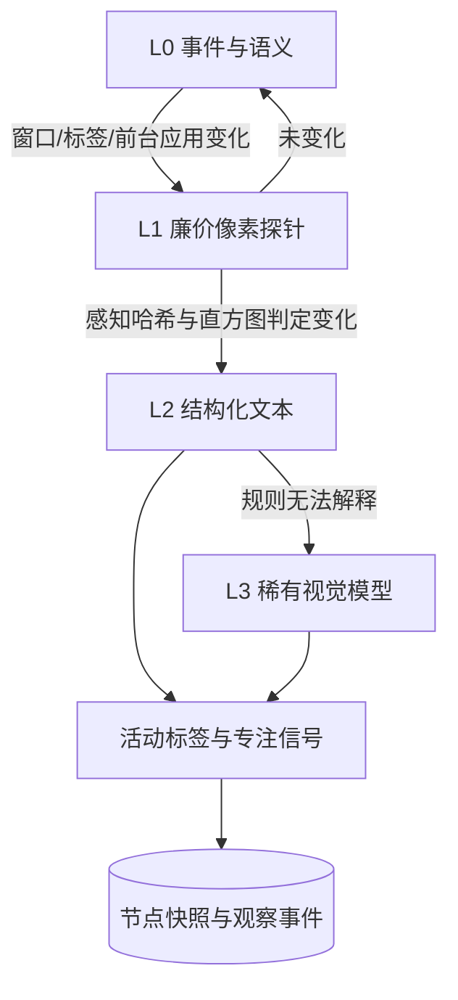

# 屏幕感知与心流判定：调研与第一版接口

后续实现：[注意力边界与自触发](proactivity.md) 已接入类型化宿主信号、任务边界候选、静默决策与受预算约束的文字生成。本文中的屏幕采集、自动专注分类与接口草案仍未实现，以后续文档和 OpenAPI 为当前合同。

调研日期：2026-10-14。本文只做调研与接口草案，没有修改运行时代码、没有新增测试，也没有在真机、真实桌面或真实浏览器上验证任何一条捕捉路径。文中区分“平台文档确认”“论文报告”和“本项目设计”，阈值与模型选择都属于工程起点，需要真实数据校准。

现有 [设备状态跟踪](device-state-tracking.md) 已经能回答“设备是否可达、有什么服务、正在进行什么显式操作”，但它明确拒绝从负载或端口推断人的注意力。本文回答后面这半：从屏幕判断“他在做什么”，以及“他在不在心流里、我们该不该开口”。结论先说：屏幕上没有心流，只有行为痕迹；能测的是“深度专注段落”，不能测的是体验本身。

## 参考与取舍

三个判断决定了后面的设计。

**语义优先于像素。** 一次可访问性树提取、一段 DOM 片段或一个窗口标题的成本比截图低一到两个数量级，而且带稳定标识和层级。Screen2AX 的实测显示 macOS 上只有约三成应用提供完整无障碍支持，所以路由不能是“树优先”而是“树优先 + 像素兜底”：先取语义，取不到或判断不了才解码像素。这与 screenpipe 的公开架构一致，也与 SeeClick、OS-Atlas 对两种输入的对比一致。

**事件驱动优先于轮询。** 变化检测比采样频率重要。ScreenLLM 的做法值得直接借用：对相邻帧求一阶差，再对差值求二阶差取 top-k。“新窗口弹出”是一阶差里的尖峰，“滚动与缩放”是持续的一阶差，二阶差能天然滤掉后者。这个技巧解决的是“什么时候值得看一眼”，比任何分辨率调优都更省。

**信任分级优先于“检测到心流”。** Google 对工程师日志与自报心流的混合方法研究给出一个必须在设计里承认的负面结论：几乎相同的日志模式，当事人既可以回顾描述为“处于心流”，也可以描述为“不处于心流”，差别只在事后是否觉得这段经历有价值。系统能稳定识别的是“专注段落”，不是心流。心流里的愉悦、自动性、时间感改变这些成分无法从行为痕迹推出，只能用低频抽样校准。任何在界面上宣称“检测到心流”的产品表述都是过度承诺。

## 平台能拿到什么

下表是本项目真正会用到的入口。签名权限、`UiAutomation`、调试命令等路径不进产品。

| 平台 | 语义来源 | 像素来源 | 强制用户动作 | 主要失败场景 |
| --- | --- | --- | --- | --- |
| 安卓 | `AccessibilityNodeInfo`、事件、`UsageStatsManager` | `MediaProjection` + `VirtualDisplay` + `ImageReader` | 系统授权对话框（每次会话）、常驻通知 | 游戏、自绘画布、DRM、`FLAG_SECURE` 黑块 |
| macOS | `AXUIElement` + `AXObserver` 通知 | ScreenCaptureKit `SCStream` | Screen Recording 授权、菜单栏绿点 | ad-hoc 签名在 Sequoia 及以后可能被拒；屏幕休眠无新帧 |
| Windows | UI Automation 树与事件 | `Windows.Graphics.Capture` 帧池 | Picker 选源；关黄边需单独同意 | 受保护内容黑帧；`WDA_EXCLUDEFROMCAPTURE` 表现为区域缺失 |
| Linux X11 | `WM_NAME`、`_NET_WM_NAME`、`XRecord` | `XShmGetImage` | 无 | 服务端未启用 MIT-SHM 时退化为协议往返 |
| Linux Wayland | Portal 授权范围 + `libei` | Portal ScreenCast + PipeWire | Portal 模态对话框 | 显示器热插拔后节点复用；不同后端行为不一致 |
| 浏览器扩展 | DOM、`chrome.tabs`、`chrome.idle` | `getDisplayMedia` + `MediaStreamTrackProcessor` | 每次弹浏览器选择器 | 非 self 捕获时 canvas 受污染；`tabs` 权限触发浏览历史警告 |

### 安卓

`MediaProjection` 是唯一可用于生产环境的像素入口，但 Android 14（API 34）收紧了状态机：同一应用同时只能有一个会话，同一个授权结果只能交给 `getMediaProjection()` 一次，且必须注册 `MediaProjection.Callback`，否则创建虚拟显示会失败。回调的 `onStop()` 是唯一真相源，它会在用户点状态栏提示、锁屏、别的应用开始投屏或进程被杀时触发，必须释放虚拟显示并标记为需要重新授权，不能静默重试。前台服务的顺序也是前置条件：先拿到用户授权，再以 `mediaProjection` 类型启动前台服务，最后取投影对象。Android 15 QPR1 起状态栏常驻投屏提示并在锁屏时自动停止，所以“全天连续”实际上是“每个亮屏片段”。

成本的关键不是分辨率而是变化检测。让虚拟显示直接以较小尺寸创建，由系统合成器完成缩放，再在低分辨率帧上算感知哈希或亮度直方图；只有判定发生语义变化时才临时切到全分辨率做 OCR 或视觉模型分析。采样层面没有官方帧率承诺，静态屏幕通常不产生新帧，但这是实现行为而不是契约，需要在目标机型上实测。

`AccessibilityService` 是更便宜的主信号源。`getRootInActiveWindow()` 加上窗口状态、滚动、文本变化事件就能拿到包名、窗口标题、文本结构和可交互控件，成本远低于像素；代价是它对游戏、画布渲染、远程桌面和受保护页面无效。服务本身也能截图，但平台限流在每 333 毫秒一次左右，而且安全窗口会返回明确错误，这比“识别黑帧”可靠。节点回收、事件类型过宽导致的资源消耗、以及 Google Play 对无障碍服务的专门政策（要求声明用途、应用内显著披露、明示同意，并禁止据此自主决策执行动作）都是实际约束。`UsageStatsManager` 的 `PACKAGE_USAGE_STATS` 属于特殊访问而非运行时弹窗，粒度只到应用前后台切换，没有窗口标题，事件只保留数天，适合作为廉价兜底而不是主信号。

OCR 用 ML Kit 文本识别 v2 按语言选包，中文用独立模块；官方只承诺拉丁文实时，其他语言更慢，中文吞吐必须自测。公开 API 中不存在 `Context.SCREENSHOT` 与 `INTERACTION_DATA` 这两个常被提及的权限，社区流传的写法有误。

### macOS 与 Windows

macOS 的现代路径是 ScreenCaptureKit（12.3 起），可以只抓指定窗口或排除自己的窗口，`minimumFrameInterval` 可以拉大到每秒一帧甚至更低。授权由 Screen Recording TCC 控制，菜单栏绿点是用户可见且应用侧无法关闭的结果。AX 语义树通常比像素更完整，并且有聚焦应用、聚焦元素、值变化的系统通知，是真正的事件驱动来源。视觉框架的 `RecognizeTextRequest` 可以直接接收 `CMSampleBuffer`，无需先转成图片对象。需要注意两个坑：社区 issue 报告指出 ad-hoc 签名的二进制在 Sequoia 及以后即使系统设置里已授权也可能取不到权限，常驻产品必须做 Developer ID 签名；另外 `SCShareableContent` 存在挂起的已知报告，需要自己加超时。

Windows 侧不要再用 GDI 的 `BitBlt` 或 `PrintWindow`：对硬件加速与 DirectComposition 窗口会返回黑屏或残影。`Windows.Graphics.Capture` 从 Windows 10 1803 起可用，`CreateFreeThreaded` 从 1809 起，降采样应该在 GPU 上用 mipmap 完成。同意模型有三个独立闸门：Picker 让用户选一次源并可长期复用；捕获时系统会画黄色边框，要关掉它必须调用 `GraphicsCaptureAccess.RequestAccessAsync` 请求同意并声明相应能力；企业策略还可以按包名整体管控。因此“Windows 不需要用户同意”这一说法是错的。UI Automation 提供 Raw、Control、Content 三种视图和结构变化、焦点变化事件，`IsPasswordProperty` 是现成的隐私过滤信号，但跨进程调用昂贵，必须缓存加事件驱动，不能定时全树遍历。

### Linux 与浏览器

X11 下 `XShmGetImage` 是成熟路径，MIT-SHM 存在时图像直接落在共享内存；服务端未启用时只能退回协议往返，代价陡增。`gnome-screenshot` 已从 GNOME 核心移出，在较新的 GNOME 上可能完全失效，不应作为依赖。

Wayland 从设计上就禁止客户端直接读其他客户端的缓冲，正确路径是桌面门户加 PipeWire。ScreenCast 门户支持 `persist_mode` 与 `restore_token`，可以让会话免重复弹窗；值得注意的是新版本不再可靠地用节点 ID 定位流，因为节点销毁后 ID 会被复用，显示器热插拔或唤醒后可能连错流，应改用序列号定位。只想“变化时拍一帧”时，截图门户的活动窗口目标比维持一条持续流省电得多。输入侧走 `libei`，每个会话只能建立一次连接。建立之后输入事件就不再经过门户方法。

浏览器里最准最便宜的路径不是截屏而是注入读 DOM，但 `chrome.tabs` 权限会触发“读取浏览历史”的安装警告，`activeTab` 只能在用户手势后临时生效。`chrome.idle` 没有安装警告，并能在锁屏或屏保时给出锁定状态，这是页面里唯一较可靠的静默停采信号（页面内的 Idle Detection 需要权限且最小阈值 60 秒）。取帧用 `MediaStreamTrackProcessor` 与 `VideoFrame.copyTo()`，可以在拷贝时顺带降采样和裁剪；把画面画进画布再读像素在非本标签页捕获时会被污染而抛错。区域捕获只按边界裁剪，遮挡目标的像素仍会被捕获，而且把流交给别的文档后接收方可以取消裁剪，这一点在设计数据边界时必须记住。

## 分层信号与变化检测



L0 是零像素成本的事件层：窗口标题与前台应用变化、标签切换、锁屏与空闲、通知、显式操作元数据。它与 [设备状态跟踪](device-state-tracking.md) 的四类状态同源，只是把“人的活动”那一行从“宿主交互信号”扩展为可采集的结构化信号。L1 是低分辨率帧加变化检测，只输出哈希，不存图。L2 是 OCR 与语义树摘要，输出文本与结构差异。L3 是视觉模型，只在规则层判不清时调用，并且必须能回溯到 L2 的文本证据。

调用量的差距比模型选择更重要：按每小时 10 次事件触发计，一天约 80 次调用；每 30 秒轮询是每小时 120 次，一天约 2880 次。这个比值与单价无关。一张 1080p 截图折算的视觉 token 通常是千级，具体取决于模型的图像分块策略，需要按实际模型重算；输出摘要应控制在几十 token 内，且提示里只放差异而不是全量文本。

变化检测建议三条叠加：先降到 32×32 灰度再比较；用 64 位感知哈希的汉明距离加一个阈值做快速否决；再用结构相似度兜底哈希相同但语义变化的极端情况。切换应用、窗口标题变化、空闲恢复和用户显式询问强制生成关键帧，其余按内容哈希判定。关闭光标渲染能显著减少无意义差异。

语义抽取的优先级是：结构树与 DOM，OCR，视觉模型。端侧小模型的瓶颈常常不在参数量而在图像预处理，因此选型前应先测自己的管线，而不是先换模型。视觉模型的图像预算应当设上限而不是只缩图，因为内部缩放存在拐点，降分辨率不一定省计算；相反，裁剪关注区域（把屏幕某个面板单独喂进去）通常比换更大的模型收益更大，这一点在高分辨率小目标的基准上被反复验证。

## 语义抽取与活动推断

可访问性树的覆盖率是这套方案的天花板。Screen2AX 报告 macOS 上只有约三成应用提供完整支持，其余要靠像素补齐；它给出的桥接思路是从单张截图重建分层无障碍树，论文报告的综合指标约 77%，但不同材料在数值和应用数量口径上不一致，引用前应回原文核对。工程结论是：树用于稳定标识与层级，像素用于视觉上下文，两者在实际任务上持续优于单一模态。

活动推断的第一层应是规则而不是模型：窗口标题含代码编辑器特征加高密度文本与行号列判为写代码；文档阅读器或全屏文档判为阅读；标题匹配会议应用加系统音频活动判为会议；标题匹配视频站点判为观看。第二层才是小模型，把结构化摘要写成一句活动描述。第三层是视觉模型，只解释规则判不清的画面。

规则层必须 100% 可回溯到输入字段：哪个包名、哪个标题模式、哪个结构特征触发了判定。这是后续调参和排查误报的唯一依据，也是相比视觉模型黑箱的优势。游戏、图表和图像文档是规则层的已知盲区，应显式标为不确定，而不是猜。

## 隐私、同意与屏蔽状态

这一节决定项目能不能长期存在，不是可选项。

**必须把三种“没变化”区分开**，否则会被当成“用户没在操作”：

| 状态 | 表现 | 判定方式 |
| --- | --- | --- |
| 画面确实没变 | 感知哈希不变 | 哈希与直方图 |
| 用户主动屏蔽 | Windows 上区域缺失而非黑帧 | 缺帧范围与窗口几何比对 |
| 平台拒绝采集 | 整块黑或捕获失败 | 黑帧比例加无障碍截图错误码交叉验证 |

平台并不会告诉我们“这块内容被隐藏了”。黑帧检测是启发式，安卓上可以与无障碍截图的安全窗口错误码交叉验证以提高可信度，但仍不能据此声称已经可靠识别受保护内容。

**用户可见性不能自建。** macOS 的绿点、Windows 的黄边、安卓的状态栏提示、浏览器的指示器都是系统强制的知情渠道。陪伴者不应再叠加“偷偷录”的预期，而应把这些指示器当作自己同意状态的一部分读取，并在自身界面里提供一键静默与彻底关闭，且关闭状态在重启后保持。

**威胁模型必须包含屏幕文字本身。** 屏幕上出现的任何文字，包括网页、邮件和文档里的内容，对模型都是不可信输入，不能给它授权。多个厂商的计算机操作接口文档都明确警告过提示注入风险。

**数据最小化。** 原始帧只在内存中停留并即用即弃，磁盘只保存降采样缩略图与语义文本；焦点段落的原始轨迹短期保留后聚合删除；窗口标题在端上分类后丢弃原文，不入库。提供导出与删除入口。加密后的明文一旦进入同用户可访问的进程就会被提取，安全研究者对 Recall 重建后的架构复现过这一点，所以不要把同用户进程当作信任边界。

**行业教训是一致的。** Recall 从默认开启改为默认关闭并要求在场证明，是最典型的翻车与修正样本。Rewind 被收购后停止桌面采集，说明依赖单一云端记忆产品有供应商风险。反过来，screenpipe 证明了“本地优先加可审计”的路线可以成立，Project Astra 选择用户主动共享屏幕而不是后台常驻抓屏，是网页上唯一可行的形态。

## 心流：能测什么，不能测什么

Csikszentmihalyi 的框架把心流拆成三个条件（目标明确、反馈即时、挑战与技能平衡）与六个特征（行动与意识融合、全神贯注、控制感、丧失自我意识、时间感改变、自动性体验）。工程上可用的是象限模型：把挑战与技能各自和个体自身均值比较并以零为界切分，而不是看绝对值。这一步个体标准化是必须的，因为通道模型本身就是个人相对的。

但从行为痕迹能推出来的远少于框架本身。Google 的日志研究用词向量把事件序列嵌入、滑窗比较并分段，再用日记与季度问卷验证。论文报告该方法与逐条自报的一致性中位数约 0.71，而两个朴素基线分别只有 0.17 和 0.40：只按“会话很长”判定几乎无效，只按“事件很多”判定也远不够。更反直觉的是，在一万三千余份季度问卷里，能显著预测自报心流的是专注段落的**数量**，而不是专注的**总时长**。这对陪伴者意味着指标要换成“保护了多少个完整段落”，而不是“今天陪你专注了多少分钟”。

因此本项目对外和内部都应该使用“深度专注段落”这个词。愉悦与自动性成分需要体验抽样，问题必须短到一题、几秒、并且在常驻界面里出现而不是弹窗；回忆偏差用 Kahneman 的峰尾法则修正，事后追问整段时间的体验几乎无效。

### 打断成本

打断确实昂贵，但流传最广的数字需要纠正。CHI 2008 的实验结论不是“恢复要 23 分钟”，而是：被打断的任务完成得更快，但心理负荷、压力、挫败、时间压力和努力全部显著升高，产出质量没有差异。约 23 到 25 分钟的重返原任务时长来自同一作者后续的田野观察系列，两者应当分开引用。

其他可用的证据：注意力残留实验表明未完成且承受时间压力的任务会拖低后续任务表现，完成后残留消失；CHI 2007 的研究还发现打断成本随介质不同而不同，切到重量级应用远贵于切到轻量级应用；自我打断与被通知打断的代价不对等，后者更伤；工程场景的研究提示，打断的“支配度”（谁发起、对方有多坚持）比媒介类型更能预测损害，而且自报压力与生理数据不一致，不要把用户主观报告当唯一指标。

对陪伴者最有用的框架是 1999 年提出的注意力敏感告警：在“延迟通知造成的期望损失”和“打断造成的成本”之间做效用比较，必要时延迟而不是立即弹出。现场验证最充分的一个产品化形态是 FlowLight，用物理红绿灯向同事广播可打断性，报告打断次数下降约 46%。启示是把可打断性做成对外可见的状态，而不是靠猜——这对一个常驻观察的 agent 同样成立。

还有一条反向约束：表现挂钩的外部奖励会削弱内在动机，而信息性反馈不会。陪伴者应当输出“你刚才连续专注了 47 分钟”这类信息，而不是累计积分、连续天数或徽章。

### AI 助手自身也在破坏心流

这一段是与本项目最相关的负面证据。对 AI 编码助手的纵向研究显示，生产力感知基本不变甚至改善，但开发体验恶化的比例明显上升，心流与认知负荷同时劣化。另有随机对照研究在资深开发者自己的大型仓库上测得使用 AI 工具后耗时增加约 19%，其中一项被反复讨论的解释是审阅 AI 产出带来的额外认知开销；该研究随后声明结论已过时并给出置信区间很宽的更新估计，引用时必须带时间戳并说明原始条件。

正面证据也有：结构化、自定节奏、按需反馈的 AI 导师能提升学习效果，但同样的研究显示“花时越多学得越好”的相关性接近于零，结构比陪伴时长重要。共同点是“按需”——用户发起时才提供。

## 可实现的心流信号

下表按“采集成本 × 证据强度”排列。标注为推测的字段，本项目需要自己跑实验验证。

| 字段 | 单位 | 采集方式 | 成本 | 证据强度 |
| --- | --- | --- | --- | --- |
| `focus_session_count` | 次/日 | 由下两项派生的段落计数 | 低 | 高，唯一在万人级问卷上显著 |
| `days_with_focus_session` | 比例 | 同上 | 低 | 高，控制活动量后仍显著 |
| `window_embedding_drift` | 距离 | 事件标签序列的端侧嵌入滑窗比较 | 中 | 高，日志方法的核心量 |
| `app_switch_rate` | 次/分 | 焦点与窗口事件 | 极低 | 中高 |
| `idle_gap_gt_60s_count` | 次/窗 | 输入事件时间戳 | 极低 | 中高，打断计数主信号 |
| `work_ball_consistency` | 比例 | 任务或工作区上下文推断 | 中 | 中高，同一目标内换工具不算打断 |
| `undo_redo_ratio` | 次/十分钟 | 编辑器集成 | 低 | 中低，受阻的候选特征 |
| `event_rate_z` | z 分数 | 输入事件率对个人基线归一化 | 极低 | 低，作用是排除卡住 |
| `focus_session_duration` | 秒 | 段落长度 | 低 | 低，单独不预测自报心流 |
| `keystroke_iat_cv` | 无量纲 | 键盘时间戳 | 低 | 推测，需自测 |
| `hrv_rmssd` | 毫秒 | 手表 | 中 | 中，文献一致但多为单实验室 |
| `meeting_mic_active` | 布尔 | 系统音频或会议窗口 | 中 | 高，用作强制静默上下文 |

所有特征都应按用户与时段的滚动分布做稳健归一化（中位数与绝对中位差），不使用全局阈值——个体标准化正是通道模型的前提。

判定规则必须带滞回与最短持续时间，否则会在边界抖动。骨架如下：

```text
每个滚动窗（例如 20 分钟）：
  1. 对每个特征做个人基线的稳健 z 分数
  2. 活动下限：event_rate_z 不显著低于基线，undo_redo_ratio 不高于个人上四分位
  3. 打断计数：app_switch_rate 与 idle_gap 长停顿计数不高于个人下四分位
  4. 语义一致性：window_embedding_drift 低于阈值
连续若干窗全部通过 → 候选段落
进入：连续通过若干次    退出：任一硬条件失败，或长时间无输入
退出后设一段冷却期，冷却期内不重新进入，除非判定为新段落
```

第 2 条是最容易被忽略的。用户盯着同一个报错二十分钟不动，其行为轨迹（低事件率、低切换、单应用）与深度专注高度相似，这是本方案最危险的假阳性来源。没有活动下限，低活动就会被标成高专注。撤销重做比例和“是否在推进”的信号也要一起看。

校准方案：让模型对候选段落做预标，只给脱敏后的工具类别、动作序列、时长和错误率，不给标题原文，输出“专注、走神、卡住、等待外部输入”加置信度；模型只用来剪枝和预标，不做最终判定。同时每个用户每周只填三到五次一题式抽样，把抽样点锚定在检测出的段落边界附近，用一致的对数似然回归估计每用户的阈值和偏置。这个流程本身是本项目的设计假设，必须先验证模型预标与抽样的一致性。

## 陪伴者介入策略

三档动作，每一档都能追溯到决策表的一行。

L0 静默记录：持续采集与推断，不弹窗、不改焦点、不上报内容。L1 非打扰式旁注：不改焦点、不要求立即响应的线索，用户召回时才看，附“稍后、现在说、忽略”三选项，默认稍后。L2 主动打断：需要用户回应的协作式提问，先安静横幅，无响应再升级声音。

| 专注置信度 | 用户明确请求 | 事件性质 | 动作 |
| --- | --- | --- | --- |
| 高 | 无 | 任意 | L0，仅本地追加一条带时间戳的记录 |
| 高 | 无 | 真实的外部后果且不可逆 | L2，走协作式协议，并记录本次打扰供事后分析 |
| 高 | 有 | 任意 | L2，属于预先授权的预算消耗 |
| 中 | 无 | 一般信息 | L1 线索卡，默认延后 |
| 中 | 有 | 任意 | L2 |
| 低 | 无 | 一般信息 | 降级为记录，不可见 |
| 低 | 无 | 有时限的待办 | L2，不在专注中，打断代价低 |
| 低 | 有 | 任意 | L2，最短延迟 |
| 任意 | 任意 | 会议中或共享屏幕 | 强制 L0，除非用户用约定手势放开 |
| 任意 | 任意 | 用户开启静默 | 强制 L0，优先级高于一切自动判断 |
| 任意 | 任意 | 同类介入被拒绝两次以上 | 该类降级为 L0，并写入偏好 |

每日与每周应有硬预算：主动打断每天不超过一次，不可逆事件除外；线索卡每周不超过五条，超出按价值密度截断。预算本身应由评测指标驱动调整，而不是先写死。

这里与现有人格策略是同一件事的两面。[人格](personality.md) 已经有 `interaction_mode` 的 `focus` 取值、非主动时保持安静、以及 `participation.reason` 的 `waiting_for_user`，`focus` 下回复上限两句。心流判定不应该新增一种交互模式，而应该成为把 `interaction_mode` 推进到 `focus` 的一个证据来源，并加强“保持安静”这一已有结论。把心流做成新模式会让状态空间和回执语义同时膨胀，而现有语义已经够用。

## 与现有协议的接入草案

一个重要约束：服务端目前只对 `modality: "vision"` 做了特殊校验，要求节点声明 `vision.capture` 能力且 `user_initiated` 为真。持续观察不满足这个前提，被动采集不能复用这个 modality，必须使用 [节点协议](protocol.md) 已列出但尚无任何客户端使用的 `screen`（或另立 `activity`）modality，否则会被服务端拒绝。这是接入前最容易被忽略的一点。

形状沿用 `device_state` 的信封，把屏幕信号放在 `context.screen_state`，事件用 `modality: "screen"`：

```json
{
  "context": {
    "screen_state": {
      "schema_version": "1.0",
      "subject_node_id": "my-desktop",
      "observer_node_id": "my-desktop-sense",
      "session_id": "a-client-session-uuid",
      "sequence": 412,
      "sampled_at": "2026-10-14T08:00:00Z",
      "ttl_seconds": 90,
      "source": {
        "adapter": "android_a11y",
        "scope": "runtime_environment",
        "quality": "ok",
        "errors": []
      },
      "focus_window": {
        "app_class": "code_editor",
        "title_class": "source_file",
        "title_redacted": true,
        "structural_hash": "b1946ac9",
        "frame_digest": "1f0c3a9e",
        "blocked_regions": 0
      },
      "activity": {
        "label": "code",
        "confidence": 0.82,
        "evidence": ["title_pattern", "text_density", "line_number_column"]
      },
      "focus": {
        "state": "focused",
        "confidence": 0.61,
        "segment_seconds": 1640,
        "signals": {
          "app_switch_rate": 0.08,
          "idle_gap_gt_60s_count": 0,
          "window_embedding_drift": 0.17,
          "event_rate_z": 0.4
        },
        "advisory": true
      }
    }
  }
}
```

字段取值需要先定死再写代码，建议的初始集合：

- `source.adapter`：`android_a11y`、`android_media_projection`、`macos_ax`、`macos_screencapturekit`、`windows_uia`、`windows_graphics_capture`、`x11`、`xdp_portal`、`browser_extension`。
- `source.scope`：本地为 `runtime_environment`，只观察本进程可见范围；被用户主动屏蔽的区域数量记在 `blocked_regions`，不记内容。
- `focus.state`：`focused`、`unfocused`、`suspected_stuck`、`unknown`。`suspected_stuck` 必须独立存在，否则用户卡住时会被当成专注。
- `activity.label`：首版只做 `code`、`docs`、`chat`、`meeting`、`video`、`game`、`media`、`terminal`、`browser`、`unknown` 这类粗分类，不做细粒度意图。
- `focus.advisory`：`true` 表示这是客户端推断，只作提示；服务端不应把它当作用户明确状态写回。

上报纪律与 [设备状态跟踪](device-state-tracking.md) 一致：一个节点 ID 由一个进程负责完整能力与 context 写入；只有活动类别变化、专注状态转换、屏蔽区域出现或消失才生成观察事件，数值波动不逐次写事件；事件数据带 `subject_node_id`、`observer_node_id`、`session_id`、`sequence`、`sampled_at` 与 `changes`。心跳替换整个 context，不调用模型，不写长期记忆。TTL 应覆盖采样间隔与上报预算的保守合计。

与记忆的关系要保守。屏幕信号和专注信号属于运行事件，不是共同经历。[长期记忆](memory.md) 里设备指标的先例是：原始指标不占用召回预算，只有经过用户确认或低成本策略筛选的显著操作经历才进入 episode。心流判定同理，段落本身不应该直接进记忆，只有用户明确表达的感受或由她主动提出的观察才值得留。

与情绪的关系要更保守。[情绪](emotion.md) 目前只在有效用户对话上评估，且用户情绪不会直接复制为生命体状态。屏幕上的专注段落不应触发情绪反应，否则一次长段落就足以改变她的状态，这正是现有边界要防的事情。

## 评测方式

学术基准衡量的是模型能力上限，不是个人助理的可用性。可用的离线基准是屏幕元素定位与长程任务那一类，但它们在 2026 年已明显分化：常规基准接近饱和，专业软件高分辨率小目标仍困难，长程过程级评测的开源与闭源差距大于常规基准的差距。只看定位分数会严重高估“理解屏幕”的能力。

真正该盯的是在线代理指标：

| 指标 | 定义 | 目标 |
| --- | --- | --- |
| 活动事件精确率与召回率 | 对自建标注的活动日志 | 需要自建基线 |
| 误打扰率 | 事后抽样回答“当时并未投入”的打断占比 | 越低越好，需自测 |
| 每会话打扰次数 | 主动打断除以完整会话 | 低于 0.3 |
| 段落保全率 | 自然中断与被打断后回到同一任务的比例 | 相对无陪伴者基线提升 |
| 假阳性率 | 被标为专注但含反复撤销的段落占比 | 低于 5% |
| 端侧开销 | 常驻 CPU、功耗、峰值内存 | 需在目标机型实测 |

标注成本是真实约束。可行做法是先只标三到七天的活动日志，把精确率与召回率的门槛定在这份数据上，而不是引用任何论文的分数。

## 扩展路线

1. 先实现零像素的 L0：安卓无障碍事件、前台应用、空闲与锁屏，作为 `context.screen_state` 的最小版本上报，只做 `app_class` 与活动粗分类，不碰像素。
2. 再实现 L1 与 L2：事件触发的低分辨率帧、感知哈希、OCR 与结构摘要，配合屏蔽状态的三分法。
3. 然后实现专注段落判定与三层介入策略，接入现有 `interaction_mode` 与 `participation`，并加入每日的打断预算。
4. 最后按需引入视觉模型作为规则层与 OCR 的兜底，并接入 [向量记忆与图谱](vector-memory-and-graph.md) 做检索。
5. 贯穿全程：本地优先、可见指示、一键静默、屏蔽状态建模、抽样校准。任何一步都不能为了省事跳过同意与屏蔽这两项。

## 调研依据

屏幕捕捉的平台文档：安卓 [MediaProjection 指南](https://developer.android.com/media/grow/media-projection)、[MediaProjection 参考](https://developer.android.com/reference/android/media/projection/MediaProjection)、[Android 14 单应用共享](https://developer.android.com/about/versions/14/features/app-screen-sharing)、[AccessibilityService 参考](https://developer.android.com/reference/android/accessibilityservice/AccessibilityService)、[UsageStatsManager 参考](https://developer.android.com/reference/android/app/usage/UsageStatsManager)、[UiAutomation 参考](https://developer.android.com/reference/android/app/UiAutomation)、[ML Kit 文本识别](https://developers.google.com/ml-kit/vision/text-recognition/v2/android)、[核心权限与静默抓屏限制](https://source.android.com/docs/core/permissions)、[Play 无障碍服务政策](https://support.google.com/googleplay/android-developer/answer/10964491)。桌面与浏览器：[ScreenCast 门户](https://flatpak.github.io/xdg-desktop-portal/docs/doc-org.freedesktop.portal.ScreenCast.html)、[Screenshot 门户](https://flatpak.github.io/xdg-desktop-portal/docs/doc-org.freedesktop.portal.Screenshot.html)、[XShm 手册](https://www.x.org/releases/current/doc/man/man3/XShm.3.xhtml)、[ScreenCaptureKit](https://developer.apple.com/documentation/screencapturekit)、[`CGPreflightScreenCaptureAccess` 的用户侧说明](https://support.apple.com/guide/mac-help/change-screen-recording-permissions-mchl211c911f3/mac)、[`AXUIElement.h`](https://developer.apple.com/documentation/applicationservices/axuielement_h)、[`RecognizeTextRequest`](https://developer.apple.com/documentation/vision/recognizetextrequest)、[Windows 屏幕捕获](https://learn.microsoft.com/en-us/windows/apps/develop/media-authoring-processing/screen-capture)、[`IsBorderRequired`](https://learn.microsoft.com/en-us/uwp/api/windows.graphics.capture.graphicscapturesession.isborderrequired)、[`SetWindowDisplayAffinity`](https://learn.microsoft.com/en-us/windows/win32/api/winuser/nf-winuser-setwindowdisplayaffinity)、[UI Automation 树概览](https://learn.microsoft.com/en-us/windows/win32/winauto/uiauto-treeoverview)、[`getDisplayMedia`](https://developer.mozilla.org/en-US/docs/Web/API/MediaDevices/getDisplayMedia)、[区域捕获](https://developer.chrome.com/docs/web-platform/region-capture)、[元素捕获](https://developer.chrome.com/docs/web-platform/element-capture)、[`chrome.idle`](https://developer.chrome.com/docs/extensions/reference/api/idle)、[扩展权限声明](https://developer.chrome.com/docs/extensions/develop/concepts/declare-permissions)。行业样本：[screenpipe 架构](https://docs.screenpipe.com/architecture)、[Recall 隐私与控制](https://support.microsoft.com/en-us/windows/privacy-and-control-over-your-recall-experience-d404f672-7647-41e5-886c-a3c59680af15)、[Recall 改为默认关闭的官方公告](https://blogs.windows.com/windowsexperience/2024/06/07/update-on-the-recall-preview-feature-for-copilot-pcs/)、[Project Astra](https://deepmind.google/models/project-astra/)、[Anthropic 计算机操作与注入风险提示](https://www.anthropic.com/news/developing-computer-use)、[OpenAI 计算机操作安全说明](https://developers.openai.com/api/docs/guides/tools-computer-use)。

屏幕理解研究：[ScreenAI](https://arxiv.org/abs/2402.04615)、[Screen2AX](https://arxiv.org/abs/2507.16704)、[ScreenLLM 的状态化屏幕 schema 与关键帧](https://arxiv.org/abs/2503.20978)、[OS-Atlas](https://arxiv.org/abs/2410.23218)、[OmniParser v2](https://huggingface.co/microsoft/OmniParser-v2.0)、[UI-TARS](https://github.com/ByteDance/UI-TARS)、[自适应关键帧采样](https://arxiv.org/pdf/2502.21271)。

心流与打断：[象限模型的原始论文](https://doi.org/10.1037/0022-3514.56.5.815)、[Google 的日志与自报心流研究](https://doi.org/10.1145/3544548.3581562)、[打断成本的实验](https://doi.org/10.1145/1357054.1357072)、[注意力残留](https://doi.org/10.1016/j.obhdp.2009.04.002)、[打断与恢复的介质差异](https://doi.org/10.1145/1240624.1240730)、[混合主动式界面的原则](https://doi.org/10.1145/302979.303030)、[注意力敏感告警](https://arxiv.org/abs/1301.6707)、[FlowLight 现场研究](https://doi.org/10.1145/3025453.3025662)、[软件工程活动中的打断](https://doi.org/10.1145/3597503.3639079)、[外在奖励的元分析](https://doi.org/10.1037/0033-2909.125.6.627)、[峰尾法则](https://doi.org/10.1111/j.1467-9280.1993.tb00589.x)、[AI 工具对资深开发者的随机对照研究](https://arxiv.org/abs/2507.09089)及其[后续声明](https://metr.org/blog/2026-02-24-uplift-update/)。

分层、变化检测、屏蔽三分法、介入分级、预算与字段集合属于本项目设计，不是任何论文的结论。

## 未验证与需实测

平台侧：安卓黑帧检测对混合场景会误判，需要与无障碍截图错误码交叉验证；连续 `MediaProjection` 的实际电量没有官方数字，必须自建基准；无障碍截图的权限常量在公开文档中不完整，需要以真机行为为准；不同厂商对单应用共享回调的实现可能不一致。桌面侧：macOS ad-hoc 签名失败与 `SCShareableContent` 挂起来自社区 issue 复现；Wayland 门户在显示器热插拔与挂起恢复后的流标识行为需逐后端验证；浏览器非本标签页捕获的画布污染边界仍在演进。研究侧：Screen2AX 的指标口径在不同材料中不一致；端侧小模型的吞吐与延迟数字多来自个人测量而非同行评审；活动分类（会议、游戏、代码）缺少可直接引用的学术文献，目前全部是工程启发式，需要自建标注集。本文中的阈值、预算与判定规则都还没有经过本项目的任何真实数据验证。
