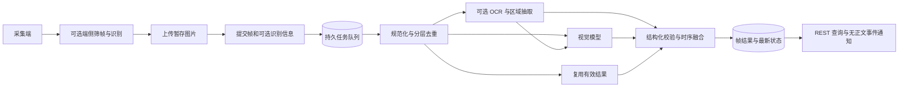

# 屏幕视觉服务端接口与算法实施规划

日期：2026-10-18。状态：待实施，供后续代理直接领取；本文没有对应的已实现接口。

## 1. 目标与已经确定的方向

客户端负责取屏，可选做轻量识别和部分重复过滤，将大部分有效屏幕数据交给服务端。服务端负责接收、二次去重、视觉分析、跨帧融合和可查询的结构化结果。**不要求客户端部署 OCR、MNN 或视觉大模型，只有截图能力也必须能完整接入。**

“大部分数据交给服务端”指服务端承担主要理解工作，不意味着每张上传图片都调用大模型。上传量、存储量、OCR 量和视觉模型调用量分别计量、分别控制。客户端是否去重、采用什么算法，不改变服务端正确性。

首个闭环：注册节点 → 显式开启视觉会话 → 上传截图 → 提交帧 → 后台分析 → 查询帧结果和最新状态 → 停止会话。完成后再增加端侧识别融合、滚动对齐和对话引用。

本轮交付限于规划文档。执行代理按本文新增服务端功能，同时更新协议、OpenAPI、配置和 Kotlin SDK；Android Demo 的联网改造列为独立后续任务。

## 2. 仓库现状与必须沿用的边界

以下是对当前代码的核查，不是待实现能力：

| 位置 | 现状 | 实施要求 |
| --- | --- | --- |
| `backend/virtual_life/models.py` | `ObservationCreate` 是通用 JSON 信封；`data` 限制 65,536 字节 | 不塞 base64 截图，不增大通用观察上限 |
| `backend/virtual_life/coordinator.py` | `observe()` 只写 `node.observation`；`vision` 要求 `vision.capture` 和 `user_initiated=true` | 保留旧合同；新增专门的屏幕会话与帧接口 |
| `backend/virtual_life/ports.py` | 有未接入的 `PerceptionProvider` 协议；`ModelRequest` 只有文本 | 新建有类型的视觉 provider 合同，不能认为现有文本调用已经支持图片 |
| `backend/virtual_life/model_provider.py` | 现有 Chat Completions 适配器发送纯文本，禁用隐式重试 | 视觉配置与适配器独立；不能默认当前文本模型具有视觉能力 |
| `backend/virtual_life/storage.py` | SQLite WAL、独立事务连接、写事务 `BEGIN IMMEDIATE` | 保持单运行时部署；解码、OCR、模型调用在写事务之外 |
| `backend/virtual_life/memory.py` | 已有模型 token 预留、结算、释放账本 | 复用额度机制，但账本不是 worker 锁；增加视觉输入预算能力 |
| `backend/virtual_life/api.py`、`node_credentials.py` | 管理 token 与 Linux 限权 reporter 分离；reporter 授权假定 POST JSON，且禁用 GET | 首版视觉 API 只接受管理 token；现有 reporter 权限不扩大 |
| `backend/virtual_life/proactivity.py`、`focus.py` | 已有注意力采样、TTL、专注状态机和参与限制 | 视觉结论是独立证据，不覆盖宿主事实、不直接触发输出 |
| `clients/android-node/.../Protocol.kt`、`RuntimeApi.kt` | 只有通用观察接口，无图片上传与视觉结果类型 | 新增独立 `ScreenVision.kt` 和 SDK 方法，保留旧方法 |
| `clients/android-vision-demo/` | 独立本地 MNN Demo；默认每秒采样，32×32 灰度平均差筛帧，2.5 秒最短推理间隔、15 秒最长刷新 | 可借用思路，不能当成已联通服务端；联网版本的基线要在服务端确认接收后提交 |

当前 Demo 的 `CapturePolicy.evaluate()` 接受帧时立即提交基线，这是本地推理合同。不要为联网需要直接修改其语义；联网采集器新增 `evaluate/commit/rollback` 或等价的独立状态机。

前置阅读：根目录 `AGENTS.md`、[节点协议](protocol.md)、[配置](configuration.md)、[后台陪伴](proactivity.md)、[长期记忆](memory.md)、[屏幕感知研究](screen-perception-and-flow.md)。

旧研究中的“端侧优先理解、视觉模型仅兜底、原图仅留本机内存”是旧方案；本任务改为**服务端主要理解，端侧识别可选，服务端原图短时暂存以支持异步处理**。其他数据来源、同意、输出权和记忆边界继续适用。阈值均为待验证的工程初值，不引用旧文研究数字作为验收成绩。

## 3. 职责与整体数据流

| 能力 | 客户端 | 服务端 |
| --- | --- | --- |
| 采集、旋转、屏幕坐标、锁屏/授权状态 | 必需 | 校验；缺失信息保持未知 |
| 轻量筛帧、压缩、限频 | 可选，建议提供 | 独立复核、限额、背压 |
| OCR、UI 树、局部识别 | 可选，以带来源的提示上报 | 缺失时自行识别；冲突时保留证据 |
| 图片哈希与近似重复判断 | 可选提示 | 自算规范化哈希与区域变化，负责最终路由 |
| 页面理解、活动描述、跨帧事件 | 可选补充 | 主要职责 |
| 长期记忆、对话与主动输出 | 请求或展示 | 走既有独立授权、证据与预算流程 |



首版只上传完整图片，算法内部可裁剪 ROI。上传差分块、视频流、像素补丁和服务端拼帧暂不实现，避免重传、缺基帧和坐标错误先于分析能力成为主要问题。

## 4. 会话、身份与时间合同

1. 新接口统一挂在 `/v1/nodes/{observer_node_id}/screen`。首版要求 `subject_node_id == observer_node_id`，节点已注册且具有 `vision.capture`；代理观察其他设备后续单独扩展。
2. 会话必须绑定 `companion_id`，用于结果归属和预算，不从“当前落脚节点”猜测归属。感知不要求该节点持有输出租约，也不随设备迁移自动取得输出权。
3. `mode` 为 `one_shot` 或 `continuous`；创建时要求 `user_initiated=true`。该布尔值表达宿主明确操作，不证明系统捕屏权限；持续模式只在开始时表达用户操作，后续帧不得伪装成每帧用户主动询问。
4. 同一 `(companion_id, observer_node_id, display_id)` 最多一个活动会话。服务端生成不可复用的 `session_id` 和递增 `generation`；开启新会话使旧会话失效。不同显示器独立排序。
5. `one_shot` 最多接收一个新的有效输入帧；命令重放不计第二帧。它在任务终结后变为 `completed`，该自然结束保留本次有效结果。`stopped/superseded/expired/purged` 会话禁止新任务和迟到结果成为当前状态。
6. 帧带 `sequence`，在会话内严格递增，范围 `0..2^63-1`。允许序号间隔；同序号新命令返回冲突；网络重试必须使用原 `command_id`。服务端先核查授权和命令重放，再判断新帧序号。
7. `sampled_at` 使用带时区 RFC3339，入库规范化为 UTC；客户端单调时钟只用于本机耗时。记录服务端 `received_at`，拒绝未来超过 30 秒的采样。新实时帧到达时已过期则拒绝，不补成当前画面。
8. 默认 `ttl_seconds=90`，允许 5～300 秒；`expires_at=min(sampled_at+ttl, received_at+ttl, session.expires_at)`。队列等待和推理时间消耗 TTL；过期结果只可作为历史回执，不能刷新当前状态。
9. 显式停止、换会话、撤销采集和 purge 都增加失效栅栏。外部调用前与结果提交时分别复核会话状态、generation、删除状态和过期时间。结果顺序比较 `(generation, sequence)`，不能按完成时间覆盖。
10. 普通帧到达只更新视觉会话，不刷新节点 heartbeat、不增加 companion revision、不更改 epoch、不修改整个 `nodes.context_json`。`screen/state` 是独立查询；以后向心跳投影时必须由宿主合并完整 context。

会话默认 30 分钟到期，首版不自动续期；宿主显式重新开启即可。会话到期与输出租约无关。暂停、锁屏、授权丢失通过 `unavailable` 输入立即清除当前“可观察”状态，不伪造黑帧。

## 5. REST 接口合同

以下均为拟新增接口。路径前缀记为 `S=/v1/nodes/{observer_node_id}/screen`，所有 JSON 使用 `snake_case`，严格拒绝未知字段和非有限数值。

| 方法与路径 | 用途 | 响应 |
| --- | --- | --- |
| `POST S/sessions` | 显式创建视觉会话，旧同流会话失效 | `201 ScreenSessionReceipt` |
| `GET S/sessions/{session_id}` | 查询当前会话状态、到期时间、purge 进度 | `200 ScreenSessionSnapshot` |
| `POST S/sessions/{session_id}/stop` | 幂等停止，阻止后续派发与当前状态更新 | `200 ScreenSessionReceipt` |
| `POST S/uploads` | 预登记图片元数据，分配上传标识 | `201 ScreenUploadReceipt` |
| `PUT S/uploads/{upload_id}/content` | 流式上传二进制图片，完成字节与解码校验 | `200 ScreenUploadReceipt` |
| `POST S/frames` | 引用已完成上传，原子接收帧并排队 | `202 ScreenFrameReceipt` |
| `GET S/frames/{frame_id}` | 帧处理状态、复用关系、错误和结果引用 | `200 ScreenFrameSnapshot` |
| `GET S/analyses/{analysis_id}` | 获取结构化正文；可能包含局部降级 | `200 ScreenAnalysis` |
| `GET S/state?companion_id=...&display_id=...` | 当前视觉状态、最新观察标识和证据新鲜度 | `200 ScreenState` |
| `POST S/sessions/{session_id}/purge` | 幂等删除该会话视觉内容，立即失效并异步清理文件 | `202 ScreenPurgeReceipt` |

`stop`、`purge` 请求均包含 `command_id`。创建、停止、上传登记、帧提交、purge 使用持久幂等指纹；指纹包含操作、目标与规范化请求。沿用仓库全局 `command_id` 唯一语义，同 ID 异内容返回 `409 idempotency_conflict`。

命令回执仅保存稳定标识、接收决定、初始状态和查询链接，不保存 OCR、屏幕摘要或可变任务进度。重放返回原始回执；实际进度用 GET 查询。停止后重放原创建命令不重新激活会话，purge 后重放不重建内容。拒绝请求不消耗有效帧序号。

### 5.1 创建会话

```json
{
  "command_id": "screen-start-001",
  "schema_version": "1.0",
  "companion_id": "sui",
  "subject_node_id": "phone-01",
  "display_id": "default",
  "mode": "continuous",
  "user_initiated": true,
  "capture_source": "android_shizuku",
  "requested_profile": "balanced"
}
```

`capture_source` 首版枚举为 `android_shizuku/android_media_projection/android_accessibility/x11/wayland_portal/macos/windows/browser/other`，用于来源说明，不赋予权限。`requested_profile` 为 `economy/balanced/detail`；服务端可下调，返回实际 `effective_profile`、generation、expires_at、server_time、limits 和 advice。

`limits` 是上传字节数、像素数、队列容量等硬限制；`advice` 是建议采样间隔、关键帧间隔和建议分辨率，客户端可在硬限制内自行选择，不让某种端侧去重算法成为准入条件。

balanced 的初始 advice：每 1,000 ms 可采样一次、一般图片上传最短间隔 2,500 ms、最长全图关键帧间隔 15,000 ms、建议长边 1,536。关键变化可在限额内优先上传；数值不是服务端假定已经观察到的采样频率。模型语义刷新默认 60 秒，仍须经过预算检查。

### 5.2 图片上传与文件生命周期

上传登记请求字段：`command_id/session_id/generation/media_type/byte_length/sha256/width/height`。`sha256` 为原始上传字节的 64 位十六进制摘要；尺寸、类型和摘要最终全部由服务器复核。返回 `upload_id/upload_expires_at/upload_path/limits`，不返回文件系统路径。

二进制 PUT 使用 `image/png` 或 `image/jpeg`，首版不接受动画图片、SVG、远程 URL、压缩包或客户端路径。服务端边流式计数边计算 SHA-256，不能只检查 `Content-Length`，也不能先 `await request.body()` 读取全部内容再限额。上传时先检查管理身份与会话；完成时在事务内再检查会话、generation 和登记状态。

单次上传默认最多 8 MiB、12,000,000 像素、单边 8,192 像素，三项同时满足。解码验证包含真实格式、完整解码、方向规范化、解压炸弹限制；先验证后重新打开解码，去除 EXIF 等非必要元信息。不要关闭图像库的像素保护。透明图固定合成到白底，方向应用后生成统一 RGB，并记录预处理版本。

PUT 幂等规则：已完成且登记摘要相同则返回原回执；并发写同一 upload 只允许一个写入者，其他返回 `409 upload_in_progress`；未完成流断开可用同一登记重新完整上传；完成后不同内容不得覆盖。PUT 不另带 `command_id`，`upload_id + 登记摘要` 是其不可变身份。

文件先落同文件系统临时目录，校验后原子改名，再提交“可引用”状态；数据库与文件系统不宣称跨资源原子提交。必须实现孤儿文件扫描、未完成上传回收和“数据库指向缺失文件”的明确失败路径。清理器遵守上传/worker 引用和删除栅栏，不能删除尚在落盘或处理中且未超硬期限的文件。

不在 `events`、`runtime_commands.result_json`、普通日志或节点心跳中保存图片和视觉正文。图片暂存默认 `.data/screen-vision/`，该目录不进入仓库、静态 Web 路由或打包产物。

### 5.3 提交帧与可选端侧特征

```json
{
  "command_id": "screen-frame-042",
  "schema_version": "1.0",
  "session_id": "server-session-id",
  "generation": 3,
  "sequence": 42,
  "sampled_at": "2026-10-18T08:00:00Z",
  "ttl_seconds": 90,
  "trigger": "changed",
  "input": {
    "kind": "image",
    "upload_id": "server-upload-id",
    "capture_width": 1224,
    "capture_height": 2688,
    "rotation_degrees": 0
  },
  "client_features": {
    "schema_version": "1.0",
    "extractor": "android-light-filter",
    "extractor_version": "0.1",
    "baseline_frame_id": "previous-accepted-frame-id",
    "hashes": [{"algorithm": "dhash64-v1", "value": "0123456789abcdef"}],
    "change_score": 0.18,
    "filtered_count_since_previous": 4,
    "ocr_blocks": [],
    "ui_elements": []
  }
}
```

`client_features` 整体可省略，内部字段除 extractor 身份外均可省略；没有 OCR 不等于 OCR 空结果。注册端侧功能不改变上传要求。字段采用有类型模型，限制序列化大小 64 KiB、OCR 块 256、UI 元素 256、嵌套深度 16；超限返回错误，由客户端裁剪或只传图。整个帧元数据请求另设 96 KiB 的流式入口上限，不能仅在反序列化完成后检查大小。

首版采用扁平 UI 元素列表：`element_id/parent_id/role/text/bbox/confidence`；OCR 块为 `text/bbox/confidence/language`。bbox 统一使用**方向规范化后的上传图**坐标，`[x1,y1,x2,y2]`、范围 `[0,1]`、左上原点、右下开区间、必须 `x1<x2,y1<y2`。端侧负责把原始取屏坐标映射到上传图；不支持无法说明变换的裁剪输入。服务端 ROI 必须保存反向映射，最终结果还原到同一坐标系。

`rotation_degrees` 记录从原采集图到最终规范化上传图的总顺时针旋转，取值 0/90/180/270，是几何校验元信息，不指示服务端再转一次。上传登记尺寸指编码文件尺寸，服务端解码时应用文件自身 EXIF 方向一次；客户端应优先烘焙方向并移除 EXIF。客户端提供特征前必须按这一规范化结果换算坐标。`capture_width/height` 是旋转与缩放前的采集尺寸，首版只允许全图等比缩放，宽高比不符则拒绝。

帧还可提供 `host_metadata`：`app_id/window_id/app_class/locked/user_present/meeting/screen_sharing`，大小上限 2 KiB；ID 为宿主不透明标识，不传原始窗口标题。布尔值未知时省略，不从截图反推其为 false。可选 `redacted_regions` 最多 32 项，每项 `bbox/reason`，仅说明客户端已遮蔽范围；服务端不尝试补全。应用/窗口、遮蔽策略和区域摘要参与缓存作用域。

客户端置信度与模型分数只是来源内的分数，不跨模型直接比较为概率。哈希算法必须带版本；未知算法不参与去重。不得用客户端哈希替代服务端自算摘要，不能仅凭客户端“未变”跳过服务端新图片。

`trigger` 为 `manual/first_frame/changed/refresh/app_changed/recovered`。`manual` 只允许 one_shot 会话，默认强制新分析；连续会话遇用户主动看屏请求，显式创建 one_shot 会话（会使同流 continuous 会话失效），不能把旧持续会话每帧标 manual。后续若需要持续观察与临时提问并存，另立子任务合同。

`input` 是判别联合，首版实现三种：

| kind | 专属字段 | 行为 |
| --- | --- | --- |
| `image` | `upload_id`、原始采集尺寸、旋转信息 | 绑定同节点同会话完成上传；一次 upload 只绑定一个新帧 |
| `reference` | `reference_frame_id`、`reason=client_filtered` | 只记录客户端重复声明和时间，不视为新的服务器像素证据；引用必须是本会话更早的有效图片帧 |
| `unavailable` | `reason=locked/permission_denied/user_paused/capture_failed/unknown` | 不附图、不调用模型，立即使当前可观察状态降级 |

P1 可增加 `structured_only`，由端侧 OCR/UI 树单独提供局部结果；必须注明没有服务端图片验证，不得返回“已完整看过屏幕”。P0 不接受这个尚未实现的 kind。

客户端可完全不发送 reference，而在下一张图的计数中汇总过滤数量；不要每个被过滤样本都创建事件。客户端基线只在收到 `202` 的持久帧回执后前移，上传成功还不算帧接收成功；响应丢失重放同命令恢复基线。服务端后续 supersede 不撤销“已接收”，客户端仍按最长关键帧间隔发送全图。

### 5.4 结果与状态

`ScreenFrameReceipt` 最小字段：`frame_id/session_id/generation/sequence/accepted_at/accepted_status/status_path`。运行进度在 `ScreenFrameSnapshot` 中，包含 `status/analysis_id/reused_from_frame_id/processing_stage/error_code/retryable`。

任务状态机：

```text
queued -> running -> succeeded | reused | partial | failed | unknown
queued -> superseded | expired | cancelled
running -> expired | cancelled | discarded | unknown
```

`reference` 可直接成为 `partial`，`unavailable` 可直接成为 `succeeded` 且没有 analysis。它们均不冒充新的视觉识别。状态、帧接收顺序和分析复用是不同概念；`retryable` 只提供建议，不授予同命令重新调用外部模型的权限。

`ScreenAnalysis` 至少包含：

- 身份：`analysis_id/schema_version/frame_id/source_frame_ids/companion_id/node_id/session_id/generation/sequence`。
- 时间和质量：`sampled_at/completed_at/expires_at/status/quality/limitations/coverage`；`quality` 为 `ok/partial/unreadable/unavailable/unknown`。
- 内容：`scene_summary`（最多 800 字符）、`activity`（复用现有 code/docs/chat/meeting/video/game/media/terminal/browser/unknown 集合）、`activity_score`、`text_blocks`、`elements`、`changes`。
- 证据：每条结构化结论附 `evidence_refs`；证据项给出 `source=server_ocr/server_vlm/client_ocr/client_ui/host_metadata`、frame_id、bbox、提取器/模型版本和原始来源分数。
- 路由：`analysis_path=exact_reuse/ocr_only/vlm/fused/client_only`、预处理/算法/提示版本、模型身份；未实施的 path 不生成。
- 用量与耗时：图片数、发送像素/分块数、已知实际 input/output tokens 或明确 `usage_unknown`，排队、解码、去重、OCR、模型、总耗时。

模型未提供可靠分数时对应 score 为 null；无法定位的视觉结论可以使用 frame 级证据并将 bbox 设为 null、标记 `unlocalized`，不能伪造 OCR 坐标。客户端/服务端 OCR 块和可定位元素仍须满足有效 bbox 约束。

正文数组的首版上限：`text_blocks<=256`、`elements<=256`、`changes<=64`，单项文本最多 2,048 字符，单份结果序列化最多 256 KiB；超过供应商响应上限直接失败，已知用量仍结算。无效模型 JSON 不能用空对象伪装成功。

`ScreenState` 区分 `latest_observation_frame_id` 与 `latest_analysis_frame_id`，返回 `observable/stale/expires_at/latest_analysis_id/analysis_path/pending_newer_frame`。新图尚未分析时允许保留上个有效分析，但必须标 pending_newer_frame，不能声称它已覆盖新图。reference 只更新观察标识，不延长像素证据有效期；新图精确相同且由服务器重验后，可更新证据时间并引用旧分析。`unavailable` 立即令 observable=false，并建立序号屏障，所有更早结果不能重新恢复 observable；TTL 到期在读取时计算 stale，不靠定时写库伪造新事件。

分析读取只通过管理授权路由；默认没有原图下载接口。页面或宿主若要预览，先使用本机截屏；后续另加受控短时下载，不暴露 `.data`。

### 5.5 能力发现与错误

扩展现有 `GET /v1/capabilities`，增加 `screen_vision` 对象：`enabled/schema_versions/input_kinds/image_formats/profiles/ocr_available/vision_model_configured/limits`。已有响应字段不删除；用它区分服务未开启、缺 provider、输入不支持，不靠探测 500。

| 状态码 | 典型 code | 语义 |
| --- | --- | --- |
| 401 / 403 | `unauthorized/forbidden` | 无凭证或 reporter 无权使用视觉 API |
| 404 | `screen_session_not_found/screen_frame_not_found` | 资源不存在或作用域不匹配 |
| 409 | `idempotency_conflict/screen_session_inactive/screen_generation_conflict/screen_out_of_order/upload_in_progress` | 重放、会话或并发冲突 |
| 409 | `screen_frame_expired/screen_upload_incomplete` | 已过期或图片尚未可引用 |
| 413 / 415 | `screen_image_too_large/screen_image_type_unsupported` | 字节、尺寸、像素超限或格式不支持 |
| 422 | `screen_payload_invalid/screen_image_invalid` | 字段、坐标、时间、摘要或图片内容无效 |
| 429 | `screen_queue_full/screen_rate_limited` | 尚未接收，不消耗序号；携带 `Retry-After` |
| 503 | `screen_disabled/screen_provider_unavailable` | 对所选模式没有可工作的分析路径 |

已接受任务遇到 provider 错误，写任务回执和具体 error_code，不把 GET 结果查询改成瞬时 502。单独的 `model_token_budget_exceeded` 沿用现有额度语义，记录为任务被预算阻止，不进行无上限等待。

## 6. 服务端算法

### 6.1 规范化与精确复用：P0 必做

为每张图计算两个摘要：`byte_sha256` 用于传输完整性；`pixel_sha256` 覆盖规范化后的尺寸、RGB 像素和 normalization_version，用于跨 PNG 元数据差异的精确相同判定。

复用键包括 companion、节点、显示器、session/generation、pixel 摘要、应用/窗口元数据摘要、有效 profile、端侧 OCR/UI 证据摘要、屏蔽策略版本、分析 schema、提示版本和 provider/model 配置指纹。指纹不含明文密钥。模型、预处理或来源信息变化均不能误用旧结论。

只复用成功且未删除、未过期的结果；缓存最大年龄默认 60 秒。即便像素相同，manual、语义刷新到期、旧结果质量不足或策略变化仍重新分析。客户端 refresh 只强制上传全图，不必每 15 秒重调模型；“全图刷新”和“模型语义刷新”分别计时。

不能无限链式续命：复用新帧保留根 `analysis_id` 和最初模型分析时间，缓存年龄从根结果算；遇删除/失效的根引用停止复用。精确复用仍记录本次新图片已由服务端检查。

### 6.2 近似重复与小变化：先保留正确性

低分辨率哈希用于找相近候选，不直接决定丢弃。推荐基线：

1. 相同显示器、方向、尺寸和可见范围内，用 32×32 灰度 MAD 与 64 位 dHash 寻找近似候选；比较上次被服务器处理的全图和有限历史关键帧。
2. 在较高分辨率图上做分块变化图，例如最长边 1,536、32×32 像素块；对疑似相同块补充原分辨率局部残差，合并变化区域并加 8～16 像素上下文。
3. 变化包含文字区、数字、弹窗、选中项、错误提示、应用切换时优先保留。没有 OCR 时也不能把“小面积”解释为“不重要”，交给 ROI+全图视觉分析。
4. P0 仅对**精确相同**自动复用；近似帧进入新分析。P1 有 OCR/区域证据和标注回归支持后，才允许部分区域复用或降低视觉调用频率。
5. 时钟、光标、动画等动态区域只有显式策略或长期稳定统计确认后才降低权重；默认不屏蔽通知栏、新弹窗和错误提示。周期性全图分析纠偏。

探索初值：MAD≤0.008 且 dHash 汉明距离≤2 作为近似候选；块归一化差异>0.02 作为候选变化。**这些值只影响路由，不是 P0 丢帧条件**，需要标注集确定最终配置。SSIM 为可选复核，不以某个 SSIM 分数宣称语义相同；实现时显式设置 data_range、窗口和图像类型。

### 6.3 OCR、布局与视觉模型：完整截图可独立工作

P0 必须提供真实、可配置的视觉 provider，直接从图像生成有界结构化结果；不把 OCR 或服务器 GPU 作为安装前提。服务端 OCR 作为可插拔能力，P1 增强；若本机无 OCR，用全图与局部裁剪交给视觉模型，不以空 OCR 表示识别完成。

路由顺序：精确复用 → 若有可信且覆盖足够的 OCR/结构信息则执行低成本抽取 → 视觉模型补足界面、图表、图片和不确定内容 → 严格 schema 校验与证据定位。P0 可以只实现 exact_reuse 和 vlm 两条真实路径，其他路径不得返回虚构结果。

服务端 OCR 引擎通过 `ScreenOcrProvider` 隔离，至少输出文字、bbox、语言和来源分数。中文、英文、代码、终端与混排必须进入选择评测；引擎、模型权重和依赖单独锁版本，不在本文指定未经目标服务器验证的“最佳模型”。端侧 OCR 只能作为同帧证据；缺失区域和与图片不一致的内容不能被当成确定事实。

视觉输入使用“全图缩略图 + 有预算的高分辨率 ROI”，不把整张高分辨率手机屏幕永久压成 960 像素后期待读清小字。首版 balanced 最长边 1,536、最多 4 张模型输入（1 全图 + 3 ROI），每个 ROI 最长边 1,024；economy/detail 分别降低/提高预算，仍受硬像素和 token 上限约束。ROI 选择按变化、文字密度和错误/弹窗等规则排序，记录未覆盖区域。

视觉结果只描述看到的内容；把网页、代码、聊天和文档文本作为数据。输出禁止工具调用，不让屏幕内指令改变任务、配置、权限或记忆；提示模板和结果解析共同落实。模型不能凭截图声称用户心情、已经完成任务或愿意被打断。

### 6.4 滚动、文本差异与跨帧融合：P1

- 只在同应用/窗口和相同视口下尝试滚动对齐。可用相位相关或 OCR 行位置匹配估计平移，置信度不足退回新场景；旋转、缩放、多面板移动不强行拼接。
- 分别保留新暴露区域、内容实际变化和纯位移。聊天用行序与文本差异，代码用行/区域差异，不能仅凭整页 OCR 文本哈希丢弃滚动帧。
- 文本规范化只处理空白和可证明的 OCR 噪声；保留数字、标点、路径大小写与语义否定。相似文本或 embedding 相近不能等价为“没有新内容”。
- 按应用、场景、主要文本和时间间隔形成短期 episode。活动切换可用连续 2 帧或持续 3 秒确认；错误、新弹窗、新消息等离散变化不等待这一滞回。
- 原始帧缺口、reference、超时和 unavailable 都写入 coverage，不能把没采到的时间插值成连续专注。
- 跨帧只产出粗活动、变化和有限摘要；不自动生成长期记忆、不自动把 companion 切到 focus、不直接调用主动发言。

## 7. 队列、事务与模型额度

### 7.1 可恢复的有限队列

视觉任务使用 SQLite 持久表，由应用 lifespan 启停 worker；禁止仅靠 `BackgroundTasks` 或内存队列保存任务。首版支持单运行时、多 worker 线程，但不承诺多实例共同拥有协调器。

默认每流最多 1 个运行任务、2 个待处理 continuous 任务。满时以最新 continuous 帧替换最旧的尚未派发任务，旧帧写 `superseded`，不能静默消失。manual 待处理槽按 observer 单独限制为 1，不被 continuous 淘汰；全局最多 2 个外部视觉调用、64 个待处理任务，跨流轮询避免一台设备独占。达到全局容量返回 429，未接受请求不生成成功回执。

每节点上传与新图片提交默认各 30 次/分钟，突发 5 次；manual 共享硬限额并有优先级。调参不能解除全局磁盘、像素、队列和预算限制。reference 每流建议不超过每 15 秒一次，不能借元数据输入绕过速率限制。

每个任务有 `worker_owner/claim_generation/claim_expires_at/provider_dispatch_state`。领取、状态变更、队列替换、命令回执和相应事件在短事务中提交；解码和推理在事务外。租期覆盖总 deadline 并可续期，结果提交核验 claim_generation，不能让过时 worker 写回。

对外部调用不能保证恰好执行一次：派发前持久标记，随后才发请求；崩溃后无法确定是否已发送的一律 `unknown`，不自动重新派发。只对能证明尚未派发的本地准备失败恢复任务，次数有界。供应商支持幂等也须另行验证后才能改变此规则。

新会话、停止、purge 与 worker 提交竞争时，在同一个提交事务读取失效栅栏。unavailable 的序号屏障同样参与派发与提交校验；更早未派发任务直接取消。迟到结果记为 discarded/cancelled；已知费用仍入账，视觉正文不重新落库。全局事件只携带帧/分析 ID、阶段、错误码和变化类别，不携带 OCR、summary 或图片。

### 7.2 预算与计费

新增 `VisionRequest/VisionResult/VisionUsage/ScreenVisionProvider`，不要把图片编码进 `ModelRequest.context_text`。请求明确图片列表、尺寸、detail、输出 schema 和预算；结果保留实际 provider usage 和派发确定性。可实现兼容当前传输风格的独立视觉适配器，但是否支持图片、JSON 输出和图像计费需要由该适配器明确声明。

额度绑定 session 的 companion，purpose 使用 `screen_vision`，复用 `reserve_model_tokens/settle_model_tokens/release_model_tokens`。视觉共享每日总额度，同时增加视觉自己的每日调用次数上限与 token 子额度，均按运行时 UTC 日汇总，不能通过换节点/会话/companion 重置。两项都在任务派发前原子占位，不允许多个 worker 先查额度再各自越额派发；已派发而结果不明也计入调用次数。

当前示例共享总额度仅 10,000 tokens/天、5,000 tokens/任务，不能据此承诺持续屏幕分析。新设 `daily_vision_token_limit`（初值 5,000）作为共享额度内的上限，视觉预留和已结算均计入；它不增加共享总额，默认配置保留至少一半日总额不被视觉占用。部署持续模式时必须按实测图像成本一起调整共享总额、视觉子额度和刷新频率，或提供本地视觉后端；本地后端也记录资源与模型用量，不暗中绕开预算。

图像输入不能套用纯文本 token 估算：使用 provider 专属估算器，覆盖图像缩放、切块、全图+ROI、系统提示和输出上限；无可靠估算器的适配器必须提供显式配置的保守上界，否则拒绝派发。接入后用实际 usage 校准；少报和超出预留都不能裁掉真实账单。

派发前预留；明确未派发且任务不再执行才释放；已经派发但超时、响应损坏或 usage 缺失，保留预留并标 `usage_unknown`。已知用量即使停止、过期、结果校验失败或当前状态已更新，也必须结算。缓存复用不重复收费；OCR 本地计算、图片字节和像素另计资源指标。

额度账本与任务表可能通过不同事务提交，需有对账恢复：确定 task_id 的命名、每个 dispatch 的唯一占位、未派发孤儿预留可释放、已派发预留不可自动释放。不要把 `new_reservation=false` 当作重新调用模型的理由，也不能把 token 预留当作并发领取锁。

## 8. 存储、保留与删除

建议新增以下专用表；实际建表风格沿用本仓库服务初始化迁移，字段变更可重入：

| 表 | 核心内容与索引 |
| --- | --- |
| `screen_sessions` | companion/node/display、generation、mode、状态、到期、删除栅栏；活动流唯一约束 |
| `screen_uploads` | 同会话 upload、摘要、尺寸、内部路径、写入占位、完成状态、保留期限 |
| `screen_frames` | 会话序号、输入 kind、采样/接收/过期、特征、上传或引用；`UNIQUE(session_id,sequence)` |
| `screen_jobs` | frame、状态、优先级、worker fencing、派发标记、task_id、错误、用量和阶段时间 |
| `screen_analyses` | 不可变版本化结果、根分析引用、有效期、正文与证据 |
| `screen_states` | 每 companion/node/display 当前观察与有效分析指针、版本 |
| `screen_content_tombstones` | purge 身份与时间、禁止迟到重建及原命令重放复活 |

高频运行指标使用聚合统计，不逐次复制进通用事件表。最近关键帧比较窗口默认 20 张且不超过 5 分钟，不做全库相似检索。

保留初值：未绑定上传 5 分钟；原图在最后一个使用者结束后尽快清理，最迟自接收 10 分钟删除；结构化结果和端侧特征默认 24 小时；只含 ID/时间/状态的运行回执 7 天。硬原图期限到达时取消尚未结束的任务再清理，不能因 worker 永久挂起无限延长保留。

原图删除后保留校验摘要和必要派生特征到它们各自期限；不能继续承诺能重新分析或返回图片。清理后引用查询明确返回 content 已过期；幂等命令仍仅返回历史标识，不重建正文。涉及 `runtime_commands` 的 7 天清理必须仅针对新增视觉操作，并保留足以阻止旧命令复活的 tombstone，不改其他操作的幂等承诺。

purge 先在事务内标记会话和内容不可见、取消队列、断开当前状态与缓存引用，再清理图片、OCR、结构化正文和临时文件。`GET session` 返回 `purge_status=pending/completed/failed`；completed 表示在线数据与文件清理完成。运行审计仅保留无正文身份、状态、时间和费用。若部署有数据库备份，另按备份生命周期清除，不把在线 purge 描述为已物理清除全部历史备份。

## 9. 配置与运行初值

在 `virtual-life.example.toml` 增加 `[screen_vision]`，在 `settings.py` 同步 TOML 映射、类型校验、环境变量覆盖和启动错误。以下为配置项，不是当前已存在的选项：

| 配置 | 初值 |
| --- | --- |
| `enabled` | `false`，显式启用且配置 provider 后运行 |
| `base_url/name/api_key/timeout_seconds` | 独立视觉 provider；timeout 30 秒 |
| `storage_path` | `.data/screen-vision` |
| `session_ttl_seconds / frame_ttl_seconds` | 1800 / 90 |
| `max_image_bytes / max_image_pixels / max_image_side` | 8388608 / 12000000 / 8192 |
| `global_concurrency / max_pending_global / max_pending_per_stream` | 2 / 64 / 2 |
| `max_uploads_per_minute_per_node / max_frames_per_minute_per_node` | 30 / 30，突发各 5 |
| `max_pending_manual_per_node` | 1 |
| `analysis_cache_ttl_seconds / comparison_window_frames` | 60 / 20 |
| `upload_retention_seconds / raw_retention_seconds` | 300 / 600 |
| `result_retention_seconds / receipt_retention_seconds` | 86400 / 604800 |
| `max_storage_bytes` | 536870912；达到限额先回收过期数据，再拒绝新上传 |
| `output_tokens / max_model_images` | 1200 / 4，受共享 per-task token 上限限制 |
| `daily_model_call_limit` | 300，同时受共享每日 token 额度限制 |
| `daily_vision_token_limit` | 5000，包含预留和实际用量，且不增加共享总额度 |
| `worker_poll_seconds / cleanup_interval_seconds` | 0.5 / 30 |

相应环境变量统一 `VIRTUAL_LIFE_SCREEN_VISION_*`；嵌套配置中的 `name` 明确映射到内部 model_name，避免撞现有文本模型变量。`limits` 与 capabilities 反映实际生效配置，不能返回文档常量。

不预设模型名称、GPU 型号和付费供应商。执行代理在目标环境提供一种真实视觉后端的配置样例；没有凭证或服务时完成 fake provider 的合同测试，并明确真实推理尚未验证，不能用模拟输出当成上线证明。

## 10. 实施阶段与代理分工

### P0：服务端闭环，可仅上传图片

先冻结第 4～5 节和 provider/dataclass 合同，再分工。P0 必须覆盖完整图片、reference、unavailable，精确复用、真实视觉 provider、有限持久队列、预算、TTL、删除与 SDK；客户端 OCR 缺失时仍能走通。

| 工作包 | 独占文件/主要范围 | 输出与依赖 |
| --- | --- | --- |
| A：接口与持久会话 | 新增 `screen_models.py`、`screen_service.py`、`screen_storage.py`，会话/帧状态/幂等/索引 | 先输出 Pydantic 模型和内部事务接口，供 B/C/D 依赖 |
| B：图片与算法 | 新增 `screen_images.py`、`screen_dedup.py`、`screen_analysis.py`、专属图片/算法测试 | 二进制校验、归一化、精确哈希、ROI、结果校验；只通过 A 接口落库 |
| C：provider、worker 与计费 | 新增 `screen_ports.py`、`screen_provider.py`、`screen_worker.py`、provider/worker 测试 | 持久领取、fencing、真实图像输入、估算、预留/结算和崩溃恢复 |
| D：SDK 与使用样例 | 新增 Kotlin `ScreenVision.kt`；修改 `RuntimeApi.kt`；新增 `examples/screen_vision.py` | 编译通过的类型、原始二进制 PUT、重放查询、停止示例；依赖冻结合同 |
| 主整合代理 | `api.py/settings.py`、公共配置、`pyproject.toml`/锁文件、协议、OpenAPI、README、集成测试 | 统一路由/lifespan/鉴权接线；解决跨包问题并执行验收 |

`api.py`、`settings.py`、共享测试、配置和锁文件只由主整合代理修改；各工作包通过约定的接口请求集成，不并行抢写。同一工作包内如需继续拆分，也先明确文件所有权。

依赖顺序：A 合同冻结 → B 与 C 并行 → 主代理接线 → D 编译和端到端整合。D 可在合同冻结后先写类型，不能自己另造字段。委派消息必须自包含目标、文件范围、合同与验收要求；使用自定义 deep 时按 `AGENTS.md` 确认首次响应确实接收了完整任务。

### P1：提升分析质量与资源效率

1. 接入服务端 OCR，接收并校验端侧 OCR/UI，记录冲突和缺失覆盖。
2. 实现高分辨率变化图、ROI 增量识别与滚动对齐；通过标注回归后再开启近似复用。
3. 实现有限跨帧 episode 和变化摘要；对话通过显式 analysis 引用在预算内读取，不把截图自动变成用户发言。
4. Android Demo 新增独立 remote 模式；保留 local MNN 模式，远程模式无需加载本地模型。实现上传确认基线、最新待发帧、锁屏 unavailable 和停止栅栏。
5. 用真实服务器和目标手机调采样、分辨率、OCR 引擎和模型预算；再决定是否需要结构化结果流式输出。

### P2：有证据后再扩展

差分块上传、视频流、多图时间窗口、跨设备关联、持久视觉检索、MCP/skill 封装、视觉专用节点凭证，以及与主动参与/长期记忆的显式接入。自动点击、输入和设备操作另立合同，不从“能看屏幕”推导执行权限。

## 11. 验收与评测

### 11.1 必须通过的合同与故障测试

用临时数据库、可控时钟、固定测试图和 fake provider 进行确定性验证：

1. 只有截图、没有任何 `client_features`，也能完成 upload→frame→analysis；provider 确实收到图像内容和尺寸，而不是截图路径字符串。
2. 字节相同、PNG 元信息不同但像素相同、JPEG 重编码、方向旋转分别走预期路径；只有符合缓存作用域的精确相同可自动复用。
3. 两帧只改一个数字、增加小错误提示、切换勾选项、新聊天消息或小弹窗，不能仅因全图哈希相近而丢失。
4. 客户端伪造 hash、“无变化”标记和高置信 OCR，不能阻止服务端处理新图片；reference 不延长视觉证据 TTL。
5. 同命令并发/超时重试只生成一个逻辑帧；同 ID 异内容 409；同 sequence 新命令冲突；原回执重放不会重复计费或调用模型。
6. 半包、摘要错误、缺图、超字节、超像素、损坏图片、动画伪装、越界 bbox、未来时间与已过期帧均明确失败，临时文件最终回收。
7. 新旧会话、generation、sequence 乱序以及模型完成顺序倒置，均不能用旧结果覆盖较新不可用状态或新结果。
8. 队列饱和、替换待处理帧、手动优先、公平调度和 429 重试符合合同；一个节点不能拖垮其他节点的模型请求。
9. 在领取、额度预留、派发标记、外部发送、返回后提交等边界模拟崩溃；不确定派发不自动重调，额度不被误释放。
10. 模型错误 JSON、超长响应、无 usage、用量超出预留、超时、停止后返回都能正确落回执和结算。
11. purge 与上传/推理并发时内容立即不可见，迟到回调和旧命令不能复活；孤儿文件、失效缓存、运行回执正文不存在。
12. 旧 observations、租约/迁移、心跳、reporter 限权、对话和自动记忆测试继续通过；视觉会话不会授予输出权。
13. reporter 对新 POST/PUT/GET 路由均明确 403，不能因现有授权依赖先解析二进制 JSON 而变成 500。主代理须在 API 鉴权层先拒绝该类路由，再走原 reporter JSON 授权分支。
14. 锁屏、权限拒绝、采集失败保持 unavailable/unknown，不能把黑图判定成“用户空闲”或“安全窗口已识别”。

### 11.2 小型标注集与质量门槛

准备有授权的脱敏回放序列，覆盖中文长文、代码/终端、聊天、表单、图表/图片、滚动、动画、应用切换、锁屏/失败和网络抖动。将原始数据放 `.data` 或外部测试目录，不提交真实私人截图；仓库可提交合成 UI 图片与标注。按会话分离调参与验收集。

标注单位是“用户可见的有意义变化”，包括短暂出现的小弹窗。既统计服务端已接收样本，也统计从原始采样开始的端到端漏检，避免客户端已过滤掉的变化从分母消失。

| 指标 | 首轮门槛或测量方式 |
| --- | --- |
| 精确重复复用率 | 符合作用域的固定重复用例 100%；manual/到期刷新除外 |
| 关键变化召回 | 固定数字/消息/弹窗回归集 100%；独立标注集目标 ≥99%，同时报告样本数与置信区间 |
| 错误去重率 | 有意义变化被当重复/噪声跳过的比例，目标 ≤1%；分别列端侧、服务端贡献 |
| 分析质量 | 活动分类、OCR 字符错误率、变化准确率和幻觉分别报告，不用一个总分掩盖缺陷 |
| 模型调用节省 | 相对“每张有效上传均调用模型”的基线实测，先建基线再定节省目标，不以漏检换成绩 |
| 入口耗时 | 本地固定 1 MiB 图测试，帧接收 p95 目标 <200 ms；解码/网络上传耗时另列 |
| 结果延迟 | 分别报告采样→接收、排队、OCR、模型、接收→结果的 p50/p95，以及过期结果比例 |
| 资源 | CPU/RSS/临时磁盘上限、每小时上传字节、OCR 次数、模型次数、真实 token 与已知费用 |
| 迟到结果与删除 | 确定性故障测试中覆盖旧状态、删除后复活、重复已知结算均为 0 |

时延和资源必须注明机器、provider、输入尺寸、并发与样本数量。真实模型不可用时不宣称识别质量达标；实现与离线合同验收仍可完成，实测缺项写入交付报告。

### 11.3 实施后的检查命令与交付物

```bash
uv run pytest
uv run ruff check backend examples
uv run ruff format --check backend examples
clients/android-node/build-sdk.sh assemble exampleClasses
uv run python examples/export_openapi.py
```

新建示例默认读取本地测试图片、显式创建会话并输出帧查询路径；连接真实服务与调用真实模型必须是文档中明确的运行步骤，不在导入模块或默认测试时发生。OpenAPI 导出后核对 SDK 字段、请求媒体类型和 response_model。

P0 交付清单：新模块与迁移、可运行图片分析示例、Kotlin 类型/上传方法、协议与配置说明、OpenAPI、测试结果、端到端运行记录、模型与算法版本、未验证项，以及回滚方法（关闭 screen_vision、停止 worker，保留既有业务接口与数据库数据）。

## 12. 给执行代理的任务入口

可直接转交下面这段，再指定领取的工作包：

> 在 `/home/wjqawa/virtual_life` 实施 `docs/screen-vision-server-plan.md` 的 P0。先阅读根 `AGENTS.md` 和文档第 2、4、5、7、10、11 节，确认你领取的工作包及独占文件。客户端 OCR/模型不是前提，服务端必须接收完整截图并通过真实视觉 provider 分析。接口不使用 observations 携带图片，保留当前 vision 用户主动规则及节点/epoch/lease 约束。先与主整合代理冻结模型、事务接口、provider 合同，再编码；落实幂等、有限队列、旧结果栅栏、图像预算、未知计费、删除与 reporter 禁入。按第 11 节测试，并明确区分 fake provider 合同验证和真实模型实测。不要提前实施 P1/P2 或修改其他工作包文件；共享文件由主整合代理合并。最终报告列行为变化、检查结果、真实推理证据和剩余限制。

## 13. 工程参考与验证边界

- [Pillow Image 文档](https://pillow.readthedocs.io/en/stable/reference/Image.html)：像素保护、解压炸弹告警与图像校验；已读取官方正文。实现时同时设置本项目独立像素/尺寸硬限制，不把默认库阈值当本项目策略。
- [scikit-image metrics 文档](https://scikit-image.org/docs/stable/api/skimage.metrics.html)：SSIM 等指标的官方接口；已读取正文。SSIM 只作为可选图像相似特征，不提供语义无变化保证。
- [Starlette Request 文档](https://www.starlette.io/requests/)：流式读取入口参考；本次站点读取失败，执行代理按实际锁定版本核对 `Request.stream()` 行为和断连处理。
- [OpenCV 运动分析文档](https://docs.opencv.org/4.x/d7/df3/group__imgproc__motion.html)：P1 相位相关参考；本次返回 403，执行代理在选用时核对 API、输入条件和位移置信度。

本次未新增软件依赖、未选定生产 OCR/视觉模型、未跑真实截图识别。所有性能目标、资源初值和算法阈值都是实施与评测起点，不是已经取得的结果。
